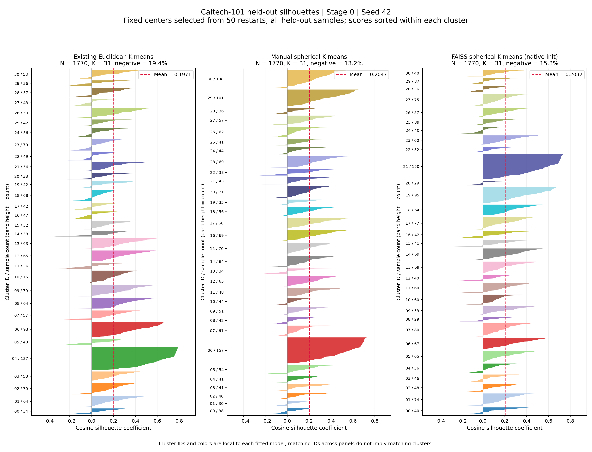
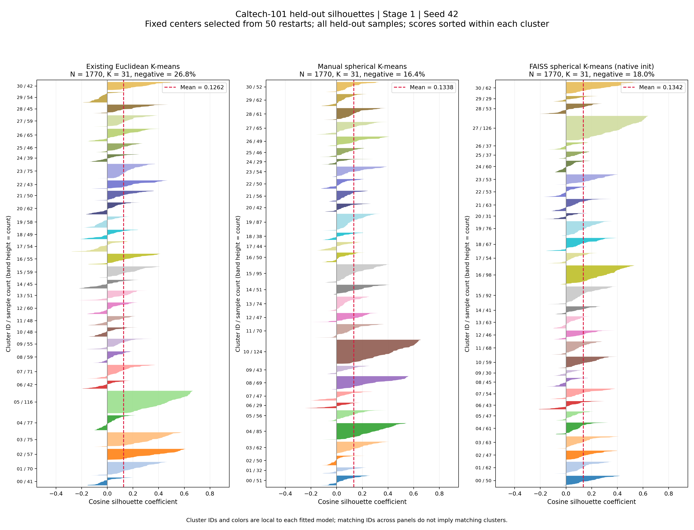
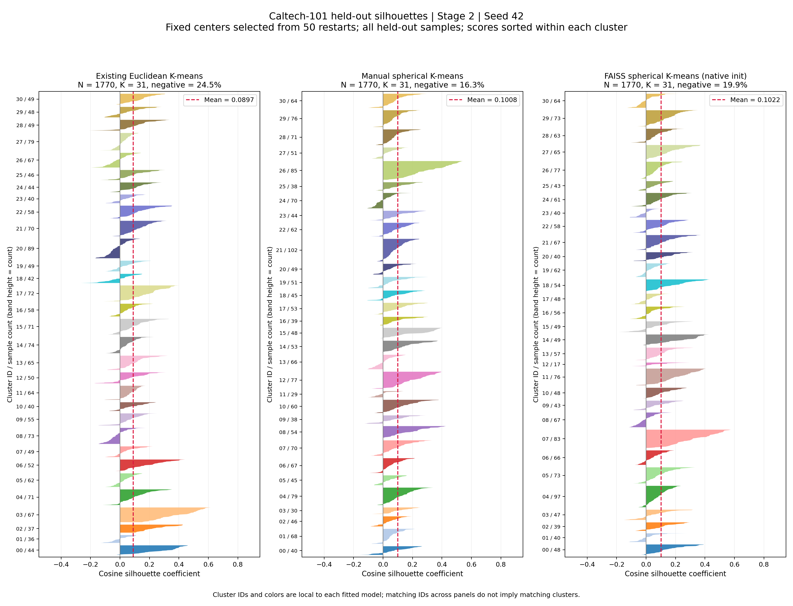

# K-means 改進實驗報告：三種方法的 Silhouette 比較

日期：2026-10-05  
研究目標：使 K-means 的距離與中心更新方式符合 L2-normalized 特徵的方向空間特性。

> **本報告整理已完成的舊座標版本實驗，沒有新增修正座標後的結果。**代表影像檢視發現，Caltech-101 的輪廓座標漏加 bounding-box 偏移，導致既有特徵常取自物體中心以外的位置。因此下列數值只能描述原取樣特徵的分群，不能直接作為物體質心或部件語義的結論。座標修正後的特徵抽取、分群與評估尚待重跑。

## 一、研究問題與實驗目的

目前流程先將 ViT token features 做 L2 normalization，再使用一般 Euclidean K-means。然而一般 K-means 的中心是群內算術平均，更新後未必具有單位長度。因此即使所有樣本都在單位球面，assignment 仍會受到 centroid norm 的影響。

本週比較三種方法：

1. 原方法：迭代過程不重新正規化 centroid。
2. 修正方法：每輪將 centroid 正規化，使用與 cosine distance 等價的 Euclidean assignment。
3. FAISS 實作的球面 K-means。

主要研究問題為：

> 在相同特徵、相同 K 與相同初始化預算下，限制 centroid 為 unit norm，是否能改善方向空間中的群內集中程度與群間分離程度？

本報告以 **cosine silhouette** 為主要指標。先前的平移同群比例保留作歷史比較，用來說明「分群幾何品質」與「平移指派穩定性」是否得到相同結論。

## 二、欲比較的三種方法

### 2.1 共同的樣本前處理

所有方法都先對每筆輸入特徵做一次 L2 normalization：

$$
z_i=\frac{x_i}{\|x_i\|_2}.
$$

「原方法在迭代過程不做 normalization」在本報告中特別指 **centroid 更新後不重新正規化**，並不是將未正規化的 raw features 直接傳入 K-means。

三種方法使用相同的 normalized features，避免將樣本前處理的差異混入中心更新方式的比較。

### 2.2 方法一：原方法

使用 sklearn 的一般 Euclidean K-means。

Assignment：

$$
q_i=\arg\min_k\|z_i-c_k\|_2^2.
$$

Centroid update：

$$
c_k=\frac{1}{|C_k|}\sum_{i\in C_k}z_i.
$$

更新後保留算術平均的長度，沒有將中心投影回單位球面。

若 $c_k\ne 0$，令 $r_k=\|c_k\|_2$、$u_k=c_k/r_k$，則：

$$
\|z_i-c_k\|_2^2=1+r_k^2-2r_k z_i^\top u_k.
$$

因此 assignment 除了受到方向相似性影響，也受到中心長度 $r_k$ 影響。它不是單純選擇 cosine similarity 最大的中心方向。

### 2.3 方法二：修正方法

手寫球面 Lloyd 迴圈，每輪先計算群內平均，再對 centroid 做 L2 normalization。

流程：

1. 將樣本 L2 normalize。
2. 在 normalized features 上以 K-means++ 選取初始中心，中心維持 unit norm。
3. 以 Euclidean distance 分配樣本。
4. 計算群內算術平均 $m_k$。
5. 記錄投影前的 $\|m_k\|_2$。
6. 更新 $c_k=m_k/\|m_k\|_2$。
7. 達到停止門檻或迭代上限後，用最終中心重新指派樣本。

因為樣本與中心均為 unit norm：

$$
\|z_i-c_k\|_2^2
=2-2z_i^\top c_k
=2\bigl(1-\cos(z_i,c_k)\bigr).
$$

所以：

$$
\arg\min_k\|z_i-c_k\|_2^2
=\arg\min_k\bigl(1-\cos(z_i,c_k)\bigr)
=\arg\max_k\cos(z_i,c_k).
$$

本方法的 Euclidean assignment 與 cosine assignment 等價。等價關係需要樣本與中心都保持 unit norm；只正規化樣本，不足以保證成立。

空群或平均向量接近零時，使用目前表示最差的樣本重新初始化，並記錄事件。

### 2.4 方法三：FAISS 球面 K-means

使用 `faiss-cpu==1.12.0`：

```python
kmeans = faiss.Kmeans(
    d=feature_dim,
    k=31,
    spherical=True,
    niter=300,
    nredo=50,
    seed=seed,
    max_points_per_centroid=len(train_features),
    gpu=False,
)
kmeans.train(normalized_train_features)
```

`spherical=True` 使中心在每輪更新後正規化。主比較使用 FAISS 自身的 random 初始化，結果名稱為 `faiss_native`。

`max_points_per_centroid` 設為 training 樣本數，避免訓練資料被套件抽樣。球面模式的 objective 是 assignment 的內積總和，越大越好；它不能直接與 sklearn 的 Euclidean inertia 比較。

### 2.5 方法設定總表

| 項目 | 原方法 | 修正方法 | FAISS 球面方法 |
|---|---|---|---|
| 結果名稱 | `sklearn_existing` | `spherical` | `faiss_native` |
| 樣本 L2 normalize | 是，一次前處理 | 是，一次前處理 | 是，一次前處理 |
| 每輪 centroid normalize | 否 | 是 | 是 |
| Assignment | Euclidean | Euclidean，等價 cosine | Inner product，等價 cosine |
| 初始化 | sklearn K-means++ | K-means++ | FAISS random |
| 每個 seed 初始化次數 | 50 | 50 | 50 |
| 最大迭代次數 | 300 | 300 | 300 |
| 停止條件 | sklearn `tol=1e-4` | 中心最大位移 ≤ `1e-5` | 固定 300 輪 |
| 數值精度 | float64 | float64 | float32 |

三種方法的初始化方式、停止條件與精度不同。因此主表比較的是最終方法設定的表現，不能把全部差異都歸因於 centroid normalization。

為補足控制，本次另保留兩組輔助實驗：

- 手寫 Euclidean 與手寫球面法使用相同的 K-means++ 初始中心、相同停止門檻，隔離中心正規化的影響。
- FAISS shared-init 使用與手寫球面法相同的 50 組初始中心。3 stages × 3 seeds 共 9 組最終 training assignments 與手寫版完全一致，ARI 全為 1。此控制組用於確認實作，不列為第四種主要方法。

## 三、資料、特徵與實驗設定

| 項目 | 設定 |
|---|---|
| 資料集 | Caltech-101 |
| 模型 | MergingViT，既有 letterbox160 checkpoint |
| Checkpoint | `runs/train/mergingvit_caltech101_letterbox160/MergingViT_best.pth` |
| 影像前處理 | 最長邊縮至 160px，置中放入 224 × 224 canvas |
| 分群 fitting 資料 | 6,907 張未平移 training images |
| 主要 silhouette 評估資料 | 1,770 張全類別、未平移 held-out images |
| 前次平移評估資料 | 160 張 held-out airplanes |
| 特徵 | 各 stage 最後一個 block 的單一位置 token feature |
| Stages | 0、1、2，分開 fitting 與評估 |
| Token 網格大小 | 分別為 8 × 8、16 × 16、32 × 32px |
| K | 31 |
| Seeds | 42、43、44 |
| 初始化預算 | 每個方法、stage、seed 執行 50 次 |
| 最佳 run 選擇 | 各方法自己的 training objective |

評估資料不加入 fitting；評估時固定中心，不重新更新。

3 個主要方法 × 3 stages × 3 seeds × 50 次初始化，對應 1,350 次初始化擬合。最終每個方法、stage 仍只有 3 個 seed 結果，不能將 150 次初始化視為 150 次獨立評估。

Held-out split 曾用於原模型 checkpoint 選擇，因此本次屬於既有模型的比較評估，不是完全未使用過的最終 test。

## 四、使用指標：Cosine Silhouette

### 4.1 這個指標想回答什麼問題？

想像已經把一批樣本分成數群。對其中一個樣本，可以問兩件事：

1. 它與自己群裡的其他樣本，有多相似？
2. 它是否也很像另一群的樣本，甚至更像另一群？

Silhouette 將這兩件事合成一個分數。只看「樣本到自己中心很近」還不夠，因為其他群也可能同樣近；只有自己群相對更近、其他群相對更遠，才具有較清楚的分群結構。

例如某群的樣本都是相似的亮色、平滑紋理，而其他群以深色或強邊緣為主，該群可能得到較高分數。若兩群都混合亮色、深色與邊緣，樣本對自己群與另一群的距離可能差不多，分數就接近 0。這是視覺上的類比，實際距離由 feature vectors 決定，不能只憑人眼判定。

「Cosine Silhouette」不是另一套獨立公式，而是 **Silhouette 使用 cosine distance 作為樣本距離**。

平移同群比例衡量固定分群器對變換的指派穩定性，但高分可能來自較大的群，也可能將輕微跨界與明顯特徵偏移視為相同失敗。

本週的問題是方向空間中的分群品質，因此選擇 cosine silhouette，同時檢查群內距離與最近其他群的距離。

所有方法使用同一套樣本間 cosine distance。這是一個共同的方向空間評估標準，不表示 Euclidean 方法在其他幾何定義下也具有相同排名。

### 4.2 先定義「相似」：Cosine Distance

本實驗關心特徵方向。向量長度不同，但方向相同的兩個特徵，在這套距離下是完全相似的。

一般向量的 cosine similarity 為：

$$
\cos(x_i,x_j)=\frac{x_i^\top x_j}{\|x_i\|_2\|x_j\|_2}.
$$

每筆特徵先做 L2 normalization 後，其長度為 1，公式就簡化成內積 $z_i^\top z_j$。

對已正規化的特徵：

$$
d(i,j)=1-z_i^\top z_j.
$$

| 方向關係 | Cosine similarity | Cosine distance | 直覺 |
|---|---:|---:|---|
| 相同方向 | 1 | 0 | 最接近 |
| 互相垂直 | 0 | 1 | 沒有方向上的相似性 |
| 相反方向 | -1 | 2 | 方向差異最大 |

例如 $x=(1,0)$、$y=(10,0)$，雖然長度不同，正規化後都變成 $(1,0)$，cosine distance 為 0。換成 $y=(0,1)$，cosine distance 則為 1。

距離越小，方向越接近。**Silhouette 使用樣本與樣本的距離，不使用樣本到 centroid 的距離。**Centroid 的角色是先決定群標籤；之後的 silhouette 由樣本之間的距離計算。

同一個 stage 裡，三種方法使用相同特徵，因此距離矩陣相同；方法之間的分數差異來自它們把哪些樣本放進同一群。

### 4.3 計算 $a_i$：我與自己的群有多接近？

令 $C_i$ 為樣本 $i$ 所屬的群：

$$
a_i=\frac{1}{|C_i|-1}
\sum_{\substack{j\in C_i\\j\ne i}}d(i,j).
$$

$a_i$ 越小，樣本與自己的群越接近。這個量描述樣本在群內的緊密程度。

計算時排除自身。如果把自身距離 0 也平均進去，就會讓群內距離看起來比實際更小，尤其對小群影響較大。

本實驗的 held-out 評估中，$C_i$ 是 **1,770 張 held-out 圖片裡，被固定中心分到同群的樣本集合**。計算群內距離時不混入 training 樣本。

### 4.4 計算 $b_i$：最像我的另一群，離我有多遠？

$$
b_i=\min_{C\ne C_i}
\left[\frac{1}{|C|}\sum_{j\in C}d(i,j)\right].
$$

$b_i$ 是到「平均而言最近的其他群」的距離。計算順序是：

1. 對每個其他群，計算樣本 $i$ 到該群所有樣本的平均距離。
2. 比較這些群平均距離，選最小值。

這個群是樣本目前最有可能混淆的另一群。$b_i$ 越大，表示即使是最像它的另一群，仍與它有較大差異。

不能把 $b_i$ 換成最近其他樣本的距離：另一群裡可能剛好只有一個很像自己的樣本，但該群大多數樣本並不相似。也不能直接用最近 centroid 取代，因為群內分布與中心位置不是同一件事。

### 4.5 計算 $s_i$：自己群是否比另一群更適合？

$$
s_i=\frac{b_i-a_i}{\max(a_i,b_i)}.
$$

分子 $b_i-a_i$ 表示兩種距離的差距：

- 若 $b_i>a_i$，自己群平均更近，得到正分。
- 若 $b_i\approx a_i$，兩群差不多近，分數接近 0。
- 若 $b_i<a_i$，另一群平均更近，得到負分。

分母 $\max(a_i,b_i)$ 將差距換成相對比例，使分數落在 $[-1,1]$。例如 $(a_i,b_i)=(0.2,0.5)$ 與 $(0.4,1.0)$ 都得到 0.6：它們的絕對距離不同，但「自己群相對另一群有多近」的比例相同。

公式也可分成兩種情況：

$$
s_i=
\begin{cases}
1-\dfrac{a_i}{b_i}, & b_i\ge a_i,\ b_i>0,\\[6pt]
\dfrac{b_i}{a_i}-1, & a_i>b_i.
\end{cases}
$$

正分越接近 1，表示 $a_i$ 相對 $b_i$ 越小；負分越接近 -1，表示另一群的平均距離 $b_i$ 相對自己群 $a_i$ 越小。

| 分數 | 意義 |
|---|---|
| 接近 1 | 同群樣本近，其他群相對遠；分群歸屬較清楚 |
| 接近 0 | 自己群與最近其他群差不多近；可能是兩群重疊或歸屬模糊 |
| 小於 0 | 平均而言，另一群比自己群更近；值得檢查分群與樣本內容 |

負分不是「已確認分類錯誤」：這裡沒有使用物體類別的 ground truth。它只表示，在目前 cosine 距離與分群標籤下，該樣本到另一群的平均距離更小。

只有一個樣本的群，其 silhouette 按慣例設為 0；若 $a_i=b_i=0$，分數設為 0。Silhouette 的一般定義要求至少兩個群，且群數小於樣本數。因此把所有樣本放進同一群，不能得到一般 silhouette 分數。

### 4.6 完整算例：從距離表算出一個樣本的分數

以下是教學用距離範例，不是實驗中的某張圖片。

假設樣本 $i$ 目前屬於群 A；群 A 還有三個其他樣本，另外有群 B 與群 C：

| 樣本所在群 | 樣本 $i$ 到該群各樣本的 cosine distance | 平均距離 |
|---|---|---:|
| A，自己的群，排除自身 | 0.10、0.20、0.30 | 0.20 |
| B | 0.45、0.50、0.55 | 0.50 |
| C | 0.80、0.90 | 0.85 |

先計算自己群的平均距離：

$$
a_i=\frac{0.10+0.20+0.30}{3}=0.20.
$$

其他群中，B 的平均距離比 C 小，所以 B 是最近其他群：

$$
b_i=\min(0.50,0.85)=0.50.
$$

最後：

$$
s_i=\frac{0.50-0.20}{0.50}=0.60.
$$

這個樣本與自己的群平均距離，只有最近其他群的 40%，因此分群歸屬較清楚。

再看三種情況：

| 情況 | $a_i$ | $b_i$ | $s_i$ | 直覺 |
|---|---:|---:|---:|---|
| 歸屬清楚 | 0.20 | 0.50 | +0.60 | 自己群明顯較近 |
| 歸屬模糊 | 0.48 | 0.50 | +0.04 | 自己群只比另一群近一點 |
| 另一群更近 | 0.50 | 0.20 | -0.60 | 另一群平均距離只有自己群的 40% |

同群的不同樣本可以有不同分數；一個群可能同時包含高分、近零與負分樣本。

### 4.7 從逐樣本分數得到表格平均

每張圖片得到一個 $s_i$ 後，先在同一個 seed 下平均全部樣本：

$$
S=\frac{1}{N}\sum_{i=1}^{N}s_i.
$$

這是 **逐樣本平均**，不是「每群先平均，再讓每群等權重」。樣本數較多的群，對整體平均有較大的影響。

例如某個教學用分群有 5 個樣本，分數為 0.60、0.40、0.10、0、-0.30：

$$
S=\frac{0.60+0.40+0.10+0-0.30}{5}=0.16.
$$

平均 0.16 不代表所有樣本都得到 0.16；其中可能有歸屬清楚的樣本，也有負分樣本。因此本報告同時呈現負分比例與輪廓圖，保留分數分布的資訊。

讀取本報告的 0.1012 時，應理解為「這個分群的逐樣本相對距離分數，三個 seeds 平均約為 0.1012」，不能讀成 10.12% 正確率，也不能直接說整群的群內距離比群外距離小 10.12%。

### 4.8 三個 Seeds 的平均與標準差

每個 seed 先選出最佳 training run，再計算全部 held-out 樣本的平均 silhouette：

$$
S_r=\frac{1}{1770}\sum_{i=1}^{1770}s_{i,r}.
$$

表格平均為：

$$
\bar S=\frac{S_{42}+S_{43}+S_{44}}{3}.
$$

Seed 標準差為樣本標準差：

$$
\mathrm{SD}_{seed}
=\sqrt{\frac{\sum_r(S_r-\bar S)^2}{3-1}}.
$$

假設三個 seeds 的平均 silhouette 分別為 0.09、0.10、0.11，表格就會顯示 $0.10\pm0.01$。這個例子說明的是平均與 seed 標準差，並非實際某個方法的結果。

標準差越小，表示這三次初始化搜尋最後選出的分群，平均 silhouette 越接近。這是三個 seed 結果的離散程度，不是標準誤，也不是 bootstrap 信賴區間。

50 次初始化的作用，是讓每個 seed 更有機會找到較好的 training objective；並不是將 50 個 silhouette 平均進表格。

### 4.9 為什麼還需要配對差值與信賴區間？

平均值較高，可能代表改善，也可能只是少數影像或有限 seeds 的影響。配對比較讓同一張圖片、同一個 seed 的兩種方法直接相減，減少樣本組成不同帶來的干擾。

對某方法 $M$ 與原方法 $B$，先計算每張圖片在相同 seed 下的 silhouette 差值，再平均 seeds：

$$
\delta_i=\frac{1}{3}\sum_r
\left(s_{i,r}^{M}-s_{i,r}^{B}\right).
$$

以 held-out 影像為單位抽樣 5,000 次，取平均差值的第 2.5 與 97.5 百分位形成 95% CI。中心、reference distances 與逐樣本 silhouette 都保持固定，不重新 fitting。

CI 反映這批影像分數差值的抽樣不確定性，不涵蓋重新訓練模型、reference set 改變或更多 seeds 的不確定性。

若差值 CI 完全大於 0，表示在本次固定評估設定下，影像抽樣結果支持平均 silhouette 改善；若 CI 跨過 0，則尚沒有同樣明確的差值證據。CI 跨過 0 不等於兩種方法已被證明相同。

### 4.10 為什麼這套評估對三種方法使用相同距離？

本研究想比較方向特徵空間，所以先固定 cosine distance 作共同尺規，再比較不同方法得到的群。若每個方法各用自己的距離來評分，分數差異就會同時包含分群差異與尺規差異。

對 unit-norm 的**樣本對**，有：

$$
\|z_i-z_j\|_2^2=2\bigl(1-z_i^\top z_j\bigr)=2d_{cos}(i,j).
$$

若所有距離都乘上同一個正常數 $c$，群內與其他群平均距離也分別變成 $ca_i$、$cb_i$，因此：

$$
\frac{cb_i-ca_i}{\max(ca_i,cb_i)}
=\frac{b_i-a_i}{\max(a_i,b_i)}.
$$

所以在相同 unit-norm 樣本、相同群標籤下，使用 **cosine distance** 或 **平方 Euclidean distance** 計算 silhouette，會得到相同分數。

這不代表直接使用未平方的 Euclidean distance 也會得到相同 silhouette。開根號會改變群平均距離之間的比例，平均值也不能直接移到根號外。

也要區分兩個等價關係：

- **Assignment 的等價**：比較樣本到中心的距離，需要樣本與中心都 unit norm，才可把 Euclidean assignment 視為 cosine assignment。
- **Silhouette 距離的等價**：比較樣本與樣本的距離，只需要這些樣本都 unit norm；中心長度不參與 silhouette 計算。

### 4.11 閱讀結果時的限制

Silhouette 是一個幾何指標。它能檢查「依這套距離，群內是否相對較近、群間是否相對較遠」，但不能直接證明群具有物體或部件語義。

例如一群白色背景特徵很集中，也可能得到高分。因此仍需要對照代表影像，確認高分來自想研究的內容。這也是本次代表圖能揭露取樣座標問題的原因。

接近 0 的分數不一定是程式錯誤：特徵可能具有連續變化、群之間可能重疊，或固定 K 將相似模式分進不同群。負分樣本也應先檢視內容及最近其他群，再判斷是否需要改進分群。

本報告不採用「大於某固定分數就是好分群」的通用門檻。分數會受到特徵、距離、K、群分布與評估樣本影響；優先在同一 stage、同一批資料、同一距離與同一 K 下比較方法。

跨 stage 的特徵空間不同，Stage 0 分數較高不代表它比 Stage 2 更有語義辨識能力。比較方法時應看同一 stage 的差值、seed 波動、CI，以及輪廓圖中的分布。

計算流程可整理為：

```text
固定同一批 held-out features，先 L2 normalize
→ 建立樣本間 cosine distance 矩陣
→ 用某方法、某 seed 的固定中心取得群標籤
→ 每筆樣本計算 a：自己群平均距離
→ 每筆樣本計算 b：最近其他群平均距離
→ 計算 s = (b - a) / max(a, b)
→ 平均全部 1,770 筆分數，得到這個 seed 的結果
→ 平均三個 seeds，並報告 seed 標準差與配對 CI
```

### 4.12 Silhouette 多少才合理？傳統經驗區間

**Silhouette 沒有適用於所有資料的合格線。**以下是常見的平均 silhouette 經驗區間，例如美國 ASPE 於 2024 年發布的研究報告，在階層式分群分析中採用這套解讀：

| 平均 Silhouette | 傳統解讀 |
|---|---|
| 0.71–1.00 | 群結構很明顯 |
| 0.51–0.70 | 群結構合理、分離較清楚 |
| 0.26–0.50 | 群結構偏弱，可能是人工切分形成的結構 |
| ≤ 0.25 | 缺乏明顯群結構 |

表格沿用來源以小數點後兩位表示的區間，是粗略經驗準則，不是統計顯著性檢定；不應用四捨五入後的邊界決定方法是否合格。負值則表示平均樣本分數偏向其他群。

來源：[ASPE，Exhibit VI.5：Interpretation of average silhouette width values in hierarchical cluster analysis](https://www.ncbi.nlm.nih.gov/books/NBK610805/table/ch6.tab5/?report=objectonly)。

上述區間描述的是幾何分離程度，不能直接當成所有高維特徵、Cosine 距離或 K-means 實驗的門檻，也不等同分類準確率。尤其不能因為使用深度特徵，就把低分自動解釋為良好分群。

### 4.13 其他 K-means 研究中的實際分數

以下案例說明研究中確實可能出現約 0.1 的分數；它們不是本實驗的同條件基準，也不足以推導所有 embedding 分群的「正常範圍」。

| 研究 | 資料、特徵與方法 | 報告的 Silhouette | 對照限制 |
|---|---|---|---|
| *A Comparative Study of Clustering and BERT-Based…*，2025，表 5.6 | 學生反思文字；Sentence Transformers、Cosine 距離、K-means | 三個資料設定分別為 0.12、0.11、0.10 | 碩士論文；文字資料與本實驗影像 token 不同 |
| *LLM-Based Enhanced Clustering for Low-Resource Language: An Empirical Study*，2025，表 5 | 50K 文字資料；不同 embedding 搭配 K-means | 多個模型約 0.018–0.084；UrduBERT 為 0.1215 | 不同資料與設定；不能視為本實驗 Cosine Silhouette 的直接基準 |

第一篇的兩個資料設定，雖然 silhouette 分別只有 0.12、0.11，仍報告 purity 約 0.79、0.82；第二篇的 UrduBERT 同時報告 ARI 0.6250。這說明幾何分離偏弱與具有一定語意分類用途可以同時存在。Purity 又會受到群數影響，不能用它單獨證明分群品質。

來源：[第一篇論文原文，表 5.6](https://ninercommons.charlotte.edu/nanna/record/26174/files/Kim_uncc_0694N_14179.pdf?registerDownload=1&version=1&withMetadata=0&withWatermark=0)、[第二篇論文原文，表 5](https://www.sciencedirect.com/org/science/article/pii/S1526149225004527)。

影像方面，Lowe 等人的 *An Empirical Study into Clustering of Unseen Datasets with Self-Supervised Encoders*（2024）比較自監督影像特徵與包含 K-means 的多種分群方法，發現在 UMAP 降維空間計算的 silhouette 與 AMI 高度相關。這個結果支持 silhouette 作為評估工具，但也提醒我們：**計算空間是評估條件的一部分**，不能直接拿降維後的分數對照原始特徵空間的 Cosine Silhouette。

來源：[Lowe 等人研究原文](https://arxiv.org/html/2406.02465v1)。

### 4.14 本實驗的分數應如何解讀？

目前三種方法的 held-out 平均 Cosine Silhouette 約為：Stage 0：0.200–0.202；Stage 1：0.132–0.134；Stage 2：0.090–0.101。依此應區分三個問題：

- **絕對幾何品質：**這些分數顯示群間分離程度有限，尚不能稱為清楚分離的群結構。
- **方法的相對改善：**在同一 stage、同一資料、同一距離與 K 下，Stage 2 的球面方法相對原方法有較明確的提升；提升後的絕對分離程度仍偏弱。具體差值與 CI 見第五章。
- **群的語意價值：**需要搭配負分比例、每群代表影像與語意一致性，不能只看全體平均。

可用於報告的判讀文字：

> 本實驗的 Cosine Silhouette 約為 0.09–0.20，顯示群間幾何分離程度有限。雖然部分深度特徵分群研究也報告約 0.1 的分數，仍不能據此認定本實驗已達良好分群品質；應以相同資料與計算條件下的方法比較，配合群的語意可解釋性評估。

**本次數值來自舊座標取樣位置。**物體中心座標修正後，需要重新提取特徵與重跑分群，才能判斷物體質心附近的分群品質；外部文獻分數不能消除這個有效範圍限制。

## 五、實驗結果

### 5.1 主要結果：全類別 Held-out Silhouette

數值為 **3 seeds 平均 ± seed 樣本標準差**，越高越好。每個 seed 使用全部 1,770 張 held-out 圖片，沒有抽樣近似。

| Stage | 原方法 | 修正方法 | FAISS 球面 K-means |
|---|---:|---:|---:|
| 0 | 0.1996 ± 0.0055 | 0.2024 ± 0.0020 | 0.2010 ± 0.0036 |
| 1 | 0.1320 ± 0.0052 | 0.1339 ± 0.0022 | 0.1324 ± 0.0016 |
| 2 | 0.0903 ± 0.0032 | 0.1000 ± 0.0018 | 0.1012 ± 0.0011 |

### 5.2 相對原方法的配對差值

| Stage | 比較 | Silhouette 平均差值 | 95% CI |
|---|---|---:|---|
| 0 | 修正方法 − 原方法 | +0.00282 | [-0.00221, +0.00789] |
| 0 | FAISS − 原方法 | +0.00137 | [-0.00268, +0.00526] |
| 1 | 修正方法 − 原方法 | +0.00191 | [-0.00076, +0.00462] |
| 1 | FAISS − 原方法 | +0.00037 | [-0.00254, +0.00318] |
| 2 | 修正方法 − 原方法 | +0.00976 | [+0.00727, +0.01230] |
| 2 | FAISS − 原方法 | +0.01094 | [+0.00857, +0.01335] |

Stage 0、1 的差值 CI 涵蓋 0，目前沒有同樣明確的改善證據。Stage 2 的兩種球面方法差值 CI 都大於 0，支持其在這批舊取樣特徵的 cosine 幾何下有較好的分群。

FAISS 的平均值略高於手寫修正方法，但本表未估計這兩種球面方法互相比較的 CI，不能只依平均值宣布 FAISS 穩定較好。

### 5.3 Training Silhouette 對照

Training 使用固定 2,000 個 query 樣本，對全部 6,907 個 training reference 樣本計算每個 query 的精確 silhouette；平均值對 training 整體平均是一個 query 抽樣估計。

| Stage | 原方法 | 修正方法 | FAISS 球面 K-means |
|---|---:|---:|---:|
| 0 | 0.2198 ± 0.0025 | 0.2210 ± 0.0017 | 0.2236 ± 0.0047 |
| 1 | 0.1420 ± 0.0033 | 0.1444 ± 0.0029 | 0.1428 ± 0.0013 |
| 2 | 0.0939 ± 0.0022 | 0.1027 ± 0.0024 | 0.1044 ± 0.0021 |

Stage 2 的改善方向在 training 與 held-out 都出現，不只侷限於 training；但兩個 split 的分群距離 reference 集合不同，不能把 training–held-out 分數差直接當作標準化的泛化誤差。

### 5.4 負 Silhouette 樣本比例

下表是 held-out 中 $s_i<0$ 的比例，先按 seed 計算，再取三個 seeds 平均。這是同一個 silhouette 指標的分布診斷，不是額外的分類錯誤率。

| Stage | 原方法 | 修正方法 | FAISS 球面 K-means |
|---|---:|---:|---:|
| 0 | 18.00% | 13.95% | 15.57% |
| 1 | 24.50% | 17.16% | 18.72% |
| 2 | 24.80% | 17.68% | 18.98% |

球面方法的負值比例較低，但應連同平均值、CI 與群形狀判讀，不能單獨據此認定語義正確。

#### 20 個 Seeds 的負 Silhouette 樣本比例

新實驗使用 seeds 42–61。每個 seed 都以同一批 1,770 張 held-out 影像計算：

$$
r_{s,m}=\frac{1}{1770}\sum_{i=1}^{1770}\mathbf{1}[s_{i,s,m}<0],\qquad
\bar r_m=\frac{1}{20}\sum_{s=42}^{61}r_{s,m}.
$$

下表為 **20 個 seeds 的平均比例 ± seed 標準差**（標準差使用 ddof=1；單位均為百分比）。恰好為 0 的 silhouette 不列入負值。

| Stage | 原方法 | 修正方法 | FAISS 球面 K-means |
|---|---:|---:|---:|
| 0 | 18.47% ± 1.29% | 14.13% ± 0.84% | 14.54% ± 0.93% |
| 1 | 23.86% ± 1.69% | 17.80% ± 0.83% | 17.64% ± 1.02% |
| 2 | 24.83% ± 0.84% | 18.32% ± 0.82% | 18.25% ± 1.02% |

相對原方法的平均負值比例下降如下，單位為**百分點（pp）**，不是相對下降百分比：

| Stage | 修正方法下降 | FAISS 球面下降 |
|---|---:|---:|
| 0 | 4.34 pp | 3.93 pp |
| 1 | 6.06 pp | 6.23 pp |
| 2 | 6.52 pp | 6.58 pp |

三個 stages 的兩種球面方法平均負值比例都較低。負值表示樣本對其他群的平均距離較小，不等同語意或分類錯誤。

這 20 個 seeds 重複使用同一批影像，因此不是 35,400 張獨立影像；以上結果仍限定於舊座標特徵。逐 seed 比例已由保存的逐樣本 silhouette 重新核對一致。

#### 20 個 Seeds 負值比例的顯著性檢定

本次另行對負值比例做檢定，不能沿用平均 silhouette 的 p 值。每個 seed 計算配對下降量：

$$d_s=r_{s,\mathrm{original}}-r_{s,\mathrm{candidate}}.$$

正值代表球面方法的負值比例較低。主檢定為雙尾配對 t 檢定（等價於對 20 個 $d_s$ 做平均是否為零的單樣本 t 檢定），虛無假設為固定評估資料上、跨初始化的期望下降量為零。三個 stages × 兩個球面方法，共六組負值比例比較使用 Holm 校正。

| Stage | 相對原方法 | 負值比例下降 | Holm 校正 p（t） | Holm 校正 p（sign-flip） | 交叉 bootstrap 95% CI（pp） |
|---|---|---:|---:|---:|---|
| 0 | 修正方法 | 4.34 pp | 3.822e-12 | 1.144e-05 | [3.40, 5.27] |
| 0 | FAISS 球面 | 3.93 pp | 9.557e-10 | 1.144e-05 | [2.94, 4.94] |
| 1 | 修正方法 | 6.06 pp | 6.507e-12 | 1.144e-05 | [4.96, 7.21] |
| 1 | FAISS 球面 | 6.23 pp | 1.991e-11 | 1.144e-05 | [5.07, 7.40] |
| 2 | 修正方法 | 6.52 pp | 3.003e-14 | 1.144e-05 | [5.45, 7.59] |
| 2 | FAISS 球面 | 6.58 pp | 6.131e-14 | 1.144e-05 | [5.54, 7.66] |

敏感度分析另外列舉全部 $2^{20}=1,048,576$ 種 seed 差值正負翻轉，以 $|\sum_s d_s|$ 為統計量做雙尾 sign-flip 檢定，再對六組 p 值做 Holm 校正。此檢定需要虛無假設下差值符號可交換的假設，不是對所有資料分布都無假設的檢定；t 檢定與 sign-flip 都是固定影像下的 seed 層級推論。

交叉 bootstrap 同時重抽 20 個 seeds 與 1,770 個影像，兩方法共用索引，重複 10,000 次。上表是未校正的逐比較 95% 百分位 CI；以下另外提供六組比較的 Bonferroni 百分位區間，每組取 0.4167% 與 99.5833% 分位，作為近似同時區間：

| Stage | 相對原方法 | Bonferroni 交叉 bootstrap 區間（pp） |
|---|---|---|
| 0 | 修正方法 | [3.07, 5.61] |
| 0 | FAISS 球面 | [2.61, 5.32] |
| 1 | 修正方法 | [4.64, 7.65] |
| 1 | FAISS 球面 | [4.69, 7.82] |
| 2 | 修正方法 | [5.10, 7.98] |
| 2 | FAISS 球面 | [5.18, 8.05] |

六組負值比例比較在 t 檢定與 sign-flip 的 Holm 校正後都達 p < 0.05，支持目前固定資料下兩種球面方法的負值比例穩定較低。負值比例下降約 3.93–6.58 個百分點。六組 Bonferroni 交叉 bootstrap 區間也均高於零。

**推論限制：**同一批影像在不同 seeds 重複使用，因此不能把 35,400 筆 seed × image 記錄當成獨立影像做一般比例檢定。Bootstrap 保留既有 silhouette 分數與參考群幾何，不包含重新抽訓練資料、重算群幾何或重新訓練模型的不確定性。沿用舊座標特徵，且本指標是在檢視前次結果後新增的探索性分析；Holm 校正範圍僅為本次六組負值比例比較，不包含先前平均 silhouette 或其他指標。統計顯著不代表群具有正確語意。

方法參考：[SciPy 配對 t 檢定](https://docs.scipy.org/doc/scipy/reference/generated/scipy.stats.ttest_rel.html)、[SciPy 配對置換檢定](https://docs.scipy.org/doc/scipy/reference/generated/scipy.stats.permutation_test.html)。

計算程式：[負值比例檢定](../scripts/test_negative_silhouette_significance.py)；結果：[檢定與 CI CSV](../plots/kmeans/quality_evaluation_1005_n20seeds/negative_rate_significance.csv)。

### 5.5 增加至 20 個 Seeds 的重複實驗

為評估增加獨立實驗次數是否有助於辨識穩定差異，固定 seeds 42–61，共 20 個（保留原 3 個，新增 17 個），每次仍使用 50 次初始化、K=31 及相同特徵資料。不依顯著性提前停止。增加 n_init 是改善單次解的搜尋，增加 seeds 才提供更多初始化重複。

| Stage | 原方法（20 seeds） | 修正方法（20 seeds） | FAISS 球面（20 seeds） |
|---|---|---|---|
| 0 | 0.19836 ± 0.00505 | 0.20292 ± 0.00409 | 0.20288 ± 0.00287 |
| 1 | 0.12803 ± 0.00545 | 0.13195 ± 0.00370 | 0.13348 ± 0.00409 |
| 2 | 0.09084 ± 0.00174 | 0.09905 ± 0.00228 | 0.09925 ± 0.00167 |

下表的 seed 配對 t 檢定以每個 seed 的全體影像平均差值為觀測，六組比較採 Holm 校正。交叉 bootstrap 同時重抽 seed 與影像、兩方法共用索引，重複 5,000 次；參考距離與群幾何保持固定，所列 CI 未做多重比較校正。

| Stage | 相對原方法 | 平均差值 | Holm 校正 p | seed × image 95% CI |
|---|---|---|---|---|
| 0 | 修正方法 | +0.00456 | 0.01288 | [+0.00070, +0.00842] |
| 0 | FAISS 球面 | +0.00452 | 0.02094 | [+0.00051, +0.00851] |
| 1 | 修正方法 | +0.00391 | 0.02094 | [+0.00073, +0.00701] |
| 1 | FAISS 球面 | +0.00545 | 0.02094 | [+0.00131, +0.00930] |
| 2 | 修正方法 | +0.00822 | 5.392e-10 | [+0.00615, +0.01032] |
| 2 | FAISS 球面 | +0.00841 | 1.157e-11 | [+0.00646, +0.01039] |

固定這批評估影像下，六組比較經 Holm 校正後均達 p < 0.05；新增 17 seeds 的平均差值也全部為正。更多 seeds 支持球面方法具有穩定的小幅改善，但不代表增大次數使效果變大，也不保證其他實驗會達顯著。Stage 2 提升約 0.008，比原 3 seeds 的約 0.010 略小。

這是沿用舊座標特徵的探索性重複實驗；不包含重新抽訓練資料、重新訓練模型或修正座標的不確定性。各 stage 的絕對 silhouette 仍偏低，不能以統計顯著取代群的可解釋性驗證。交叉 bootstrap CI 為逐比較區間，不能解讀成六組在較廣泛影像母體上均已通過多重校正。

完整設定、逐 seed 結果、統計計算與限制見[20 seeds 實驗報告](1005_kmeans_20_seeds_experiment_results.md)。原 3 seeds 的分數已核對與先前結果一致。

## 六、與先前實驗比較

### 6.1 先前以平移同群比例為主要觀察

先前使用 160 張 held-out airplanes，對各 stage 分別平移一個 token：Stage 0／1／2 為 8／16／32px，各測上、下、左、右四個方向。

每筆樣本只判斷平移前後是否被固定中心分到同群，再平均四方向與 seeds。

| Stage | 原方法，20 次初始化 | 修正方法，10 次初始化 | FAISS，10 次初始化 |
|---|---:|---:|---:|
| 0 | 96.04% | 93.59% | 94.64% |
| 1 | 91.46% | 90.52% | 91.41% |
| 2 | 89.53% | 88.54% | 88.23% |

這批初始結果沒有顯示球面法的平移穩定性優勢，但初始化預算不完全一致。

### 6.2 增加到一致的 50 次初始化

下表為平均同群百分比 ± seed 標準差；標準差的單位為百分點。

| Stage | 原方法 | 修正方法 | FAISS 球面 K-means |
|---|---:|---:|---:|
| 0 | 95.47 ± 0.87 | 95.36 ± 0.79 | 94.48 ± 0.45 |
| 1 | 91.46 ± 0.33 | 92.66 ± 0.16 | 91.41 ± 1.51 |
| 2 | 88.91 ± 1.13 | 87.60 ± 1.33 | 88.70 ± 1.67 |

增加初始化預算後，Stage 1 的修正方法同群比例提高，seed 波動也縮小；Stage 2 的波動沒有同步縮小。更多初始化保證的是在已有候選中選取更好的 training objective，並不保證平移指標更好。

### 6.3 更換主要指標後的判讀

| Stage | 50 次初始化的平移觀察 | Held-out silhouette 觀察 |
|---|---|---|
| 0 | 球面法未優於原方法 | 球面平均略高，但差值 CI 涵蓋 0 |
| 1 | 手寫修正方法平均較高 | 對原方法的 silhouette 改善仍不明確 |
| 2 | 球面法同群比例略低 | 球面法的 silhouette 改善有正向 CI |

兩種指標回答不同問題：平移同群比例看 assignment 對變換的穩定性；silhouette 看樣本分群的幾何集中與分離。

因此先前「未觀察到一致的平移穩定性改善」仍是舊取樣資料上的觀察，但不能延伸成「球面 K-means 的所有分群品質都較差」。

前次資料只有 160 張單一類別的平移圖，本次主評估涵蓋 1,770 張全類別原圖，也使評估範圍更廣。兩者的數值不能直接互換或相減。

## 七、輪廓圖與群的可解釋性

已依每群 silhouette 排序繪製標準輪廓圖：

- 橫軸是逐樣本 silhouette。
- 每個色帶代表一群，高度與樣本數成比例。
- 紅色虛線是該方法、該 seed 的平均值。
- 0 左側的部分是負 silhouette 樣本。
- 不同方法的 cluster ID 不代表相同群。

下面三張圖固定 seed 42，分別比較各 stage 的三種方法；其平均線是單一 seed 的平均，與本報告三個 seeds 平均表格不同。







[全部 9 張輪廓圖的 PDF](../plots/kmeans/quality_evaluation_1005/silhouette_plots/all_stages_seeds_silhouettes.pdf)。

另已製作 seed 42 的 279 張逐群代表圖，每群列出最高正分、接近 0、最负分樣本各最多 3 張，顯示原圖、中心附近內容與原取樣 token。

這些圖是人工判讀材料，不能將少數挑選樣本直接視為整群語義證明。代表图也揭露了下面的座標問題。

## 八、座標問題與結果的有效範圍

Caltech-101 的 `obj_contour` 是相對 bounding box 的座標。資料集 `show_annotation.m` 畫輪廓時，x 加 `box_coord(3)`、y 加 `box_coord(1)`；既有特徵抽取流程漏加 offset。

轉成 Python 的 0-based 原圖座標，應為：

```python
absolute_contour = obj_contour + [[box_x_min], [box_y_min]] - 1
center_x = absolute_contour[0].mean()
center_y = absolute_contour[1].mean()
```

這是輪廓點的平均位置，不是物體 mask 的面積質心。

對全部 1,770 張 held-out 圖片進行稽核：

| Stage | 修正前後仍是同一 token | 取樣 token 改變 |
|---|---:|---:|
| 0 | 8.87% | 91.13% |
| 1 | 15.42% | 84.58% |
| 2 | 35.99% | 64.01% |

位置位移中位數為 23.06 canvas pixels。例如 Stage 2 球面法 C00 的高分摩托車樣本，原取樣 token 多是白色背景，不能直接解釋為摩托車部件。

因此本報告能支持的是：

> 在同一批舊取樣位置的 normalized features 上，球面方法在 Stage 2 的 cosine silhouette 較高。

目前不能支持的是：

> 球面方法已改善物體質心特徵的分群，或已產生更好的物體部件語義群。

## 九、結論與下一階段

本次完成三種方法的比較、每個 seed 50 次初始化、全類別 held-out silhouette、配對 CI、輪廓圖與逐群代表影像。

對舊取樣資料，兩種球面方法在 Stage 2 的 silhouette 高於原方法；Stage 0、1 尚無同樣明確的差值證據。平移同群比例與 silhouette 的排名不同，顯示不宜只用平移穩定性判斷分群優劣。

代表圖發現的座標錯誤限制了物體中心與語義結論。下一階段應：

1. 修正輪廓座標轉換，明確記錄以輪廓點平均近似中心的定義。
2. 以新的座標版本重新抽取 training、全類別 held-out 與 translated features，避免沿用舊 cache。
3. 保留本報告的 K、seeds、初始化預算及三种方法，重新 fitting。
4. 重新計算同一套 cosine silhouette、CI 與輪廓圖，將新舊座標版本分開比較。
5. 再檢視各群高分、近零、負分影像，評估局部顏色、材質、邊緣與部件是否具有一致性。

## 附錄 A：Held-out 每個 Seed 的 Silhouette

| Stage | 方法 | Seed 42 | Seed 43 | Seed 44 |
|---|---|---:|---:|---:|
| 0 | 原方法 | 0.197102 | 0.205895 | 0.195838 |
| 0 | 修正方法 | 0.204748 | 0.200879 | 0.201658 |
| 0 | FAISS 球面 | 0.203204 | 0.196879 | 0.202869 |
| 1 | 原方法 | 0.126184 | 0.133732 | 0.136085 |
| 1 | 修正方法 | 0.133775 | 0.131759 | 0.136202 |
| 1 | FAISS 球面 | 0.134166 | 0.131927 | 0.131023 |
| 2 | 原方法 | 0.089650 | 0.093746 | 0.087465 |
| 2 | 修正方法 | 0.100783 | 0.098035 | 0.101326 |
| 2 | FAISS 球面 | 0.102153 | 0.101574 | 0.099945 |

附錄值顯示六位小數，主表與 CI 均使用未四捨五入數值計算。

## 附錄 B：程式、資料與相關報告

主要程式：

- [一般／手寫球面比較](../scripts/compare_spherical_kmeans.py)。
- [手寫中心更新迴圈](../scripts/spherical_kmeans.py)。
- [FAISS 球面比較](../scripts/compare_faiss_spherical_kmeans.py)。
- [品質評估與 silhouette 計算](../scripts/evaluate_kmeans_quality.py)。
- [輪廓圖產生](../scripts/plot_kmeans_silhouettes.py)。
- [逐群代表影像與座標稽核](../scripts/visualize_kmeans_cluster_meaning.py)。

本報告數值來源：

- [逐 stage、方法、seed、split 的指標](../plots/kmeans/quality_evaluation_1005/geometry_metrics.csv)。
- [Silhouette 配對差值與 CI](../plots/kmeans/quality_evaluation_1005/heldout_paired_differences.csv)。
- [逐影像 silhouette](../plots/kmeans/quality_evaluation_1005/heldout_sample_metrics.csv)。
- [50 次初始化的平移指標](../plots/kmeans/faiss_spherical_comparison_1005_n50/translation_metrics.csv)。
- [原始實驗與評估 manifest](../plots/kmeans/quality_evaluation_1005/run_manifest.json)。

相關說明：

- [Silhouette 表格完整計算方式](1005_cosine_silhouette_table_explanation.md)。
- [50 次初始化與 seed 波動比較](1005_kmeans_50_restarts_experiment_results.md)。
- [逐群代表圖索引](1005_kmeans_cluster_meaning_seed42.md)。
- [Caltech-101 座標稽核報告](1005_caltech101_annotation_coordinate_audit.md)。

指標與套件來源：

- [scikit-learn silhouette_samples 官方文件](https://scikit-learn.org/stable/modules/generated/sklearn.metrics.silhouette_samples.html)。
- [FAISS 官方 FAQ：Spherical K-means](https://github.com/facebookresearch/faiss/wiki/FAQ)。
- [資料集官方輪廓顯示程式 show_annotation.m](../data/caltech101/caltech-101/show_annotation.m)。
