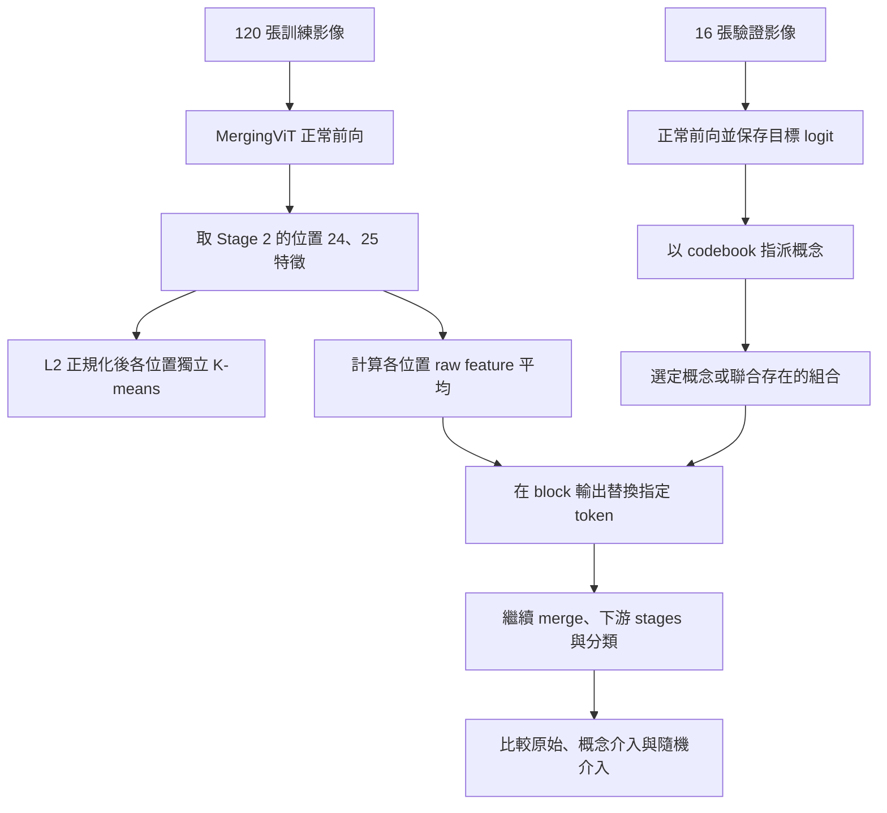
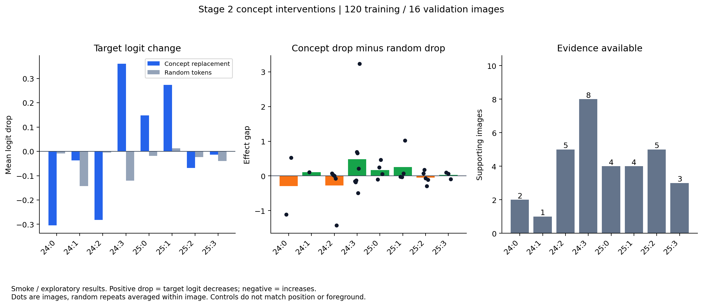
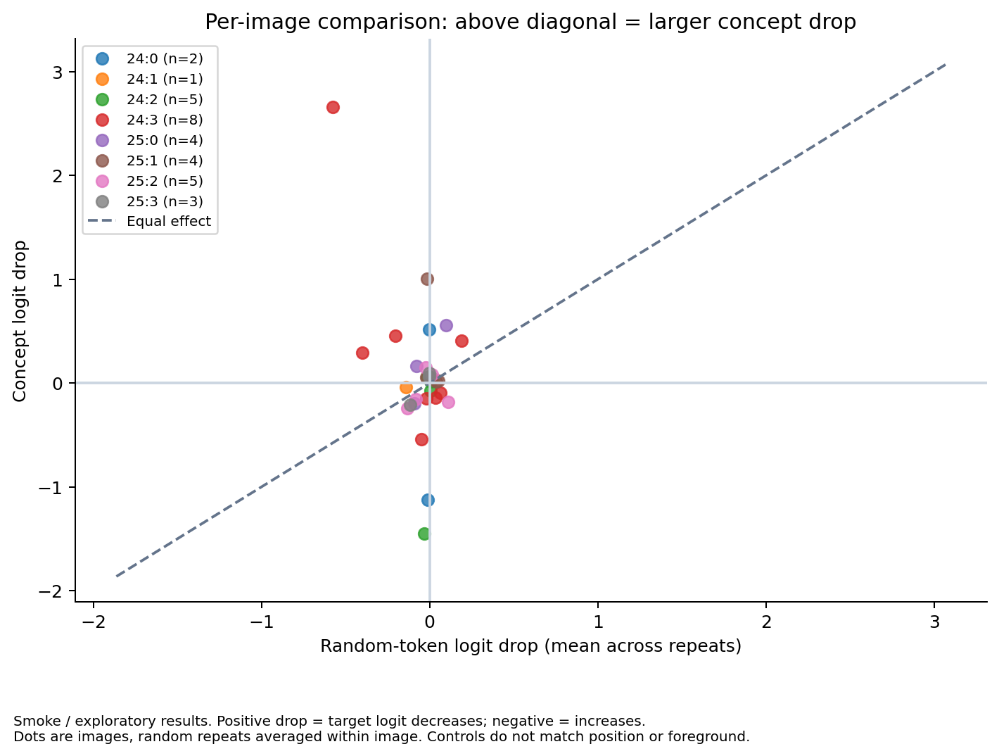
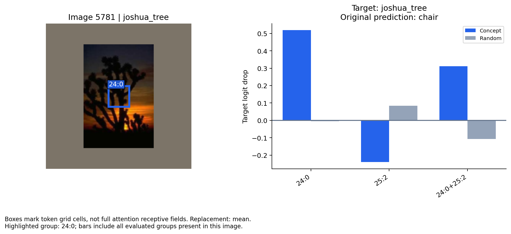
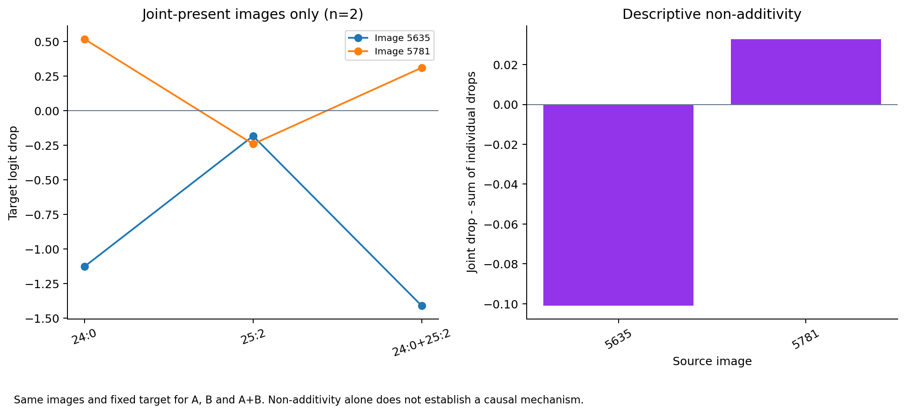

# MergingViT 概念介入小規模實驗：流程、圖解與結果

本實驗檢查：**將模型中間層、屬於指定特徵群的 token 替換掉，目標類別分數會如何改變？同時替換兩個概念時，效果是否接近個別效果之和？**

目前完成的是功能與探索性驗證：使用 120 張 training images 建立 codebook、16 張 validation images 評估。本文的「概念」指位置條件式 K-means 特徵群，尚未經語意標註確認，不能直接命名成樹幹、機翼等物體部件。

## 1. 實驗設計

| 項目 | 本次設定 |
|---|---|
| 分類模型 | MergingViT；既有 Caltech-101 letterbox160 checkpoint |
| Checkpoint | `runs/train/mergingvit_caltech101_letterbox160/MergingViT_best.pth` |
| 模型狀態 | `eval()`；停用 dropout，不更新分類模型參數 |
| 影像前處理 | 原圖等比例縮至長邊 160 pixels，置於 224×224 letterbox，使用 ImageNet normalization |
| Fitting 資料 | 原 training split 中 seeded 隨機抽取的 120 張影像；跨類別 |
| 評估資料 | 原 validation split 中 seeded 隨機抽取的 16 張影像；跨類別 |
| Split／抽樣 seed | 42／42 |
| 分析層 | Stage 2，最後 block 輸出後、patch merging 前 |
| Token 網格 | 7×7，共 49 個位置；各網格位置對應輸入 32×32 pixels |
| 分析位置 | 24、25；0-based row-major 編號，即第 3 row 的第 3、4 column |
| 分群 | 每個位置獨立 fitting；L2-normalized features + Euclidean KMeans |
| K／初始化次數 | K=4；`n_init=3` |
| 替換值 | 每個位置在 120 張 training images 上的 **raw token feature 平均** |
| 評估目標 | 真實標籤對應的 logit；即使原圖分類錯誤，也追蹤真實標籤 |
| 隨機對照 | 相同 stage、相同 token 數；從 49 個位置無放回抽取，每張影像重複 2 次 |

位置 24、25 是本次功能展示選定的位置，沒有經重要性排序；本實驗沒有聲稱它們是模型最重要的 token。

**本次不使用物體中心座標，也不讀取舊中心特徵 cache。** 雖然共用既有 letterbox 影像處理，annotation center 的 metadata 沒有參與特徵取樣或分群。因此先前漏加 bounding-box offset 的問題不影響本次位置 24、25 的定義。但固定位置仍可能落在前景、背景或 padding，不能視為物體中心實驗。

## 2. 如何形成概念與執行介入？



例如 `24:0` 表示「Stage 2 的位置 24，被指派到該位置 codebook 的 cluster 0」。`25:0` 屬於另一組 codebook，不能因編號相同就視為相同概念。這些群編號亦不能套用到舊物體中心 K-means 結果。

對 `24:0`，只在位置 24 被指派到 cluster 0 的影像上替換該 token。其他 token 保持原值，後續網路重新計算。對 `24:0+25:2`，影像必須同時具有兩個指派，才同時替換兩個位置。

這是 **activation replacement**，不是在輸入影像上塗黑，也不是把輸入 patch 真正刪掉。圖中的方框只是 token 的網格位置；self-attention 已混合其他位置資訊，因此方框不等於 token 的完整感受野。

## 3. 指標如何解讀？

令原始目標 logit 為 (z_y(x))，介入後為 (z_y(x_{intervene}))：

\[
\Delta z_y = z_y(x)-z_y(x_{intervene}).
\]

- **正值**：替換後目標分數下降。
- **負值**：替換後目標分數上升。
- **接近零**：此次替換對目標分數影響小。

隨機對照先在每張影像內平均兩次 random repeats，然後計算：

\[
G_i=\Delta z_{y,i}^{concept}-\operatorname{mean}_{r}\Delta z_{y,i,r}^{random}.
\]

`effect gap > 0` 表示指定概念介入使目標分數下降得更多；它不一定表示概念下降量本身為正。必須一起看概念與隨機下降量。

另外保存分類 margin 的下降量。Margin 定義為目標 logit 減去最大其他類別 logit。**目標 logit、margin 與 probability 不一定同方向變化**：其他類別分數也會隨介入改變。

每個概念的平均，只包含該概念存在的支持影像。不同概念平均可能來自不同影像、不同目標類別，不能當作同一張影像的排名。

## 4. 圖一：各概念平均效果與支持樣本數



**左圖**比較目標 logit 下降量：藍色是概念替換，灰色是等量隨機位置替換。**中圖**為 effect gap；柱子是平均，黑點是一張支持影像。**右圖**是支持影像數，顯示每個平均由多少樣本產生。

| 概念 | 支持影像數 | 平均概念 logit drop | 平均隨機 logit drop | 平均 effect gap |
|---|---:|---:|---:|---:|
| 24:0 | 2 | −0.3038 | −0.0089 | −0.2949 |
| 24:1 | 1 | −0.0376 | −0.1423 | +0.1048 |
| 24:2 | 5 | −0.2826 | −0.0050 | −0.2776 |
| 24:3 | 8 | +0.3608 | −0.1208 | +0.4816 |
| 25:0 | 4 | +0.1478 | −0.0179 | +0.1658 |
| 25:1 | 4 | +0.2731 | +0.0132 | +0.2599 |
| 25:2 | 5 | −0.0681 | −0.0235 | −0.0447 |
| 25:3 | 3 | −0.0139 | −0.0398 | +0.0259 |

**觀察一：24:3 值得在較大樣本上繼續檢查。** 它在 8 張支持影像上的平均下降量為 +0.3608，effect gap 為 +0.4816。但黑點分布很廣，平均可能受到少數大效果影像影響，尚不能稱為普遍重要的概念。

**觀察二：正的 gap 不等於支持分類。** 24:1 的 gap 為正，但概念替換的平均 logit drop 為負，表示替換後目標 logit 上升，只是上升幅度比隨機對照小；且只有一張影像，不宜推廣。

**觀察三：預測改變不等於分類變差。** 例如 25:2 有 2/5 張影像改變預測，但部分原始預測已錯誤。Prediction change rate 是預測是否改變，不能直接稱為 accuracy drop。

## 5. 圖二：逐影像比較，避免只看平均值



每個點是「一張影像、一個概念」。橫軸為該影像兩次隨機介入的平均 logit drop，縱軸為概念介入的 logit drop。

- **對角線上方**：概念 drop 大於隨機 drop，即 effect gap 為正。
- **對角線下方**：概念 drop 小於隨機 drop。
- **縱軸為負**：概念替換後目標 logit 上升。

此圖可看出相同概念在不同影像上的作用是否一致，亦可找出拉高平均值的案例。每個點先平均 random repeats，沒有把重複對照當成額外獨立影像。

## 6. 圖三：影像案例與介入位置



這張影像的真實類別為 `joshua_tree`，原始模型預測為 `chair`。左側藍框標出此案例選作突出顯示的 `24:0`；右圖同時呈現該影像的 A、B、A+B 介入結果。右圖的藍柱仍是概念介入，灰柱是各自的隨機對照。

本例定義 A=`24:0`、B=`25:2`：

| 條件 | joshua_tree logit | 相對原始的 logit drop |
|---|---:|---:|
| 原始 | 4.2036 | — |
| 只替換 A | 3.6843 | +0.5193 |
| 只替換 B | 4.4437 | −0.2402 |
| 同時替換 A+B | 3.8916 | +0.3120 |

替換 A 後，目標 logit 下降；替換 B 後，目標 logit 上升；共同替換後仍下降，但幅度小於單獨替換 A。三種概念介入後，預測仍為 `chair`，說明 **分數改變未必足以改變 argmax 類別**。

這些數值只描述本次替換的效果。不能據此把 A 命名成「樹幹概念」，也不能認定 B 是背景干擾：兩者仍需代表樣本與控制實驗確認。

## 7. 圖四：組合效果是否可加成？



本次 A+B 同時存在於 2 張驗證影像。左圖的每條線代表同一張影像，依次呈現 A、B、A+B 的 logit drop。右圖計算：

\[
I_i=\Delta z_{y,i}^{A+B}-(\Delta z_{y,i}^{A}+\Delta z_{y,i}^{B}).
\]

| Source index | A drop | B drop | A+B drop | 聯合效果減個別效果之和 |
|---|---:|---:|---:|---:|
| 5635 | −1.1269 | −0.1820 | −1.4101 | −0.1011 |
| 5781 | +0.5193 | −0.2402 | +0.3120 | +0.0329 |

Source 5781 的兩個單獨 drop 相加約為 +0.2791，聯合 drop 為 +0.3120，差約 +0.0329。Source 5635 的聯合替換則使目標 logit 上升更多，差值約 −0.1011。

因此目前可說：**在這兩個配對案例中，聯合替換效果接近、但不完全等於個別替換效果之和，差異方向也不一致。** 不能由兩張影像宣稱存在穩定的促進／抑制交互作用，亦不能將非加成量直接解釋為因果路徑。

此比較必須使用相同支持影像。不能將圖一的 A 全體平均、B 全體平均相加，再與 A+B 平均比較，因為三者的支持影像集合不同。

## 8. 兩輪結果的隨機對照為何略有不同？

`smoke` 評估全部 8 個單概念；`group_smoke` 評估 A、B、A+B。兩輪 training/eval IDs、codebook fitting 與替換規則相同，因此相同影像、相同概念的介入 drop 相同。

但隨機位置由同一 RNG 依群組評估順序抽取。群組清單不同會改變抽樣消耗順序，所以兩輪的部分 random controls、平均 random drop 與 effect gap 不同。圖一、二使用 `smoke`；圖三、四使用 `group_smoke`，本文不混用兩輪隨機對照數值。

後續正式比較應預先固定每張影像／token 數的對照位置，或增加對照 repeats，並完整保存抽樣計畫。

## 9. 目前可支持的結論與限制

**已完成的證據：** 工具能以原模型前向，在指定 stage 修改 token，繼續下游計算；能產生單概念、同層組合及隨機對照的逐影像效果。不同概念、不同影像的效果可能有不同方向，僅看平均不足以判定概念作用。

**尚未建立的證據：** 概念的人類語意、跨資料／seed 穩定性、相對位置匹配控制的優勢，以及跨層因果路徑。

主要限制如下：

1. 僅 120 張 fitting、16 張 validation，單群支持數為 1–8，聯合群僅 2 張；未進行顯著性檢定。
2. Validation split 曾用於 checkpoint 選擇，不是 untouched final test。
3. 隨機對照僅匹配 stage 與 token 數，未匹配位置、前景、padding 或 feature norm；亦可能與概念位置重疊。
4. Raw mean replacement 雖避免直接使用 unit centroid 的尺度問題，仍可能偏離真實 activation 分布。此次測到的是指定替換規則下的效果。
5. 概念群尚未命名，位置框亦不等於完整感受野。
6. 圖片案例依 effect gap 絕對值選出，適合展示機制，不代表隨機樣本的典型效果。
7. 不同真實類別的 logit 尺度可能不同。正式概念排序應加入類別內分析、margin 與 probability 對照。

建議下一階段先增加支持樣本，將原始分類正確／錯誤影像分開，加入同位置的真實 activation donor control，並檢查 mean／zero 替換結果是否一致，再討論概念重要性。

## 10. 重現與檔案

[實驗工具及完整操作說明](1009_concept_intervention_tool.md)。

```bash
# 單概念實驗
.venv/bin/python scripts/concept_intervention.py \
  --stage 2 --positions 24 25 --clusters 4 --n-init 3 \
  --max-train-samples 120 --max-eval-samples 16 --random-repeats 2 \
  --output-dir plots/concept_intervention/smoke

# 相同 fitting/eval 樣本的 A、B、A+B 實驗
.venv/bin/python scripts/concept_intervention.py \
  --stage 2 --positions 24 25 --clusters 4 --n-init 3 \
  --max-train-samples 120 --max-eval-samples 16 --random-repeats 2 \
  --groups 24:0 25:2 24:0+25:2 \
  --output-dir plots/concept_intervention/group_smoke

# 配圖
.venv/bin/python scripts/visualize_concept_intervention.py \
  --results-dir plots/concept_intervention/smoke
.venv/bin/python scripts/visualize_concept_intervention.py \
  --results-dir plots/concept_intervention/group_smoke

# 前向一致性與 hook 清除檢查：4 項通過
.venv/bin/python checks/verify_concept_intervention.py
```

數值來源：

- [單概念摘要](../plots/concept_intervention/smoke/concept_summary.csv)、[逐影像紀錄](../plots/concept_intervention/smoke/sample_effects.csv)、[manifest](../plots/concept_intervention/smoke/run_manifest.json)。
- [組合逐影像紀錄](../plots/concept_intervention/group_smoke/sample_effects.csv)、[相同影像的組合配對表](../plots/concept_intervention/group_smoke/visualization/joint_24_0__25_2_paired.csv)、[manifest](../plots/concept_intervention/group_smoke/run_manifest.json)。
- [單概念 PDF 圖集](../plots/concept_intervention/smoke/visualization/intervention_report.pdf)、[組合 PDF 圖集](../plots/concept_intervention/group_smoke/visualization/intervention_report.pdf)。

Checkpoint SHA256：`3cf8ab1056dfb025aa63c349e4d06e3ef49e519418fceb7798f49af1be39daca`。
