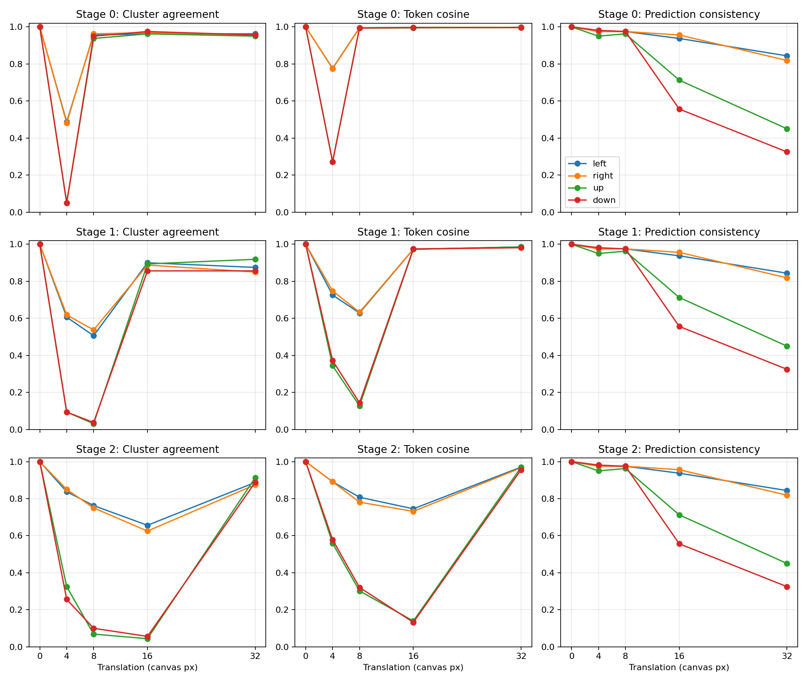

# 1012 Caltech-101 修正物體中心：靜態重測與受控平移

完成時間：2026-10-12T12:48:13.010153+00:00。本輪先完成靜態抽取與 fitting，再使用同一份固定 codebook 進行平移。原有產物保留；本輪所有 cache 使用 `caltech_box_offset_minus1_v1`。

## 設定與重現

- Checkpoint：epoch 66，SHA256 `3cf8ab1056dfb025aa63c349e4d06e3ef49e519418fceb7798f49af1be39daca`。
- Training：6907 張；validation：1770 張；平移：validation 中 160 張 airplanes。
- 與既有 seed-42 split 相同；validation 曾參與 checkpoint 選擇，不是 untouched final test。
- 每張完整圖片等比例縮至長邊 160，置中於 224×224；resize、padding 顏色、normalize、名義 scale 與 patch 切法沿用原程式。
- 座標：`obj_contour + [[box_coord[2]], [box_coord[0]]] - 1`，再使用原 letterbox scale 映射。中心是輪廓點平均，並非 mask 面積質心。為隔離此次 offset 修正，沒有另改 resize rounding 的座標協定。
- Stage 0／1／2 在最後 block 後、merge 前取一個物體中心 token；網格為 8／16／32 px。token 框只表示網格範圍，self-attention 的感受野可能包含全圖。
- 各 stage 用未平移 training 特徵建立 K=31 codebook：L2-normalized features + sklearn Euclidean KMeans，seed=42、n_init=50。本輪只重測這個原方法與單一 seed，沒有宣稱已重跑三方法／20 seeds。
- 平移量：0、4、8、16、32 canvas px；非零位移各做左、右、上、下。平移圖與 validation 特徵都不參與 fitting。

```bash
.venv/bin/python scripts/run_caltech_corrected_center.py
.venv/bin/python scripts/report_caltech_corrected_center.py
```

程式在相同 cache identity 下可重用已抽出的特徵；identity 不同會拒絕混用，請使用新 output-dir。manifest 保存 split IDs、資料／標註／checkpoint／程式 hash、參數與時間。環境版本另見 verification.json。大型 NPZ 保留本機，不納入 Git。

第一條指令可從資料及 checkpoint 重跑本輪；第二條報告／驗證指令另需本機既有 `spherical_comparison_1005_n50/features.npz` 與 `quality_evaluation_1005/heldout_features.npz`，以核對舊取樣結果。verification.json 保存這些比較來源的 hash。

## 1. 靜態重測

所有 training／validation 共 8677 張均確認修正前後輸入 tensor 與 RGB canvas **逐像素完全相同**。修正只改取樣位置，沒有引入新的 patch 對齊效應。

| Stage | 舊位置 silhouette | 修正位置 silhouette | 修正位置負 silhouette | Category AMI | Category ARI |
| --- | --- | --- | --- | --- | --- |
| 0 | 0.19710 | 0.17568 | 19.49% | 0.12373 | 0.05329 |
| 1 | 0.12618 | 0.10036 | 26.89% | 0.14222 | 0.07000 |
| 2 | 0.08965 | 0.06470 | 27.91% | 0.20281 | 0.12029 |

此表舊值與新值都使用 seed 42、n_init=50 的原 Euclidean 方法；舊值來自既有 held-out geometry_metrics。群中心已重新 fitting，cluster 編號不能直接跨版本對比。Silhouette／category agreement 是幾何及標籤統計，不能直接證明群語意。

修正後三層 silhouette 均下降；這反映重新取樣與重新 fitting 的特徵空間差異，不能解讀為同一內容的表徵漂移。

| Split | Stage | 同一 token 比例 | 不同 token：取樣特徵 cosine |
| --- | --- | --- | --- |
| train | 0 | 8.96% | 0.19577 |
| train | 1 | 16.71% | 0.17869 |
| train | 2 | 37.18% | 0.21462 |
| validation | 0 | 8.87% | 0.19486 |
| validation | 1 | 15.42% | 0.18903 |
| validation | 2 | 35.99% | 0.22537 |

上表比較同一張未平移影像的兩個取樣位置，**不是同一內容的表徵漂移**。仍落在同一 token 的樣本，已驗證新舊特徵相等（數值容差內）。逐圖片位置、token 與 padding 見 coordinate_audit.csv；靜態分群與 silhouette 見 static_assignments.csv。

Validation 分類 accuracy 為 62.09%；座標修正不改模型分類輸入。

## 2. 受控平移：相同位移量比較各 stage

下表非零位移合併四方向，各 stage／位移共有 640 筆 paired observations；0 px 為 160 筆原樣本的 identity control。它們重複使用同一來源影像，不是獨立新增圖片。

| Stage | 位移 px | 對齊此 stage 網格 | Cluster agreement | Token cosine | Prediction consistency |
| --- | --- | --- | --- | --- | --- |
| 0 | 0 | 是 | 100.00% | 1.00000 | 100.00% |
| 0 | 4 | 否 | 26.72% | 0.52348 | 97.03% |
| 0 | 8 | 是 | 95.16% | 0.99427 | 97.19% |
| 0 | 16 | 是 | 96.72% | 0.99574 | 79.06% |
| 0 | 32 | 是 | 95.62% | 0.99688 | 60.94% |
| 1 | 0 | 是 | 100.00% | 1.00000 | 100.00% |
| 1 | 4 | 否 | 35.31% | 0.54740 | 97.03% |
| 1 | 8 | 否 | 27.81% | 0.38332 | 97.19% |
| 1 | 16 | 是 | 88.44% | 0.97356 | 79.06% |
| 1 | 32 | 是 | 87.50% | 0.98366 | 60.94% |
| 2 | 0 | 是 | 100.00% | 1.00000 | 100.00% |
| 2 | 4 | 否 | 56.72% | 0.72988 | 97.03% |
| 2 | 8 | 否 | 42.03% | 0.55280 | 97.19% |
| 2 | 16 | 否 | 34.53% | 0.43706 | 79.06% |
| 2 | 32 | 是 | 89.06% | 0.96537 | 60.94% |

4 px 改變 Stage-0 初始 patch 相位；8 px 只保留 Stage-0 相位，16 px 保留 Stage 0／1，32 px 保留 Stage 0／1／2。較深層合併的相位與 absolute positional embedding 仍可能造成差異；本輪描述敏感性，未作機制因果消融。

Stage 0 的 4 px agreement 為 26.72%，8 px 為 95.16%；Stage 1 的 8 px 為 27.81%，16 px 為 88.44%；Stage 2 的 16 px 為 34.53%，32 px 為 89.06%。這些結果符合各層固定網格相位具有明顯影響，但位移幅度也同時改變，不能視為已隔離其他因素的因果證據。32 px 分類 prediction consistency 仍只有 60.94%，再次顯示局部群穩定不保證分類穩定。

0 px 已驗證 cluster／prediction agreement=100%、cosine≈1、token 不變。所有位移均驗證修正中心加上相同 dx／dy，對齊 stage 網格時 token 移動正確的整數格數。四方向分開的 AMI／ARI、分類 accuracy、token change 與 padding rate 見 translation_summary.csv，沒有將四方向 AMI／ARI直接平均當作 pooled AMI／ARI。



## 3. Token 邊界與 padding 分層

距離是中心到所屬 token 最近網格邊界的 canvas-pixel 距離。預先固定門檻 ≤2 px；原位置或移動後位置任一接近邊界即為 near，否則為 interior。以下另外排除任一端 token 接觸 letterbox padding 的配對，避免把 padding 組混入內部組。

| Stage | 位移 px | 邊界組 | N（四方向） | Agreement | Cosine |
| --- | --- | --- | --- | --- | --- |
| 0 | 4 | near | 640 | 26.72% | 0.52348 |
| 0 | 8 | near | 492 | 94.92% | 0.99424 |
| 0 | 8 | interior | 148 | 95.95% | 0.99437 |
| 0 | 16 | near | 492 | 96.34% | 0.99573 |
| 0 | 16 | interior | 148 | 97.97% | 0.99579 |
| 0 | 32 | near | 492 | 94.92% | 0.99688 |
| 0 | 32 | interior | 148 | 97.97% | 0.99688 |
| 1 | 4 | near | 305 | 31.15% | 0.50454 |
| 1 | 4 | interior | 335 | 39.10% | 0.58643 |
| 1 | 8 | near | 366 | 27.60% | 0.38400 |
| 1 | 8 | interior | 274 | 28.10% | 0.38241 |
| 1 | 16 | near | 168 | 87.50% | 0.97267 |
| 1 | 16 | interior | 472 | 88.77% | 0.97388 |
| 1 | 32 | near | 168 | 88.69% | 0.98236 |
| 1 | 32 | interior | 472 | 87.08% | 0.98413 |
| 2 | 4 | near | 52 | 61.54% | 0.69667 |
| 2 | 4 | interior | 588 | 56.29% | 0.73282 |
| 2 | 8 | near | 100 | 48.00% | 0.58824 |
| 2 | 8 | interior | 493 | 44.42% | 0.58067 |
| 2 | 16 | near | 80 | 52.50% | 0.60291 |
| 2 | 16 | interior | 384 | 44.53% | 0.53569 |
| 2 | 32 | near | 16 | 100.00% | 0.96791 |
| 2 | 32 | interior | 624 | 88.78% | 0.96530 |

translation_samples.csv 每筆保留原／移動中心對 8、16、32 的 x/y 餘數、token indices、token 是否改變、邊界距離、兩端 padding contact，以及 assigned／原 centroid 的 cosine distance。translation_summary.csv 另存邊界×padding 交叉分層。空組不輸出；分層的樣本組成不同，不能把組間差異當作邊界的因果效果。

Stage 0 在 4 px 位移下，搭配 2 px 門檻，原／移動端至少一端必然接近邊界，所以配對定義沒有 interior 組。為保留原位置與移動後位置的個別比較，另存 endpoint_boundary_summary.csv，分別依兩端距離分層。

## 4. 驗證與產物

- 完整配對資料 8,160 筆；唯一鍵 `(source_index, stage, shift_pixels, direction)` 無重複。
- 全部 2,560 個 translated canvases 的原圖內容 crop 與未平移版本逐像素相同，來源內容完整保留。
- 0 px 控制、stage-aligned token displacement、grid phase 與舊／新同 token 特徵 equality 均通過。
- 原始修正特徵、平移特徵、codebook 分別存 NPZ，manifest 存 SHA256。精選 CSV、圖及 manifest 留在版本控制，原有舊 cache 未修改。

[Manifest](../plots/kmeans/caltech_corrected_center_1012/run_manifest.json) · [驗證紀錄](../plots/kmeans/caltech_corrected_center_1012/verification.json) · [靜態指標](../plots/kmeans/caltech_corrected_center_1012/static_metrics.csv) · [平移摘要及分層](../plots/kmeans/caltech_corrected_center_1012/translation_summary.csv) · [逐筆平移紀錄](../plots/kmeans/caltech_corrected_center_1012/translation_samples.csv) · [座標對照](../plots/kmeans/caltech_corrected_center_1012/coordinate_audit.csv)

本輪平移只涵蓋 airplanes、一個 checkpoint、單一 clustering seed；不能推廣至全類別或跨模型訓練的穩定性。原先 Stage 2 32px 的 88.91% 局部分群一致率屬舊取樣座標，本輪修正結果另列，不能沿用舊值解讀物體中心。
