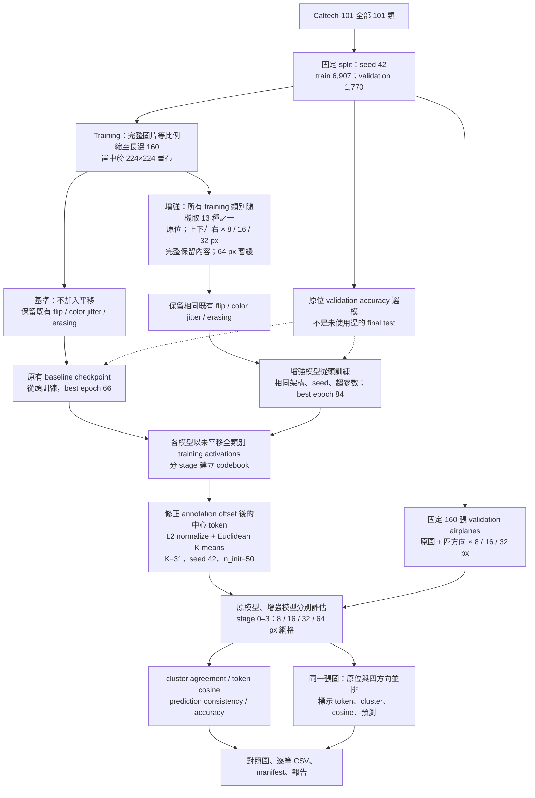
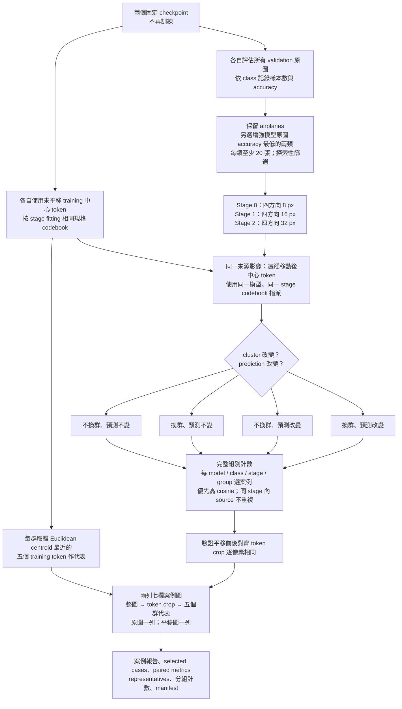

# 目前流程：平移增強、飛機評估、換群案例

## 訓練與原本的飛機比較

注意：8/16/32 px 都對齊初始 8 px patch，但不一定對齊所有更深 stage 的 merging 網格。原本飛機評估會觀察各個 stage；下方案例分析則特別限制位移等於被分析 stage 的網格，避免混入該層的非對齊 crop。

## 換群／不換群案例分析

同一模型／stage 的 codebook 跨位置使用；不是每個位置各自建立 codebook。不同模型的 cluster ID 沒有天然對應。局部 crop 相同不代表完整 token activation 必須相同，因為位置編碼與 self-attention 仍可能影響表徵。換群也不直接表示人類語意改變。

Prediction consistency 是相對原圖的預測是否改變，並不等於分類正確；兩次都錯也可能一致。四方向重用來源影像，不能把配對數當成獨立圖片數。

相關產物：[原評估報告](../plots/kmeans/caltech_aligned_translation_1014/REPORT.md)、[案例報告](../plots/kmeans/caltech_aligned_translation_1014/case_analysis/REPORT.md)。
