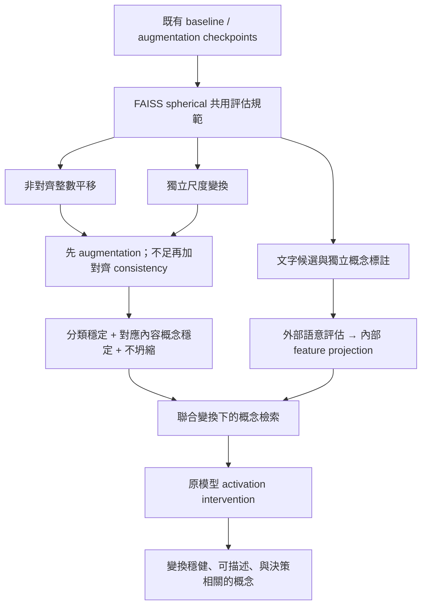

# 後續研究規劃：非對齊平移、尺度穩定性與自然語言概念

日期：2026-10-15。此文件是研究設計，尚未執行新的訓練或評估；參數為首輪提案，可依 pilot 調整並在正式測試前固定。

## 研究目標與目前證據

希望回答：同一物件移動或改變大小後，模型能否維持分類與可解釋的概念？這些概念是否能用自然語言查詢、驗證，並連回原模型的決策？

現有實驗顯示，所有 training 類別加入 8／16／32 px 平移後，飛機分類穩定性明顯改善；但不對齊深層 merging 網格時，中心 token 仍可能大幅改變。原結果使用 normalized-feature sklearn Euclidean K-means。後續依使用者決定，採真正 spherical K-means，例如 FAISS `spherical=True`，不將兩種方法混稱。

不先把「所有變換後硬性要求同 cluster」當唯一目標。不同尺度下，固定像素 token 可能從眼睛局部變成整個頭部；此時換群不必然錯誤。目標應是對應內容的概念穩定，同時保留區分不同內容的能力。

| 層級 | 希望穩定的量 | 不應混淆的問題 |
|---|---|---|
| 分類 | accuracy、原圖與變換圖的預測一致率 | 前後皆錯也可能一致 |
| 表徵 | 對應內容的 token／region cosine | 相同網格 index 不代表相同內容 |
| 概念 | 固定 codebook 指派、soft assignment、文字概念分數 | 同 cluster 不代表同人類語意 |
| 決策作用 | 概念介入後的類別 logit／margin 變化 | 名稱合理不表示原模型真的使用該概念 |

## 共用實驗規範

1. **先建立球面基準，再比較新訓練。** 保留舊 sklearn 報告；用既有 baseline／aligned-augmentation checkpoints 的相同特徵重建 spherical codebooks。之後各模型分別 fitting，相同模型／stage／readout 的 codebook 在所有測試變換間固定。
2. **固定資料角色。** Train 用於模型、projection、候選詞與 codebook；validation 選超參數與探索案例；另保留未參與探索的 final test。現有 validation 已被查看，不能重新命名為 final test。必要時重切資料並重訓，或加入額外未使用資料。
3. **保持分類任務為 101 類。** Pilot 可先分析 airplanes／chandelier／brain，正式報告須涵蓋預先選定的多類別，避免只選表現好的類別。
4. **控制資源與隨機性。** 首輪一個 seed 排查流程；正式比較至少三個配對 training seeds，相同初始化規則、split、訓練預算與選模準則。按 source image 彙整多方向／多尺度重複量測，再做影像層級 bootstrap；training seeds 另報，不把方向或 seed 當新增影像。
5. **記錄有效性。** 保存變換矩陣、實際 resized 尺寸與 rounding、有效內容遮罩、裁切比例、annotation 座標版本、checkpoint／資料／程式 hash。每一測試條件使用共同來源集合。
6. **避免分群坍縮。** 除 agreement 外，報告有效群數、群占比／熵、群間區辨與 held-out 幾何品質；一群吸收大部分樣本不能視為成功。
7. **Codebook 取樣規格清楚。** 原中心-token codebook 留作歷史對照；若改用全位置、ROI pooled 或 text-projected features，建立新版本與獨立 codebook，不能沿用原群編號。跨位置比較使用共享的 stage codebook。

FAISS 的 spherical 設定會在更新時正規化中心，適合以單位特徵及內積／cosine 指派；需明確記錄 `niter`、`nredo`、seed、實際 fitting 樣本數及取樣上限，不能將 sklearn `n_init` 與 FAISS 預設視為相同預算。[FAISS clustering 官方說明](https://github.com/facebookresearch/faiss/wiki/K%E2%80%90means-clustering)、[FAQ](https://github.com/facebookresearch/faiss/wiki/FAQ)。

## 方向一：不對齊初始 patch 的平移

### A. 先把「內容變了」與「模型對位置敏感」拆開

初始 patch=8 px。首輪用整數像素平移，無插值；維持 160-in-224，位移絕對值不超過 32 px，保留完整來源影像。先水平／垂直單軸，再做二維組合。

| 比較方式 | 做法 | 可以回答什麼 |
|---|---|---|
| 中心 token | 沿用修正中心定位 | 實際固定網格下的敏感性，含內容涵蓋改變 |
| 對應位置 feature | 依已知位移將 feature map 映射回共同座標，僅比較共同有效範圍 | 近似的表徵等變誤差；須承認 feature 插值誤差 |
| 物件／部件 region | 已知 ROI 隨圖片移動，再按網格交疊面積或 ROIAlign 讀取區域特徵 | 同一區域是否維持概念，降低只選一個 token 的不連續性 |

ROIAlign／加權平均會改變 readout 並可能平滑差異，需獨立報告，不能說原始 token 已不變。平移物件中心區域可用 annotation 導出 ROI；若要聲稱「同一部件」，仍需部件標註或固定人工 landmark，物件中心並不自動對應相同部件。

### B. 先做資料與損失，再考慮架構

| 組別 | 訓練方式 | 目的 |
|---|---|---|
| T0 | 既有 aligned-only augmentation checkpoint | 檢查未見 patch 相位的泛化 |
| T1 | 從頭訓練，包含非對齊整數平移 | 測試單靠資料增強能否改善 |
| T2 | T1＋原圖／變換圖的 prediction consistency loss | 測試分類分布一致性 |
| T3 | T2＋內容對齊 region feature consistency | 測試表徵穩定性是否有額外改善 |

首輪訓練位移候選：0、±1、±3、±5、±8、±16、±32 px。評估分為 seen 位移與 held-out 位移 ±2、±4、±6、±7、±12、±20、±28 px，並按 `dx mod 8`／`dy mod 8` 及 stage 網格餘數分層。這是「未見位移值」，不保證所有相位皆未見；正式配置須明列兩者，避免誤稱完全新相位。二維組合與次像素插值延後。

Loss 先採 `L = L_CE + λpred L_KL + λfeat(1−cos(z, z_aligned))`，其中 `z` 為相同 ROI 的 readout；KL 可用 stop-gradient teacher，兩 view 仍受正確類別監督。λ 只用 validation 選擇，檢查是否犧牲原圖 accuracy 或不同概念的區辨能力。

若分類已穩定而分群仍不穩，再另外消融 train-only、暫時固定 spherical prototypes 的 soft-assignment consistency；不直接懲罰不可微的 hard cluster ID，也不先把 K-means 結果硬塞回 backbone。若原始 feature 與投影 feature 都使用，兩者指標分開報。

### C. 何時改架構

若 T1–T3 仍有強烈的 phase 週期，再逐項比較 anti-aliasing／overlapping patch embedding、位置編碼處理、merging 的相位適應設計；不能同時全部更換後宣稱找到原因。

相關原始研究把 tokenization、位置編碼與 merging 等模組納入 shift-equivariant 設計；其中嚴格 circular-shift 結果不能直接當作本研究有限畫布、padding 情境的保證。這裡採其消融思路，並非直接宣稱自訂 MergingViT 已具相同性質。[Making Vision Transformers Truly Shift-Equivariant](https://openaccess.thecvf.com/content/CVPR2024/papers/Rojas-Gomez_Making_Vision_Transformers_Truly_Shift-Equivariant_CVPR_2024_paper.pdf)。

**交付：** shift residue 熱圖、固定 px 的逐 stage 曲線、分類／region cosine／cluster agreement 三張分開的表，以及「相同 ROI 但換群」案例。只有在 accuracy、穩定性與群多樣性共同改善時才保留方法。

## 方向二：物件大小縮放，分類與概念如何一致

### A. 先定義縮放的是什麼

第一輪對完整來源圖在畫布內等比例縮放，背景也一起縮放；這能控制變換，但不能稱為「只改物件大小」。第二輪才用物件 mask／cutout 固定背景，另加背景變換控制，檢查背景或合成邊緣的影響。Caltech 輪廓可作遮罩候選，先稽核座標與品質。

以 baseline 長邊 160 為倍率 1.0，固定 224 畫布、置中、不裁切：

| 用途 | 首輪倍率 | 實際長邊 |
|---|---|---|
| Training | 0.6、0.8、1.0、1.2 | 96、128、160、192 px |
| 未見倍率測試 | 0.7、0.9、1.1 | 112、144、176 px |

每個倍率從同一原始高解析來源直接 resize，避免多次 resampling。記錄插值與 anti-aliasing；縮小會丟失資訊，不宣稱像素完全相同。這是未見離散倍率測試，不是整個尺度區間外的 extrapolation。

先只做尺度，位置固定。192 px 內容的安全邊界只有 16 px，不能再套用原本 ±32 px 平移；最後做聯合變換時，必須滿足每端邊界約束，並對所有模型使用同一有效樣本／條件集合。

### B. 分類一致與部件同群分開做

固定 stage、固定像素 token 在不同倍率下看到的物件範圍不同，因此「同一中心 token 一定同群」可能是錯誤要求。

1. **同 stage 的 region readout（先做）：** 把原圖相對物件座標的 ROI 一起縮放，pool／對齊到同一規格，建立 region-specific spherical codebook。這是在驗證 readout 後概念穩定，不是原始 token 不變。
2. **跨 stage 的物件相對覆蓋範圍（後做）：** 小物件的細 stage 與大物件的粗 stage 可能覆蓋相近部件；需獨立學習共享 projection，再用 train-only 共同 codebook。不同 stage 維度與語意不同，不能直接比較原始 centroid 或相同編號。
3. **若需要固定局部概念：** 選有部件 landmark／mask 的小型標註子集，驗證機翼、輪子等同一部件；中心點本身不足以支持部件一致性。

### C. 訓練順序

S0 固定尺度基準 → S1 scale augmentation → S2 prediction consistency → S3 對應 region feature consistency。方法只在上一層不足時追加。使用共同 CE＋consistency 架構，並保留細節區分與原圖準確率。

Multi-crop self-distillation 可作 view-consistency 設計參考，但其視圖不一定有相同內容，不能直接視為本研究的精確部件對應。[DINO 原始論文](https://arxiv.org/abs/2104.14294)。若要從架構處理尺度，可參考 scale-equivariant 設計的問題定義；相關 CNN 方法不是現有 MergingViT 的直接可替換保證。[Scale-Equivariant Steerable Networks](https://arxiv.org/abs/1910.11093)。

**交付：** accuracy／prediction consistency 對倍率曲線、相同物件相對 ROI 的 cosine／group agreement、token vs region readout 對照。把「尺度資訊被保留」與「分類不受尺度影響」分開解讀。

## 方向三：將內部特徵與自然語言連結

### A. 先做外部語意量尺，再做模型內部對齊

不能直接把 MergingViT centroid 與 CLIP text embedding 做 cosine，兩者沒有共同的座標系；維度相同也不代表可比較。CLIP 提供經訓練的 image／text 共同空間，適合作為外部語意工具，但不自動解釋另一個模型。[CLIP 原始論文](https://arxiv.org/abs/2103.00020)。

| 路線 | 做法 | 可以宣稱什麼 |
|---|---|---|
| L0：群的文字標註 | 用 training 群內多個樣本、局部與 context，對候選詞做 CLIP scoring；VLM 只協助產生候選 | 這群的影像內容與某些文字屬性相符 |
| L1：特徵到文字概念 | 固定 backbone，按 stage 訓練小型 linear／MLP projection，對齊語意目標或人工 concept labels | 原模型特徵中可讀出這些語意；不代表決策一定使用 |
| L2：概念決策驗證 | 經驗證概念接回原有 activation intervention，檢查目標 logit／margin 變化 | 在指定介入與控制下，概念特徵與原模型決策有作用關係 |

首輪詞彙分級：Stage 0 顏色／邊緣／紋理；中層輪廓／重複結構；深層部件／物件。這是候選詞設計，不預設深層必然有部件概念。容許一群對多個詞、一個詞對多群，以及「無可靠名稱」。加入同義改寫、互斥屬性及相近 hard negatives；避免只用類別名把語意檢索退化成分類。

8×8 的 crop 對文字模型可能資訊不足；同時檢查 crop-only、適量 context、原圖遮罩 context，避免名稱其實來自框外物件。CLIP 及 VLM 分數只作候選證據，不是自動 ground truth。

### B. 如何真正量化

- **人工概念小測試集：** 對獨立來源圖的指定 ROI 標記 20–50 個候選屬性，保留不確定／不可見選項；按 source image 切分，不能讓同圖不同 crop 分散到 train/test。
- **Text → region retrieval：** 例如查詢「平行細線」或「金屬曲面」，看獨立標註下的 Precision@k／Recall@k；與隨機、類別名-only、CLIP-only 比較。
- **Feature → concept prediction：** 對人工標註報每概念 AUROC／AUPRC、support，與 shuffle-label／nearest-centroid 基準比較；VLM 自產標籤不能用作唯一自我驗證。
- **變換一致性：** 同一 ROI 平移／縮放後，文字概念分數或排名是否穩定，同時仍能區分真的不同概念。
- **決策作用：** 在同位置、相近 norm／前景條件下用真實 activation donor 替換，追蹤原模型的固定目標 logit、margin 及下游概念變化。投影 head 上分數改變不能取代原模型介入。

可額外用概念分數訓練稀疏分類 head 作診斷，看少量文字概念能重建多少 accuracy／原模型預測；這是新的 surrogate，不等於原模型本身已是概念瓶頸模型。語言引導概念瓶頸可參考 LaBo，其方法使用文字候選與 image-text 模型形成概念層。[Language in a Bottle](https://arxiv.org/abs/2211.11158)。

**交付：** `concept_dictionary.csv`（詞、同義詞、stage、證據、置信與未知）、文字檢索頁／表、獨立概念評估、概念介入報告。代表圖片保留作證據，文字與量化指標成為主要索引。

## 推進順序與最低可行範圍

| 階段 | 工作 | 決策點／產物 |
|---|---|---|
| P0 | 固定 split 與 transform manifest；既有兩 checkpoints 重建 FAISS spherical 基準 | 不混淆換分群實作與換訓練資料的效果 |
| P1 | 非對齊整數平移：現有模型評估＋T1 訓練 | 是否僅靠 augmentation 就足夠？phase 熱圖與多類別結果 |
| P2 | 獨立做尺度 augmentation＋region readout | 定位是否為 token 覆蓋範圍／分類不穩問題 |
| P3 | 只對不足的方向加 consistency loss；必要時架構消融 | 準確率、穩定性與群多樣性是否共同改善？ |
| P4 | 可與 P1/P2 並行：L0 詞彙／小標註集；再訓練 L1 projection | 是否具有超越類別名與 CLIP-only 的語意證據？ |
| P5 | 聯合平移＋尺度，最後接 L2 概念介入 | 對變換穩定、可用語言描述且影響決策的概念 |

不一開始同時訓練所有變換、損失與架構。建議第一個可執行實驗是 P0＋P1；語言線先完成小規模 L0 候選與標註規範，不必等待整套不變性研究完成。

參照：[本輪報告](../plots/kmeans/caltech_aligned_translation_1014/REPORT.md)、[既有流程](1014_aligned_translation_workflow.md)、[方法決定筆記](1014_aligned_translation_augmentation.md)。
