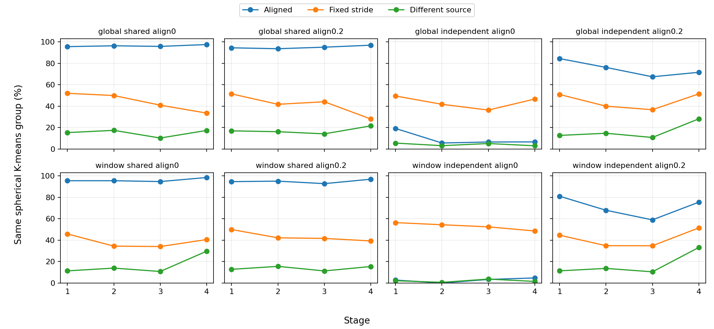
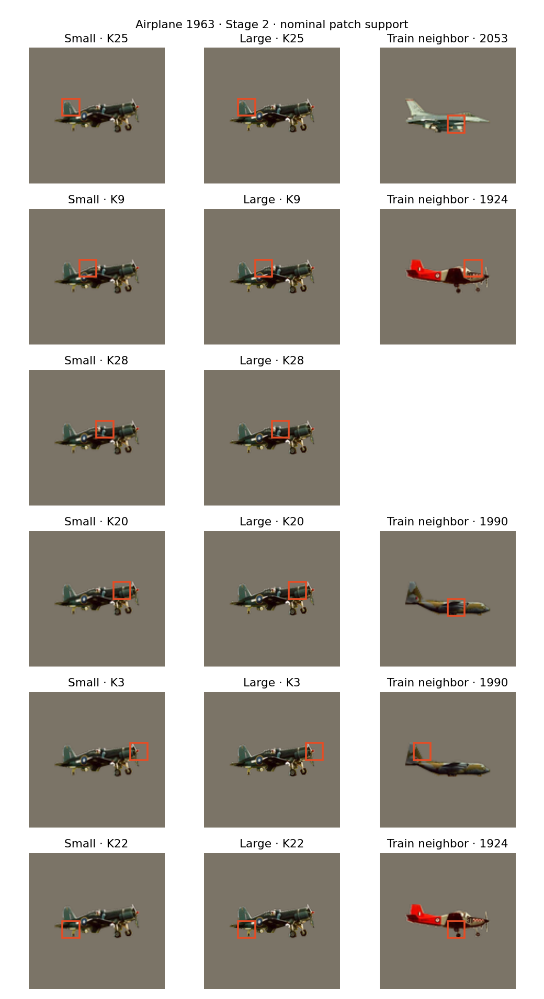

# 1.25× 物件縮放下的雙分支 token 穩定性

在 Caltech101 的合成配對上，stride 8／10 對齊加上共享權重，讓 Stage 2／3 的同一前景區域跨尺度同群率達約 95%。隨機初始化對照也達到相近水準，顯示高同群率很大一部分來自幾何對齊與共享權重。跨照片檢索同一部件仍有錯配。

## 設計

- 同一來源的輪廓物件以長邊 80／100 px 合成，配對內共用背景色。取樣區域為 128×128／160×160，patch stride 為 8／10。四層 token 網格皆為 16² → 8² → 4² → 2²，同索引 token 的名義支援區域可映回來源物件的同一位置。大圖的 10×10 patch 固定重採樣成 8×8。
- 比較共享／獨立參數、全域／窗口注意力、純交叉熵／加權 0.2 的 Stage 2／3 前景 token cosine 一致性損失。1,616 個訓練來源、606 個保留來源，每組 10 epochs，seed 42。窗口大小沿用 7，四層實際為 7／7／4／2。
- 沿用 FAISS 球形 K-means，K=31、100 iterations、50 restarts。每個模型與 stage 各用小圖訓練前景 token 建字典，凍結後以同一本字典查詢兩個尺度的保留 token。 [既有球形 K-means 比較](1109_clip_spherical_scale_comparison.md) · [既有窗口注意力比較](1109_window_attention_comparison.md)

## 結果

| 注意力 | 參數 | 一致性損失 | Stage 2 同群 | Stage 3 同群 | 融合準確率 |
|---|---|---|---:|---:|---:|
| 全域 | 共享 | 無 | **96.28%** | **95.69%** | 8.42% |
| 全域 | 共享 | 有 | 93.54% | 94.98% | 5.28% |
| 全域 | 獨立 | 無 | 5.68% | 6.59% | 15.51% |
| 全域 | 獨立 | 有 | 76.12% | 67.39% | 16.67% |
| 窗口 | 共享 | 無 | **95.40%** | **94.62%** | **19.31%** |
| 窗口 | 共享 | 有 | 95.01% | 92.70% | 1.98% |
| 窗口 | 獨立 | 無 | 0.09% | 3.40% | 17.16% |
| 窗口 | 獨立 | 有 | 67.88% | 58.92% | 19.14% |

- **對齊 stride。** 在窗口共享純分類模型上，同一模型用 stride 8 讀放大圖中央區域，並按最近的來源 token 中心配對，Stage 2／3 同群率為 34.45%／34.08%。切回對齊的 stride 8／10 後，分別增加 60.95／60.54 個百分點，按來源重抽樣的 95% 信賴區間分別為 [59.47, 62.32]／[58.08, 62.88] 個百分點。這個對照使用同一模型做推論。
- **共享與注意力。** 純分類的獨立分支難以直接共用字典，一致性損失可部分恢復。共享分支下，窗口注意力提高了這輪融合準確率，Stage 2／3 同群率較全域注意力略低。窗口共享模型在隨機初始化時已達 95.25%／96.15%，與訓練後相近。
- **適用範圍。** 本輪只驗證合成物件的 1.25×，準確率來自 10 epochs 的短訓練。Stage 4 的前景覆蓋率偏低，字典樣本也低於 FAISS 對 K31 的建議數量，因此以 Stage 2／3 為主。

## 飛機部件檢索

窗口共享純分類模型的保留飛機 token 在 Stage 2 有 **33／34**、Stage 3 有 **10／10** 對跨尺度同群。圖中 K22 的查詢區域與訓練近鄰都涵蓋起落架附近。K25 的查詢框涵蓋尾翼，近鄰卻落在機身下方。檢索候選限定已知飛機類別。這些案例展示可跨尺度找回相同區域，也保留了跨照片部件錯配的例子。部件正確率仍需用部件標註量測。

