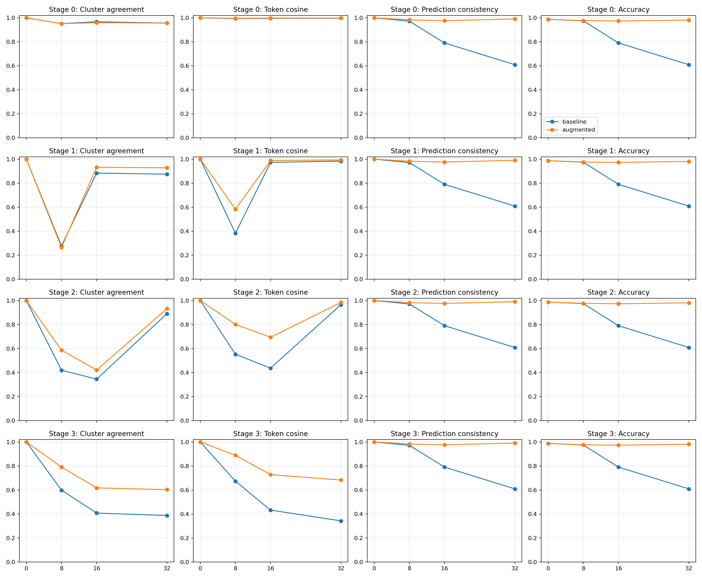
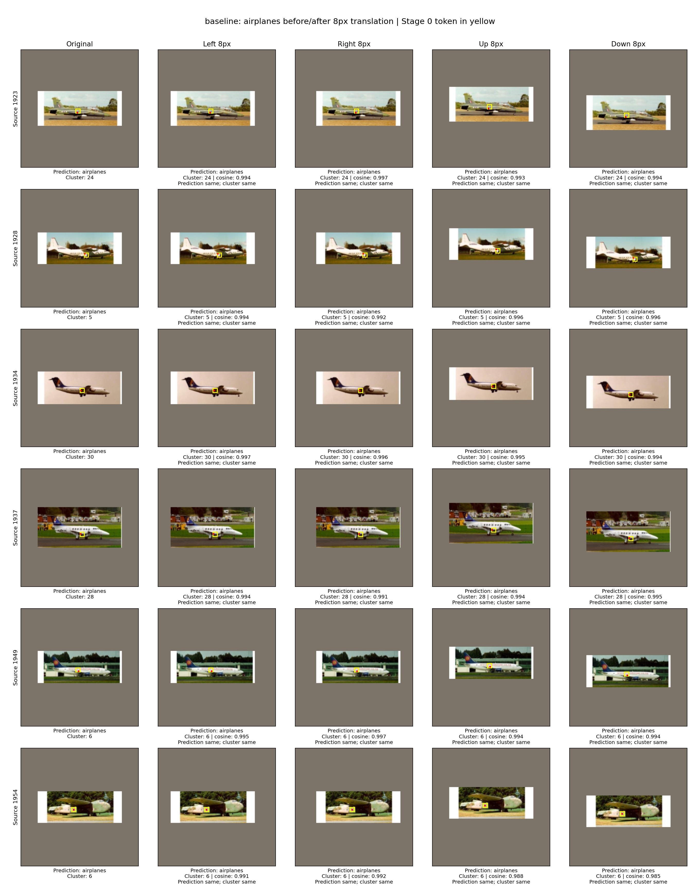
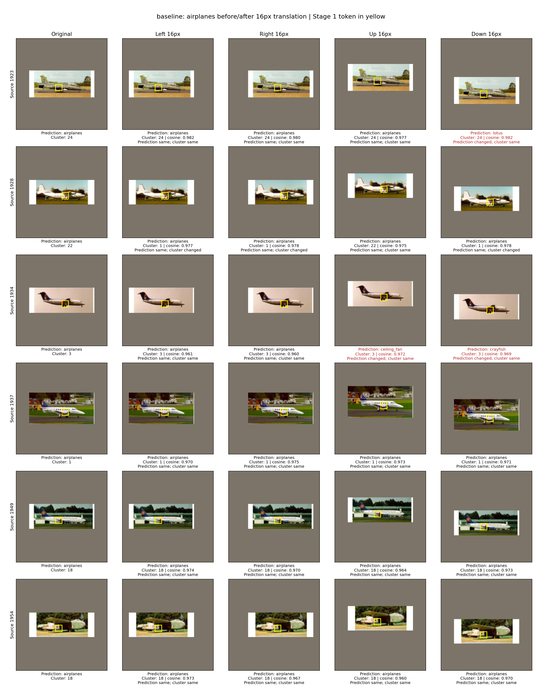
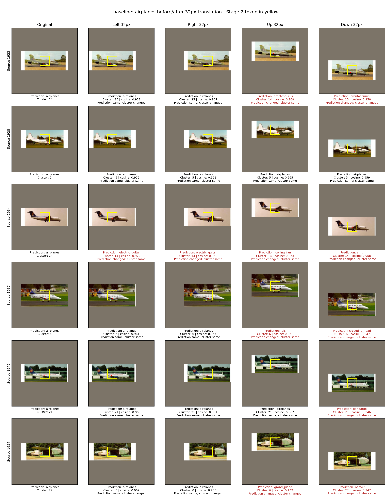
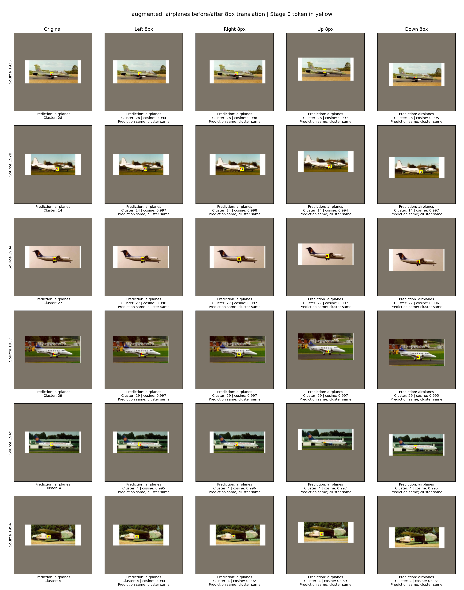
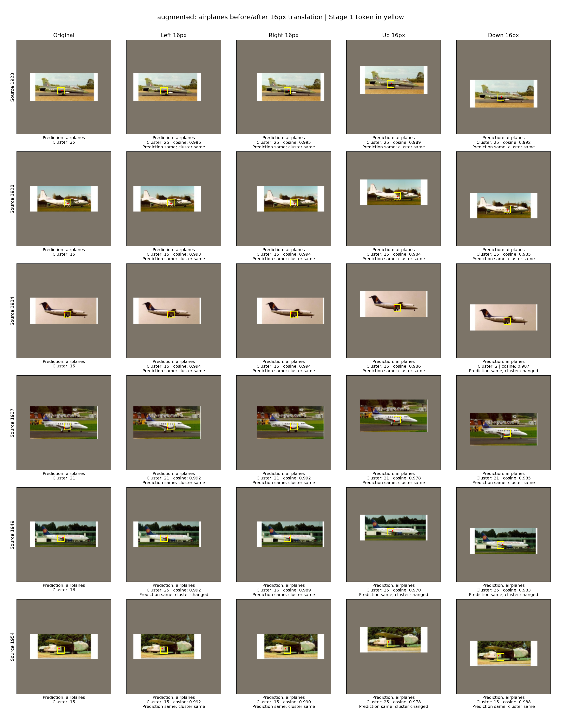
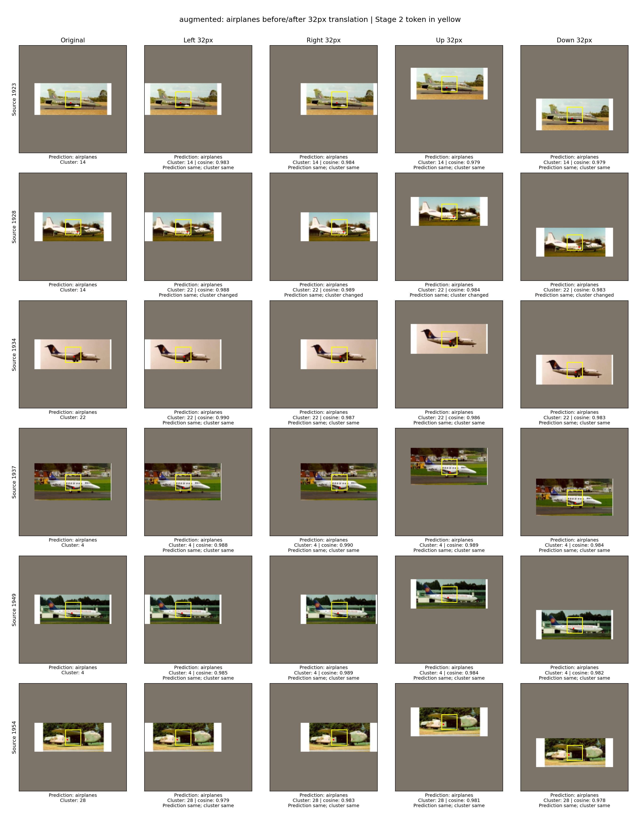

# Caltech-101 平移增強：分類穩定性與內部表徵比較

## 研究解讀

本次結果支持以下工作假設：本研究使用的 MergingViT 含絕對位置編碼與固定 patch／merging 網格，架構本身不保證平移等變性或分類輸出的平移不變性；透過平移資料增強，模型可以學到對位置變動較穩健的表徵與決策，因此平移前後分類與部分內部特徵更穩定。

這與「藉由增強資料，讓模型內部學習到類似模式」的解讀一致。不過，特徵 cosine 與群指派只支持表徵穩定性的描述，尚未驗證具體學習機制或跨位置共用的人類語意概念；也不能將這一個模型的結果推廣為所有 Transformer 都具有相同特性。

分類輸出保持不變與對應 token 表徵保持相近是兩件事：後者比較的是平移後移動位置的 token，屬於內容對齊的表徵穩定性；不是要求所有固定位置 activation 完全不變。

## 實驗設定

- 所有 training 類別加入平移：原位或上下左右 × 8／16／32 px，共 13 種等機率取樣，每次讀取抽一次。原有 flip、color jitter、random erasing 保留。
- 兩模型皆從頭訓練；沿用 seed 42、相同架構與資料切分。原模型 best epoch 66，增強模型 best epoch 84；以原位全類別 validation accuracy 選模。
- 160-in-224，完整原圖等比例縮至長邊 160，平移最多 32 px，不裁掉影像內容。實際 64 px 平移暫緩。
- 主要比較固定 160 張 validation airplanes。各位移四方向共 640 筆配對，重複使用同一來源圖片，不能當成 640 張獨立影像。
- 使用修正 annotation bbox offset 後的輪廓點平均中心，非 mask 面積質心。分 stage 用未平移全類別 training 中心 token，L2 normalize 後做 Euclidean K-means：K=31、seed 42、n_init=50。
- 每模型各自 fitting，cluster ID 不跨模型對應；本實驗同一 stage 的 codebook 跨位置使用。

## 1. 相同修正座標下的直接比較

各 stage 使用等於該層網格大小的位移。兩表的群一致率為 cluster agreement，Token cosine 為平移前後 token 的 cosine similarity，Accuracy 為平移後分類正確率。Margin 為平移後特徵到次近與最近 Euclidean centroid 的距離差；越大表示指派較明確。

### Baseline（原模型）

| Stage | 位移 | 群一致率 | Token cosine | Margin | Accuracy |
| --- | ---: | ---: | ---: | ---: | ---: |
| Stage 0 | 8 px | 95.16% | 0.9943 | 0.1542 | 97.50% |
| Stage 1 | 16 px | 88.44% | 0.9736 | 0.0973 | 79.06% |
| Stage 2 | 32 px | 89.06% | 0.9654 | 0.1105 | 60.94% |

### Augment（平移增強）

| Stage | 位移 | 群一致率 | Token cosine | Margin | Accuracy |
| --- | ---: | ---: | ---: | ---: | ---: |
| Stage 0 | 8 px | 95.16% | 0.9958 | 0.1409 | 97.66% |
| Stage 1 | 16 px | 93.28% | 0.9891 | 0.1042 | 97.34% |
| Stage 2 | 32 px | 93.28% | 0.9845 | 0.1111 | 98.13% |

對齊位移下，Stage 1／2 的 token cosine 與 cluster agreement 均改善，分類 accuracy 維持約 97–98%。Stage 0 的 cluster agreement 仍為 95.16%，因此分類改善不能僅由中心 token 更少換群解釋。不同 stage 同時採不同位移量，這張表不能單獨歸因網路深度。

## 2. 原圖與平移後分類比較

### Baseline（原模型）

| 位移 | Accuracy | 預測一致率 |
| --- | ---: | ---: |
| 0 px | 98.75% | 100.00% |
| 8 px | 97.50% | 97.19% |
| 16 px | 79.06% | 79.06% |
| 32 px | 60.94% | 60.94% |

### Augment（平移增強）

| 位移 | Accuracy | 預測一致率 |
| --- | ---: | ---: |
| 0 px | 98.75% | 100.00% |
| 8 px | 97.66% | 98.28% |
| 16 px | 97.34% | 97.66% |
| 32 px | 98.13% | 99.06% |

32 px 平移的 accuracy 由 60.94% 升至 98.13%，prediction consistency 由 60.94% 升至 99.06%；原圖 accuracy 兩組均為 98.75%。預測一致不等於正確，也可能前後皆錯。

## 3. 固定 32 px 位移，追蹤深層是否仍驟降

這裡所有圖片實際都只移動 32 px。「Stage 3 網格 64 px」不是平移 64 px。

### Baseline（原模型）

| Stage | 網格 | 對齊 | Token cosine | 換群率 |
| --- | ---: | ---: | ---: | ---: |
| Stage 0 | 8 px | 是 | 0.99688 | 4.37% |
| Stage 1 | 16 px | 是 | 0.98366 | 12.50% |
| Stage 2 | 32 px | 是 | 0.96537 | 10.94% |
| Stage 3 | 64 px | 否 | 0.34280 | 61.25% |

### Augment（平移增強）

| Stage | 網格 | 對齊 | Token cosine | 換群率 |
| --- | ---: | ---: | ---: | ---: |
| Stage 0 | 8 px | 是 | 0.99846 | 4.38% |
| Stage 1 | 16 px | 是 | 0.99306 | 7.19% |
| Stage 2 | 32 px | 是 | 0.98446 | 6.72% |
| Stage 3 | 64 px | 否 | 0.68265 | 39.69% |

增強後 Stage 3 的 cosine 仍由 Stage 2 的 0.98446 降至 0.68265，換群率由 6.72% 升至 39.69%。因此資料增強沒有讓所有內部表徵達到完全平移穩定；但分類仍可高度穩定。Stage 3 不對齊時中心 token 的像素涵蓋範圍也不同，不能將全部差異歸因於相同局部內容的 activation 漂移。

## 4. 局部換群與分類改變的關係

固定 Stage 2／32 px；每個模型共 640 筆配對，表內數字為配對數。

### Baseline（原模型）

| 局部群指派 | 預測改變 | 預測不變 |
| --- | ---: | ---: |
| 換群 | 26 | 44 |
| 不換群 | 224 | 346 |

### Augment（平移增強）

| 局部群指派 | 預測改變 | 預測不變 |
| --- | ---: | ---: |
| 換群 | 0 | 43 |
| 不換群 | 6 | 591 |

增強後 43 筆換群案例全部預測不變，另有 6 筆不換群但預測改變；中心 token 群指派與分類決策並非一一對應。

## 5. 舊表的歷史對照與座標差異

使用者提供的 9/21 舊表如下。該輪取樣漏加 annotation bbox offset；數值描述舊位置，不能與修正後新模型直接作相同內容的增強前後比較。嚴格對照應使用本報告第 1 表的修正座標 baseline。

| Stage | 位移 | 群一致率 | Token cosine | Margin | Accuracy |
| --- | ---: | ---: | ---: | ---: | ---: |
| Stage 0 | 8 px | 96.41% | 0.9934 | 0.1484 | 97.50% |
| Stage 1 | 16 px | 92.97% | 0.9768 | 0.1112 | 79.06% |
| Stage 2 | 32 px | 88.91% | 0.9622 | 0.0927 | 60.94% |

本次 baseline 與 10/12 修正重測的 1,920 筆對齊配對已核對：群指派與分類預測完全一致，token cosine 最大絕對差約 1.79e-7。座標修正不改分類輸入，因此舊／修正 baseline 的 accuracy 可相同，但群統計不同。

## 結論與適用範圍

本次結果支持：在這個模型、資料切分與平移範圍內，平移增強可讓模型學得更穩健的位置泛化，分類穩定性的改善尤其明顯；這種穩定性並非架構保證，也不要求每層 token 都保持同群或完全相同。內部學到何種模式、是否由位置編碼／attention／merging 或全局 pooling 主導，仍需介入與消融驗證。

本輪只有單一訓練 seed；validation 曾用於選模。沒有驗證未見位移量、連續平移／不對齊初始 patch 的位移、實際 64 px 平移或其他 Transformer 架構的泛化。吊燈與腦部影像屬另外挑選的探索性案例，不能據此推論所有類別均同樣受益。

## 流程、逐筆資料與案例圖

- [Mermaid 流程](../../../plan/1014_aligned_translation_workflow.md)
- [與之前 Caltech 實驗的比較](../../../plan/1014_caltech_previous_cluster_comparison.md)
- [換群案例分析](case_analysis/ANALYSIS.md)與[全部 66 張案例](case_analysis/REPORT.md)
- [逐筆群／預測資料](case_analysis/paired_metrics.csv)與[原評估 summary](translation_summary.csv)

