# 平移換群／不換群案例分析

原圖與平移圖分列：整圖＋token crop＋該群五個 training 代表樣本。每張案例已驗證內容對齊 crop 逐像素相同。
Stage 0/1/2 分別使用 8/16/32 px，四方向；160-in-224；64 px 暫緩。Codebook 與既有評估相同規格，各模型獨立，以未平移全類別 training 中心 token 擬合 K=31、n_init=50。
中心為修正 annotation offset 後的輪廓點平均；token 框是網格來源範圍，不是完整感受野。群代表是最接近 centroid 的 training token crop。
這是同一個 stage codebook 跨位置比較；不是每個位置獨立 fitting。cluster ID 不跨模型對應。
保留 airplanes，另依增強模型原圖 validation accuracy 最低且 n>=20 選兩類。這是探索性挑選，不作全資料集效能推論。Validation 曾參與選模；單一訓練 seed。
案例優先選 cosine 高的換群樣本；各 model/class/stage 內案例 source 不重複。缺少的組別以完整計數顯示，不能因未展示就推定不存在。

| Class | N | Baseline original accuracy | Augmented original accuracy |
|---|---:|---:|---:|
| airplanes | 160 | 98.75% | 98.75% |
| chandelier | 22 | 59.09% | 45.45% |
| brain | 20 | 65.00% | 65.00% |

## 四種組別計數

| Model | Class | Stage / px | Cluster | Prediction | Pairs / total |
|---|---|---|---|---|---:|
| baseline | airplanes | 0 / 8 | cluster_changed | prediction_changed | 0 / 640 |
| baseline | airplanes | 0 / 8 | cluster_same | prediction_changed | 18 / 640 |
| baseline | airplanes | 0 / 8 | cluster_changed | prediction_same | 31 / 640 |
| baseline | airplanes | 0 / 8 | cluster_same | prediction_same | 591 / 640 |
| baseline | airplanes | 1 / 16 | cluster_changed | prediction_changed | 19 / 640 |
| baseline | airplanes | 1 / 16 | cluster_same | prediction_changed | 115 / 640 |
| baseline | airplanes | 1 / 16 | cluster_changed | prediction_same | 55 / 640 |
| baseline | airplanes | 1 / 16 | cluster_same | prediction_same | 451 / 640 |
| baseline | airplanes | 2 / 32 | cluster_changed | prediction_changed | 26 / 640 |
| baseline | airplanes | 2 / 32 | cluster_same | prediction_changed | 224 / 640 |
| baseline | airplanes | 2 / 32 | cluster_changed | prediction_same | 44 / 640 |
| baseline | airplanes | 2 / 32 | cluster_same | prediction_same | 346 / 640 |
| baseline | chandelier | 0 / 8 | cluster_changed | prediction_changed | 4 / 88 |
| baseline | chandelier | 0 / 8 | cluster_same | prediction_changed | 48 / 88 |
| baseline | chandelier | 0 / 8 | cluster_changed | prediction_same | 1 / 88 |
| baseline | chandelier | 0 / 8 | cluster_same | prediction_same | 35 / 88 |
| baseline | chandelier | 1 / 16 | cluster_changed | prediction_changed | 8 / 88 |
| baseline | chandelier | 1 / 16 | cluster_same | prediction_changed | 58 / 88 |
| baseline | chandelier | 1 / 16 | cluster_changed | prediction_same | 2 / 88 |
| baseline | chandelier | 1 / 16 | cluster_same | prediction_same | 20 / 88 |
| baseline | chandelier | 2 / 32 | cluster_changed | prediction_changed | 15 / 88 |
| baseline | chandelier | 2 / 32 | cluster_same | prediction_changed | 60 / 88 |
| baseline | chandelier | 2 / 32 | cluster_changed | prediction_same | 0 / 88 |
| baseline | chandelier | 2 / 32 | cluster_same | prediction_same | 13 / 88 |
| baseline | brain | 0 / 8 | cluster_changed | prediction_changed | 1 / 80 |
| baseline | brain | 0 / 8 | cluster_same | prediction_changed | 35 / 80 |
| baseline | brain | 0 / 8 | cluster_changed | prediction_same | 7 / 80 |
| baseline | brain | 0 / 8 | cluster_same | prediction_same | 37 / 80 |
| baseline | brain | 1 / 16 | cluster_changed | prediction_changed | 8 / 80 |
| baseline | brain | 1 / 16 | cluster_same | prediction_changed | 37 / 80 |
| baseline | brain | 1 / 16 | cluster_changed | prediction_same | 3 / 80 |
| baseline | brain | 1 / 16 | cluster_same | prediction_same | 32 / 80 |
| baseline | brain | 2 / 32 | cluster_changed | prediction_changed | 20 / 80 |
| baseline | brain | 2 / 32 | cluster_same | prediction_changed | 49 / 80 |
| baseline | brain | 2 / 32 | cluster_changed | prediction_same | 6 / 80 |
| baseline | brain | 2 / 32 | cluster_same | prediction_same | 5 / 80 |
| augmented | airplanes | 0 / 8 | cluster_changed | prediction_changed | 0 / 640 |
| augmented | airplanes | 0 / 8 | cluster_same | prediction_changed | 11 / 640 |
| augmented | airplanes | 0 / 8 | cluster_changed | prediction_same | 31 / 640 |
| augmented | airplanes | 0 / 8 | cluster_same | prediction_same | 598 / 640 |
| augmented | airplanes | 1 / 16 | cluster_changed | prediction_changed | 4 / 640 |
| augmented | airplanes | 1 / 16 | cluster_same | prediction_changed | 11 / 640 |
| augmented | airplanes | 1 / 16 | cluster_changed | prediction_same | 39 / 640 |
| augmented | airplanes | 1 / 16 | cluster_same | prediction_same | 586 / 640 |
| augmented | airplanes | 2 / 32 | cluster_changed | prediction_changed | 0 / 640 |
| augmented | airplanes | 2 / 32 | cluster_same | prediction_changed | 6 / 640 |
| augmented | airplanes | 2 / 32 | cluster_changed | prediction_same | 43 / 640 |
| augmented | airplanes | 2 / 32 | cluster_same | prediction_same | 591 / 640 |
| augmented | chandelier | 0 / 8 | cluster_changed | prediction_changed | 2 / 88 |
| augmented | chandelier | 0 / 8 | cluster_same | prediction_changed | 28 / 88 |
| augmented | chandelier | 0 / 8 | cluster_changed | prediction_same | 10 / 88 |
| augmented | chandelier | 0 / 8 | cluster_same | prediction_same | 48 / 88 |
| augmented | chandelier | 1 / 16 | cluster_changed | prediction_changed | 1 / 88 |
| augmented | chandelier | 1 / 16 | cluster_same | prediction_changed | 32 / 88 |
| augmented | chandelier | 1 / 16 | cluster_changed | prediction_same | 3 / 88 |
| augmented | chandelier | 1 / 16 | cluster_same | prediction_same | 52 / 88 |
| augmented | chandelier | 2 / 32 | cluster_changed | prediction_changed | 9 / 88 |
| augmented | chandelier | 2 / 32 | cluster_same | prediction_changed | 30 / 88 |
| augmented | chandelier | 2 / 32 | cluster_changed | prediction_same | 2 / 88 |
| augmented | chandelier | 2 / 32 | cluster_same | prediction_same | 47 / 88 |
| augmented | brain | 0 / 8 | cluster_changed | prediction_changed | 0 / 80 |
| augmented | brain | 0 / 8 | cluster_same | prediction_changed | 18 / 80 |
| augmented | brain | 0 / 8 | cluster_changed | prediction_same | 2 / 80 |
| augmented | brain | 0 / 8 | cluster_same | prediction_same | 60 / 80 |
| augmented | brain | 1 / 16 | cluster_changed | prediction_changed | 0 / 80 |
| augmented | brain | 1 / 16 | cluster_same | prediction_changed | 12 / 80 |
| augmented | brain | 1 / 16 | cluster_changed | prediction_same | 4 / 80 |
| augmented | brain | 1 / 16 | cluster_same | prediction_same | 64 / 80 |
| augmented | brain | 2 / 32 | cluster_changed | prediction_changed | 1 / 80 |
| augmented | brain | 2 / 32 | cluster_same | prediction_changed | 9 / 80 |
| augmented | brain | 2 / 32 | cluster_changed | prediction_same | 12 / 80 |
| augmented | brain | 2 / 32 | cluster_same | prediction_same | 58 / 80 |

同一影像的四方向重複使用；pair 數不是獨立影像數。Prediction same 可包含兩次皆錯，不等於 correct。

## 案例圖

### baseline / airplanes / Stage 0 / cluster_same__prediction_changed

Source 1976, down 8px; cosine=0.99757; cluster 30→30; prediction wrench→airplanes

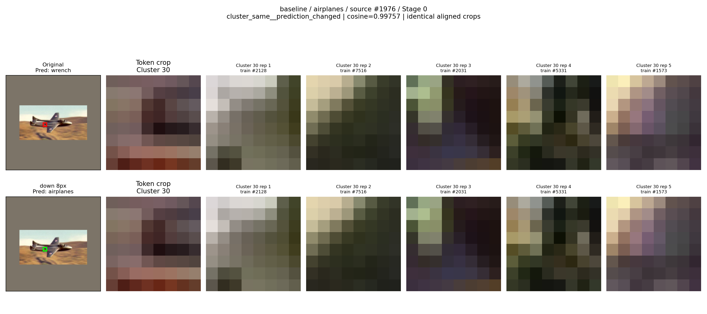

### baseline / airplanes / Stage 0 / cluster_changed__prediction_same

Source 2543, right 8px; cosine=0.99702; cluster 3→19; prediction airplanes→airplanes

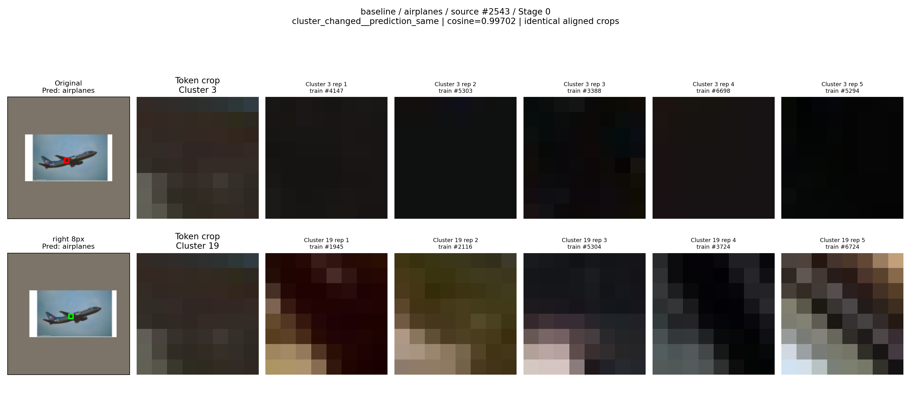

### baseline / airplanes / Stage 0 / cluster_same__prediction_same

Source 1995, right 8px; cosine=0.99806; cluster 11→11; prediction airplanes→airplanes

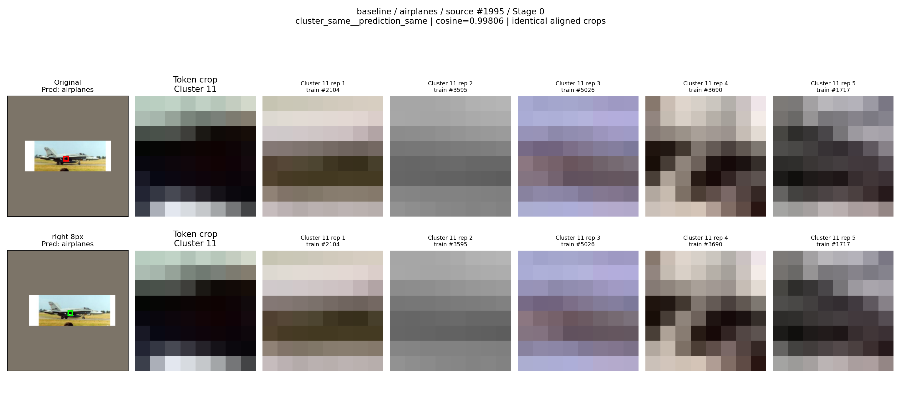

### baseline / airplanes / Stage 1 / cluster_changed__prediction_changed

Source 2123, down 16px; cosine=0.98187; cluster 0→29; prediction airplanes→pyramid

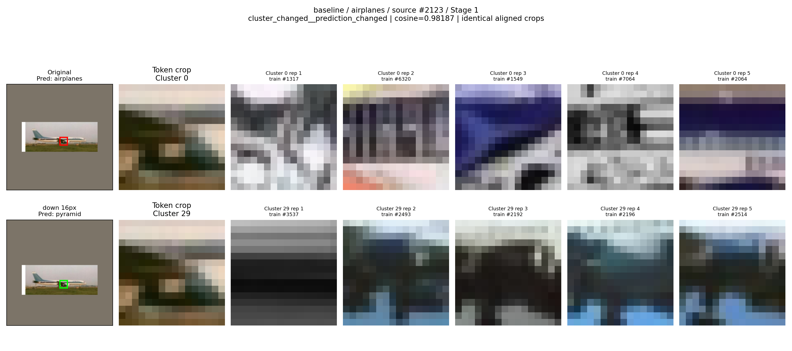

### baseline / airplanes / Stage 1 / cluster_same__prediction_changed

Source 2333, down 16px; cosine=0.98687; cluster 29→29; prediction airplanes→ferry

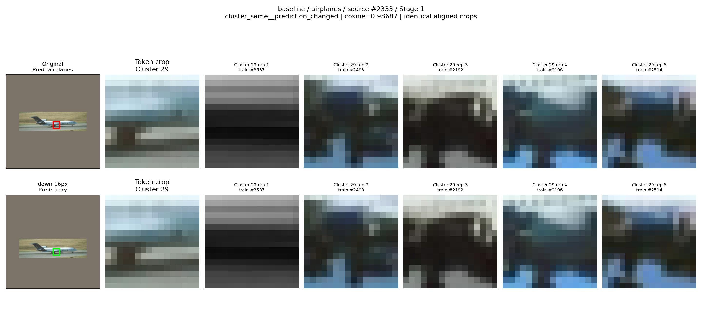

### baseline / airplanes / Stage 1 / cluster_changed__prediction_same

Source 2071, down 16px; cosine=0.98393; cluster 9→18; prediction airplanes→airplanes

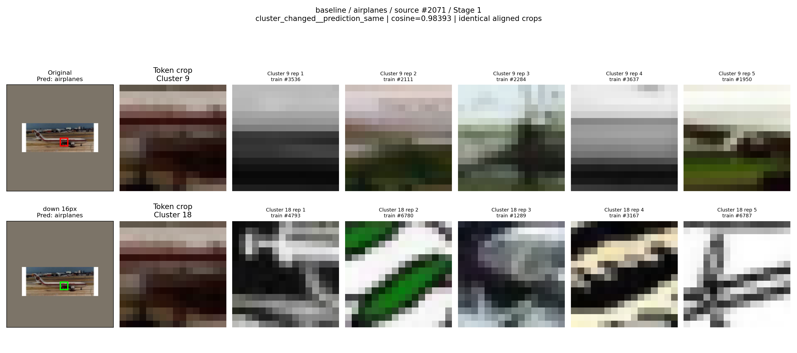

### baseline / airplanes / Stage 1 / cluster_same__prediction_same

Source 2002, down 16px; cosine=0.98952; cluster 22→22; prediction airplanes→airplanes

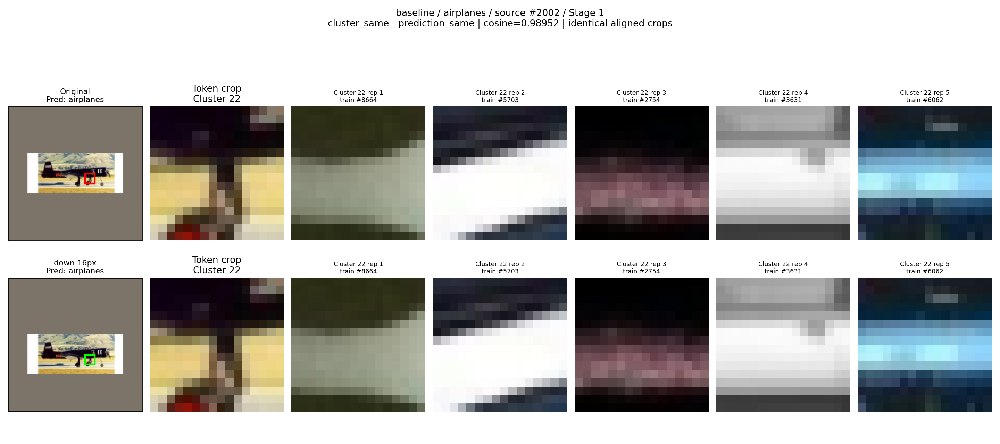

### baseline / airplanes / Stage 2 / cluster_changed__prediction_changed

Source 2046, up 32px; cosine=0.97471; cluster 2→6; prediction airplanes→ceiling_fan

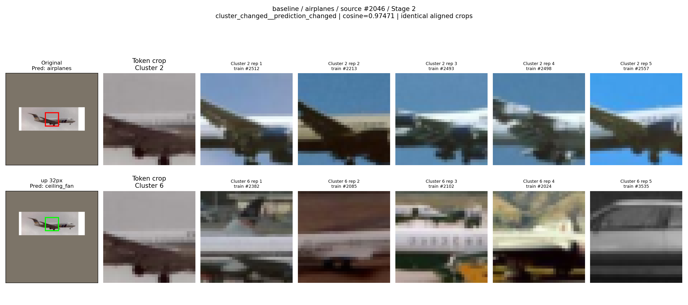

### baseline / airplanes / Stage 2 / cluster_same__prediction_changed

Source 2565, up 32px; cosine=0.98282; cluster 6→6; prediction airplanes→Motorbikes

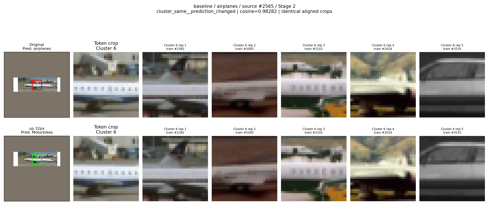

### baseline / airplanes / Stage 2 / cluster_changed__prediction_same

Source 2431, left 32px; cosine=0.97784; cluster 6→21; prediction airplanes→airplanes

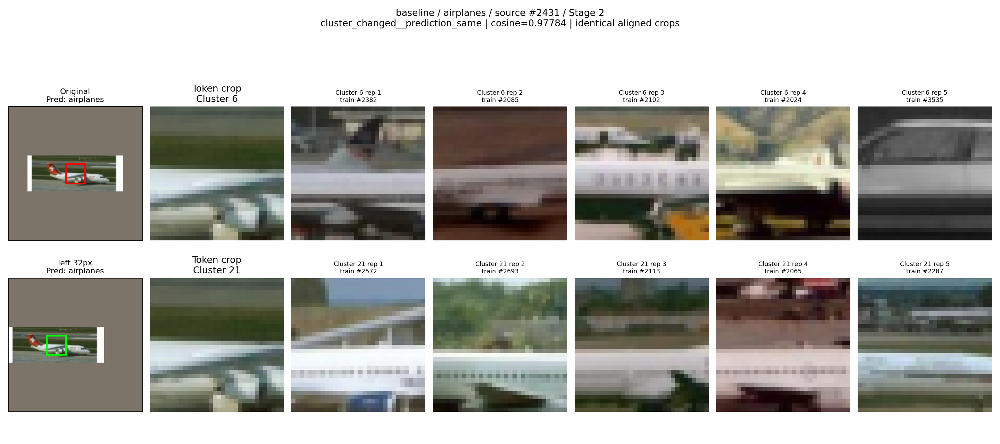

### baseline / airplanes / Stage 2 / cluster_same__prediction_same

Source 2149, left 32px; cosine=0.98150; cluster 6→6; prediction airplanes→airplanes

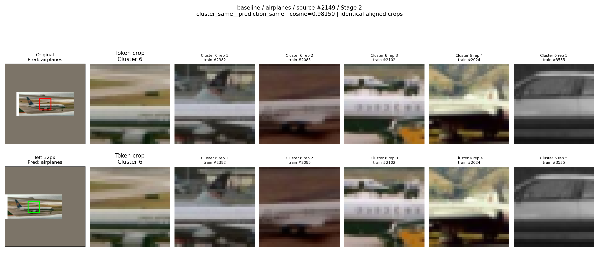

### baseline / chandelier / Stage 0 / cluster_changed__prediction_changed

Source 3827, down 8px; cosine=0.99584; cluster 15→5; prediction saxophone→buddha

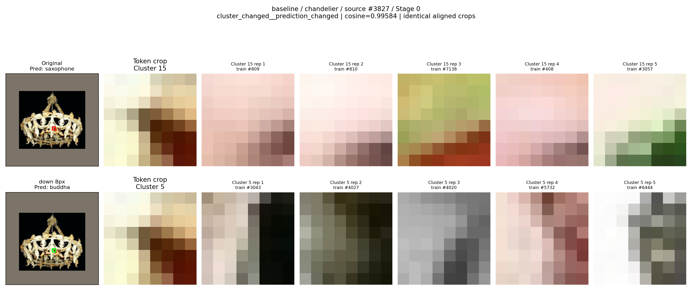

### baseline / chandelier / Stage 0 / cluster_same__prediction_changed

Source 3830, right 8px; cosine=0.99784; cluster 5→5; prediction chandelier→ketch

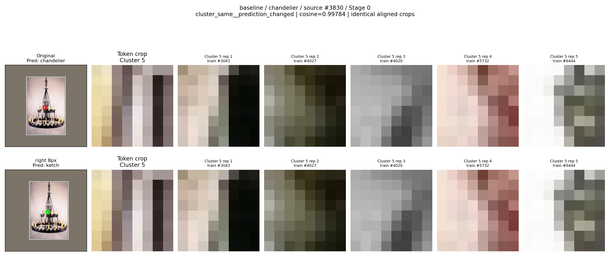

### baseline / chandelier / Stage 0 / cluster_changed__prediction_same

Source 3902, up 8px; cosine=0.99345; cluster 4→16; prediction platypus→platypus

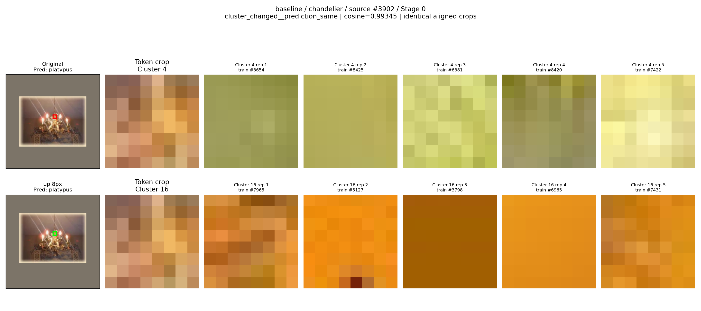

### baseline / chandelier / Stage 0 / cluster_same__prediction_same

Source 3918, right 8px; cosine=0.99796; cluster 10→10; prediction chandelier→chandelier

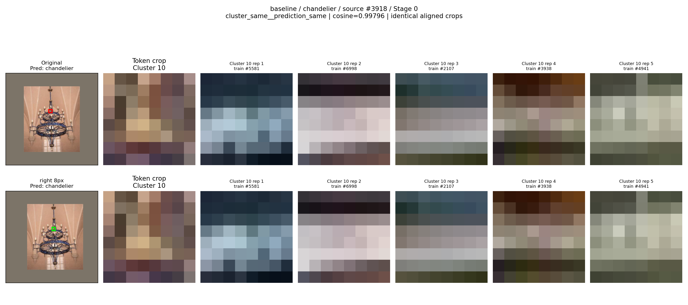

### baseline / chandelier / Stage 1 / cluster_changed__prediction_changed

Source 3875, left 16px; cosine=0.98173; cluster 3→21; prediction starfish→cup

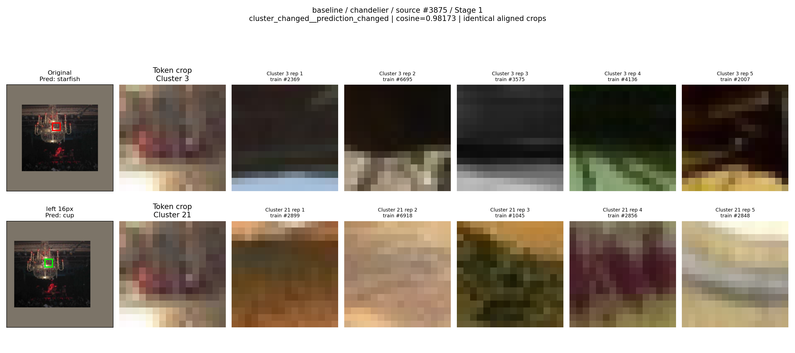

### baseline / chandelier / Stage 1 / cluster_same__prediction_changed

Source 3910, right 16px; cosine=0.98744; cluster 16→16; prediction chandelier→windsor_chair

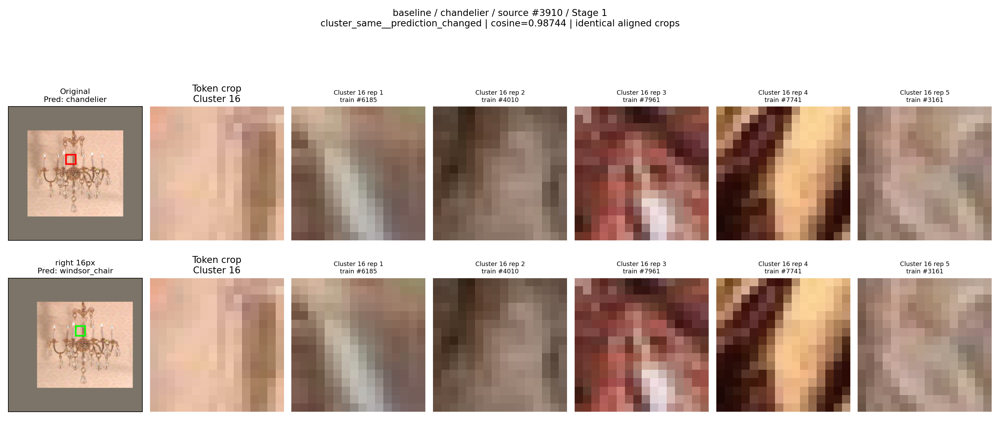

### baseline / chandelier / Stage 1 / cluster_changed__prediction_same

Source 3918, left 16px; cosine=0.97746; cluster 4→22; prediction chandelier→chandelier

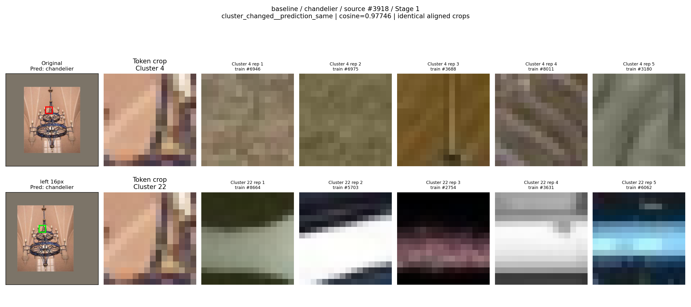

### baseline / chandelier / Stage 1 / cluster_same__prediction_same

Source 3921, right 16px; cosine=0.98633; cluster 28→28; prediction chandelier→chandelier

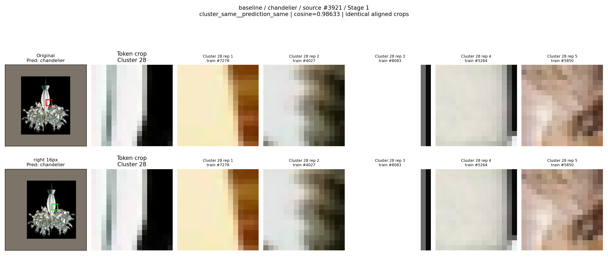

### baseline / chandelier / Stage 2 / cluster_changed__prediction_changed

Source 3830, left 32px; cosine=0.97559; cluster 26→16; prediction chandelier→scissors

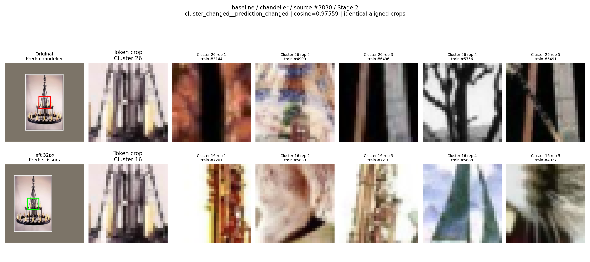

### baseline / chandelier / Stage 2 / cluster_same__prediction_changed

Source 3921, left 32px; cosine=0.97475; cluster 18→18; prediction chandelier→scissors

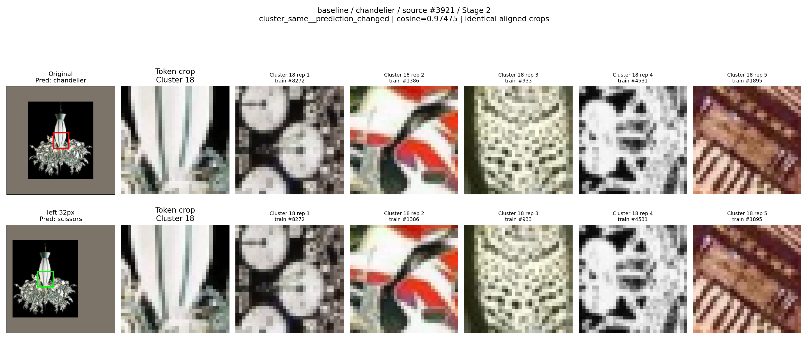

### baseline / chandelier / Stage 2 / cluster_same__prediction_same

Source 3827, right 32px; cosine=0.96194; cluster 28→28; prediction saxophone→saxophone

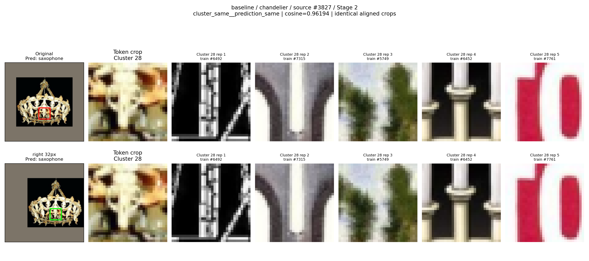

### baseline / brain / Stage 0 / cluster_changed__prediction_changed

Source 3189, down 8px; cosine=0.98613; cluster 7→8; prediction yin_yang→Faces_easy

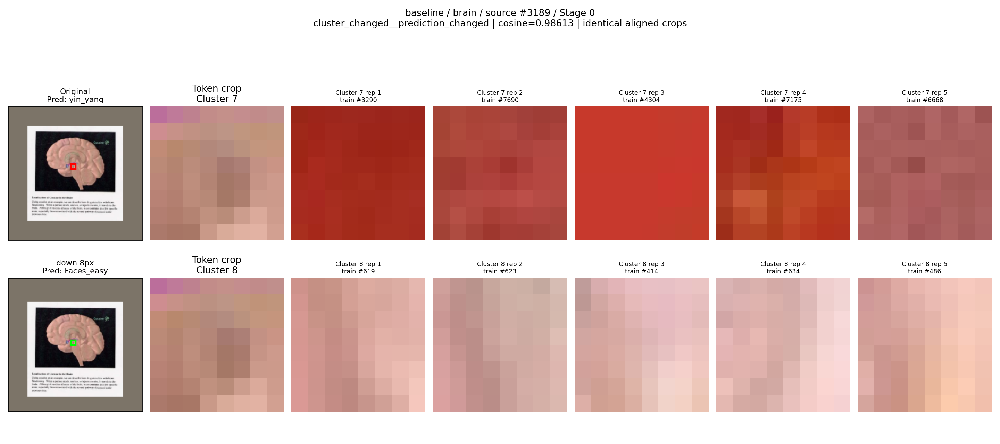

### baseline / brain / Stage 0 / cluster_same__prediction_changed

Source 3198, right 8px; cosine=0.99753; cluster 22→22; prediction crayfish→menorah

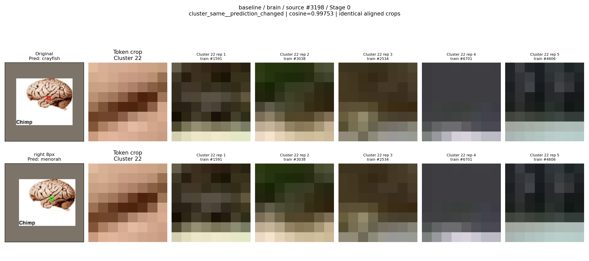

### baseline / brain / Stage 0 / cluster_changed__prediction_same

Source 3135, left 8px; cosine=0.99706; cluster 2→17; prediction brain→brain

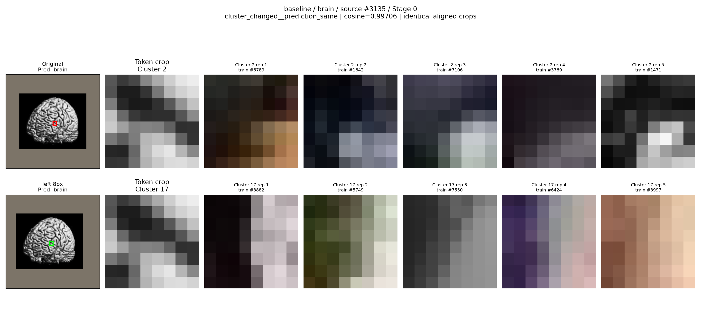

### baseline / brain / Stage 0 / cluster_same__prediction_same

Source 3128, right 8px; cosine=0.99788; cluster 10→10; prediction brain→brain

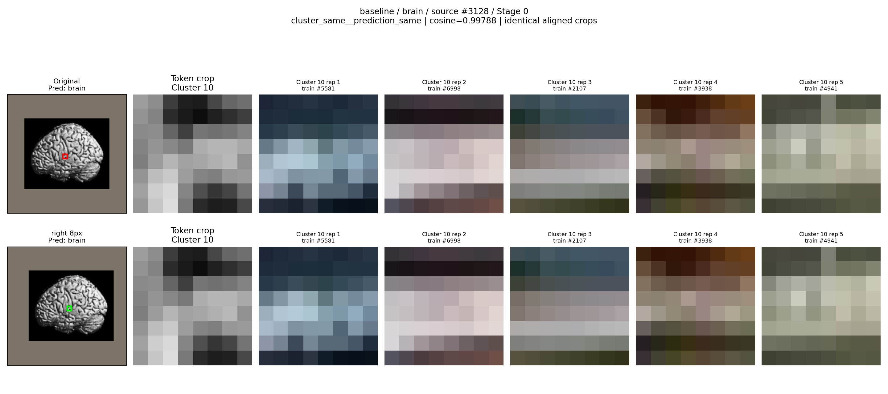

### baseline / brain / Stage 1 / cluster_changed__prediction_changed

Source 3189, left 16px; cosine=0.97973; cluster 15→26; prediction yin_yang→headphone

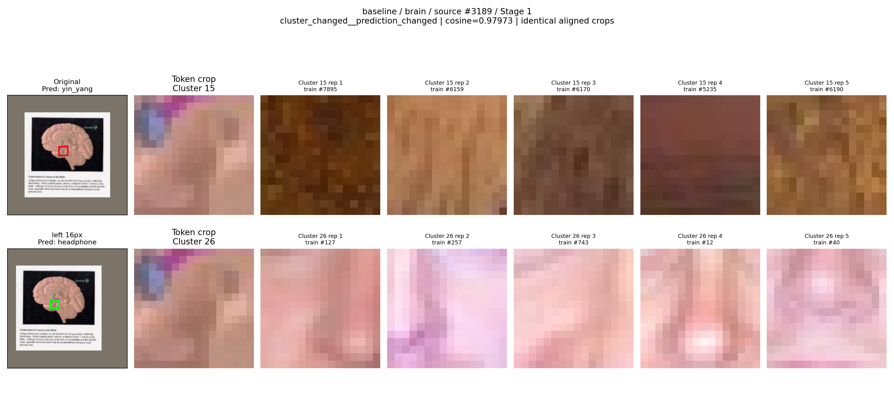

### baseline / brain / Stage 1 / cluster_same__prediction_changed

Source 3179, left 16px; cosine=0.98339; cluster 13→13; prediction cougar_face→panda

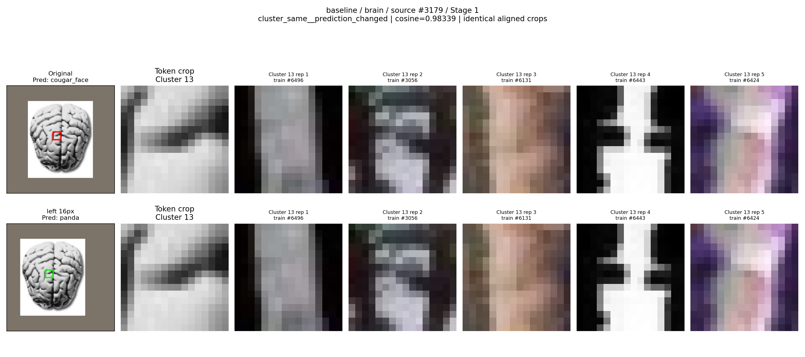

### baseline / brain / Stage 1 / cluster_changed__prediction_same

Source 3164, up 16px; cosine=0.97444; cluster 14→18; prediction brain→brain

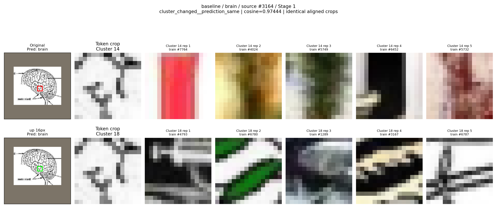

### baseline / brain / Stage 1 / cluster_same__prediction_same

Source 3130, left 16px; cosine=0.98369; cluster 9→9; prediction brain→brain

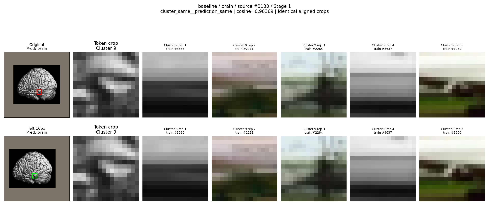

### baseline / brain / Stage 2 / cluster_changed__prediction_changed

Source 3135, right 32px; cosine=0.97123; cluster 23→5; prediction brain→euphonium

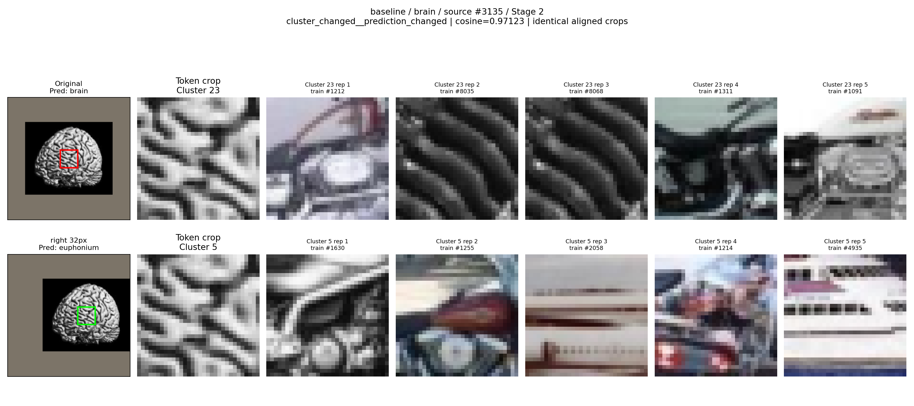

### baseline / brain / Stage 2 / cluster_same__prediction_changed

Source 3179, up 32px; cosine=0.97617; cluster 26→26; prediction cougar_face→Motorbikes

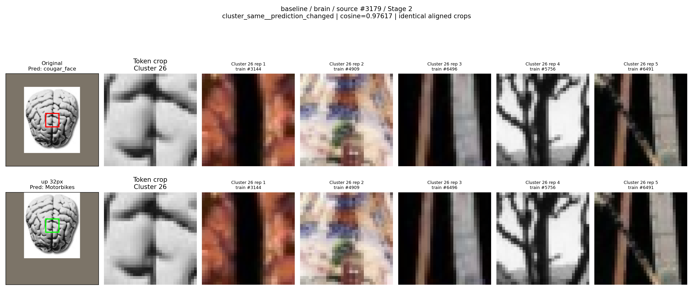

### baseline / brain / Stage 2 / cluster_changed__prediction_same

Source 3128, up 32px; cosine=0.96941; cluster 18→10; prediction brain→brain

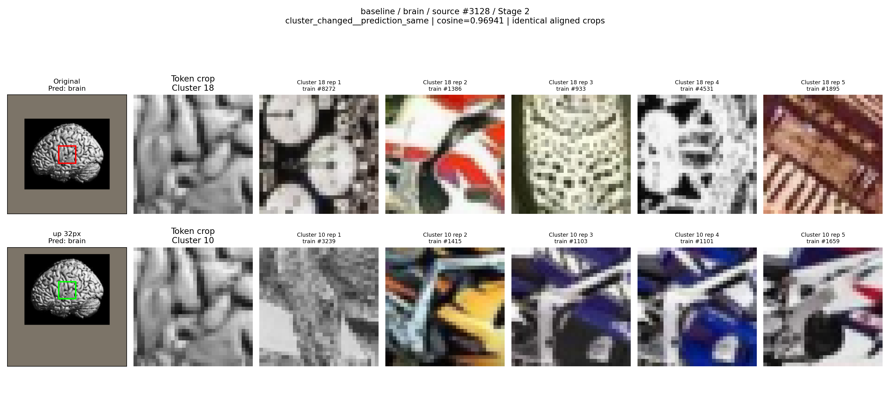

### baseline / brain / Stage 2 / cluster_same__prediction_same

Source 3131, up 32px; cosine=0.96551; cluster 5→5; prediction brain→brain

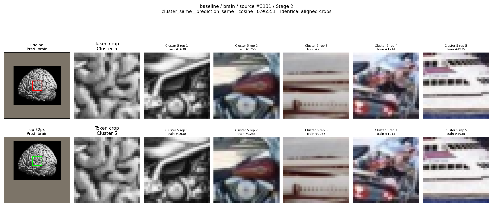

### augmented / airplanes / Stage 0 / cluster_same__prediction_changed

Source 2187, right 8px; cosine=0.99715; cluster 24→24; prediction wheelchair→bonsai

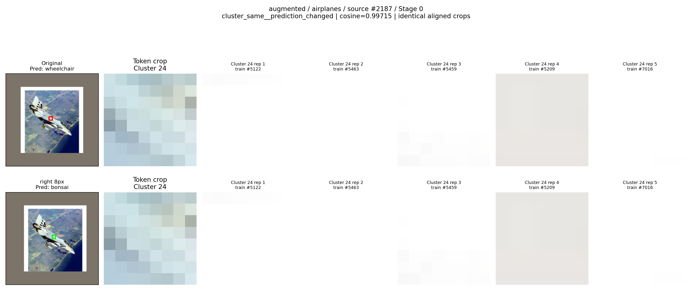

### augmented / airplanes / Stage 0 / cluster_changed__prediction_same

Source 2046, up 8px; cosine=0.99736; cluster 23→29; prediction airplanes→airplanes

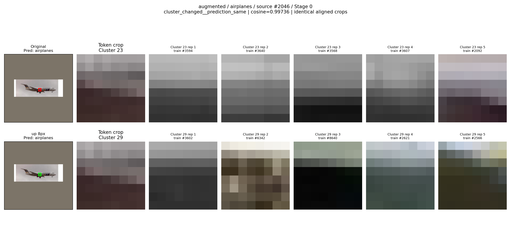

### augmented / airplanes / Stage 0 / cluster_same__prediction_same

Source 2444, right 8px; cosine=0.99832; cluster 14→14; prediction airplanes→airplanes

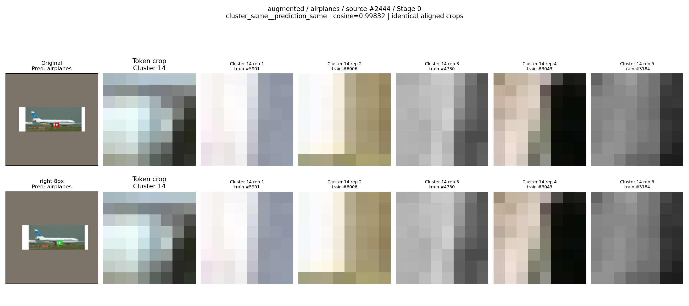

### augmented / airplanes / Stage 1 / cluster_changed__prediction_changed

Source 2014, right 16px; cosine=0.99321; cluster 2→22; prediction airplanes→mandolin

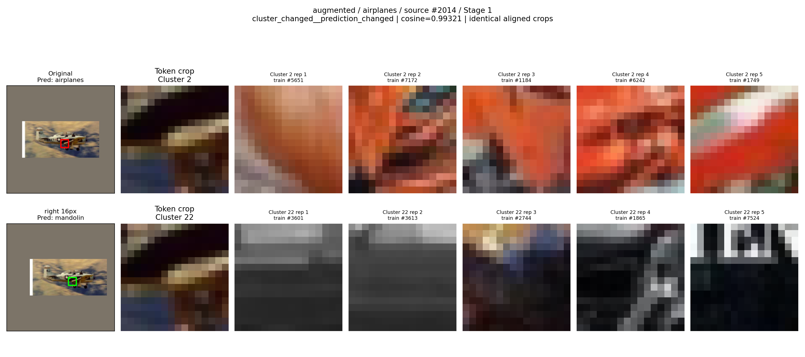

### augmented / airplanes / Stage 1 / cluster_same__prediction_changed

Source 1976, right 16px; cosine=0.99573; cluster 28→28; prediction helicopter→airplanes

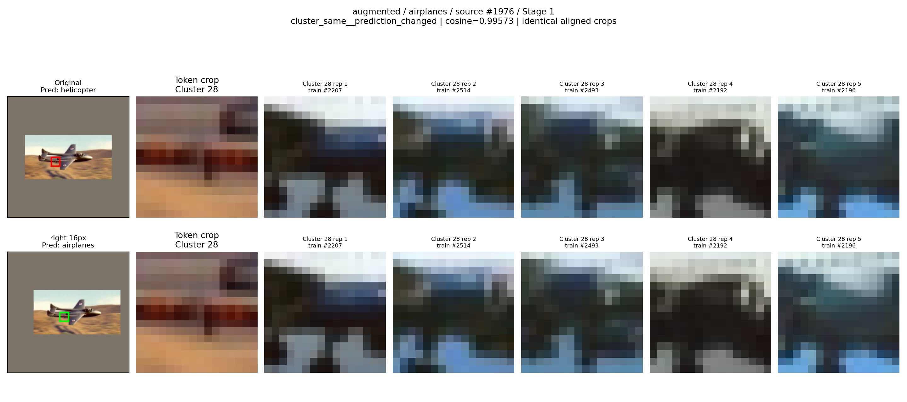

### augmented / airplanes / Stage 1 / cluster_changed__prediction_same

Source 2515, left 16px; cosine=0.99496; cluster 8→27; prediction airplanes→airplanes

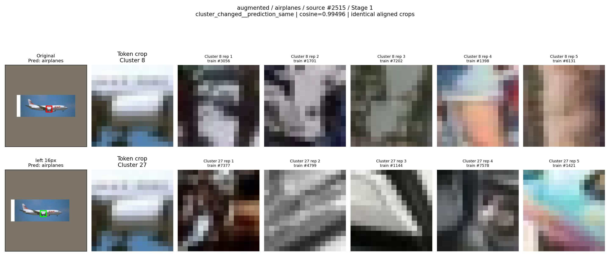

### augmented / airplanes / Stage 1 / cluster_same__prediction_same

Source 2093, left 16px; cosine=0.99674; cluster 28→28; prediction airplanes→airplanes

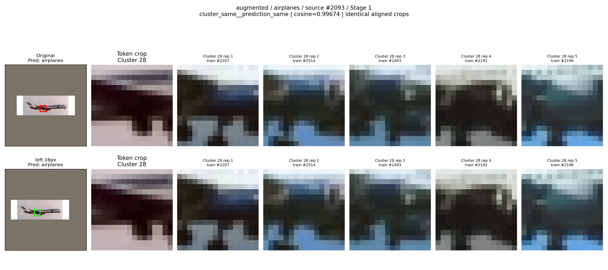

### augmented / airplanes / Stage 2 / cluster_same__prediction_changed

Source 1969, left 32px; cosine=0.98878; cluster 22→22; prediction airplanes→Motorbikes

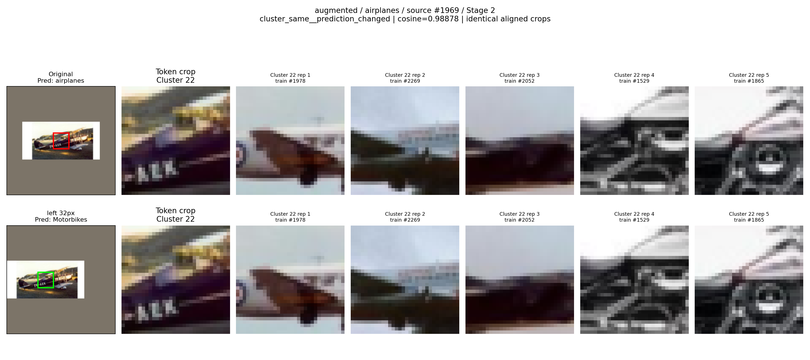

### augmented / airplanes / Stage 2 / cluster_changed__prediction_same

Source 2038, up 32px; cosine=0.99267; cluster 10→12; prediction airplanes→airplanes

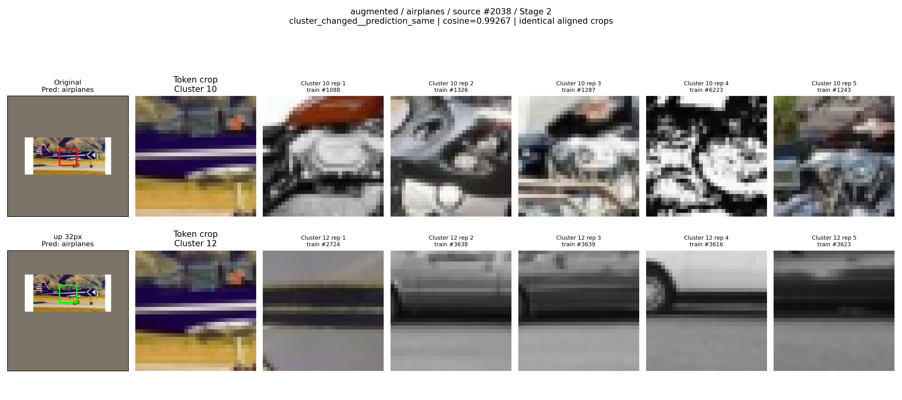

### augmented / airplanes / Stage 2 / cluster_same__prediction_same

Source 2431, right 32px; cosine=0.99306; cluster 4→4; prediction airplanes→airplanes

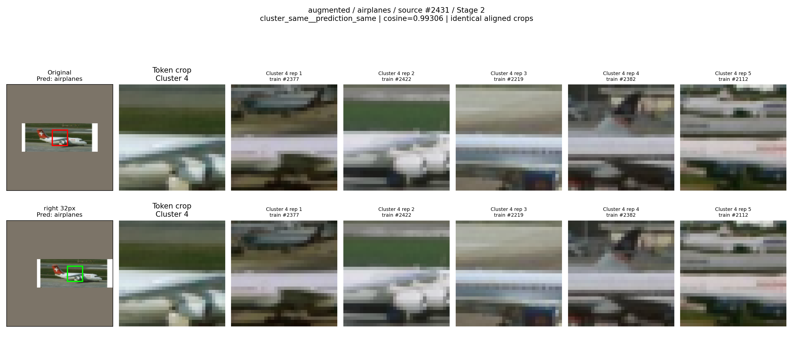

### augmented / chandelier / Stage 0 / cluster_changed__prediction_changed

Source 3911, left 8px; cosine=0.99619; cluster 26→25; prediction octopus→tick

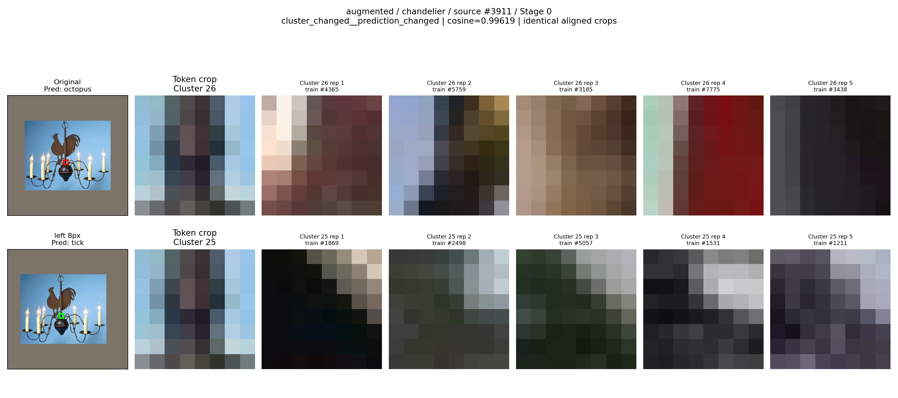

### augmented / chandelier / Stage 0 / cluster_same__prediction_changed

Source 3912, right 8px; cosine=0.99840; cluster 30→30; prediction inline_skate→chair

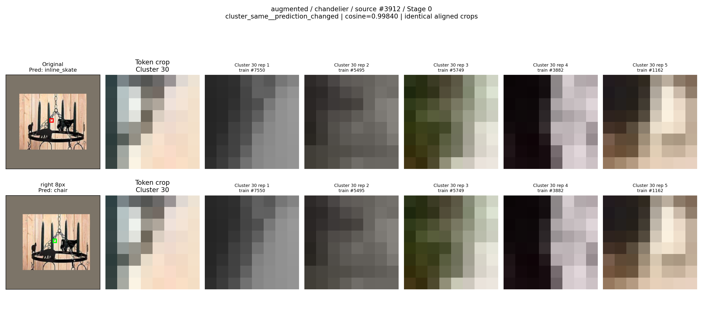

### augmented / chandelier / Stage 0 / cluster_changed__prediction_same

Source 3876, up 8px; cosine=0.99696; cluster 25→21; prediction chandelier→chandelier

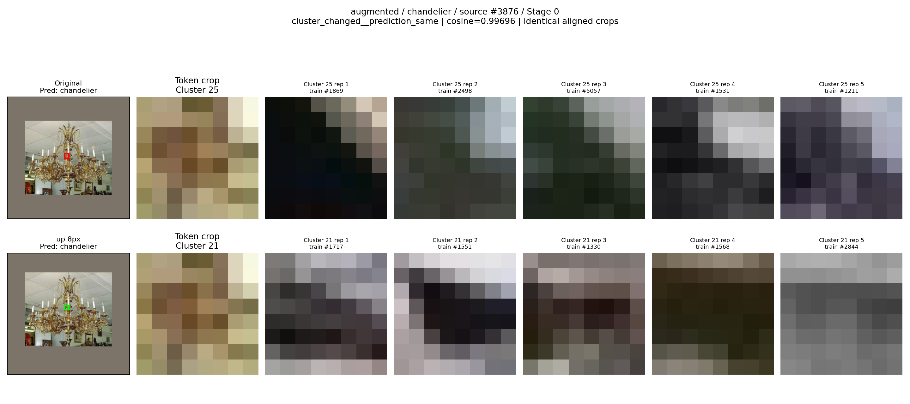

### augmented / chandelier / Stage 0 / cluster_same__prediction_same

Source 3921, left 8px; cosine=0.99834; cluster 18→18; prediction chandelier→chandelier

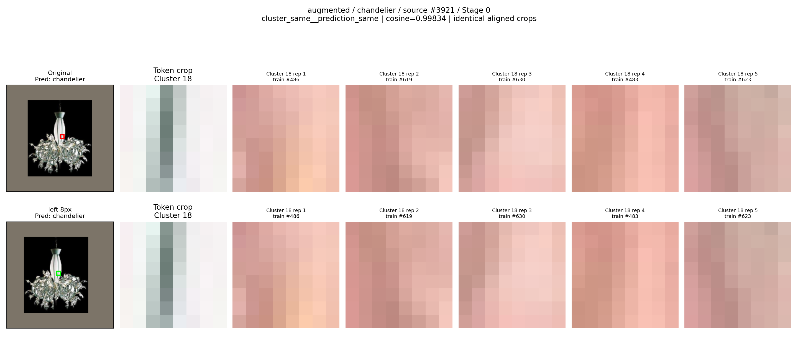

### augmented / chandelier / Stage 1 / cluster_changed__prediction_changed

Source 3916, left 16px; cosine=0.98196; cluster 11→30; prediction menorah→ewer

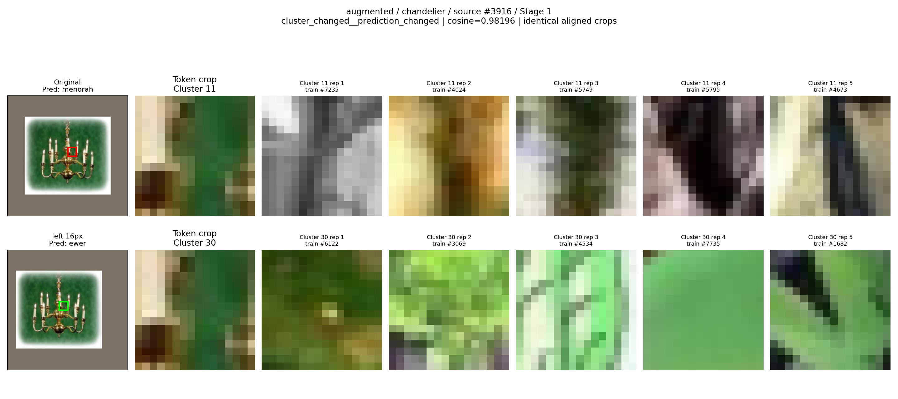

### augmented / chandelier / Stage 1 / cluster_same__prediction_changed

Source 3875, right 16px; cosine=0.99468; cluster 24→24; prediction crayfish→bonsai

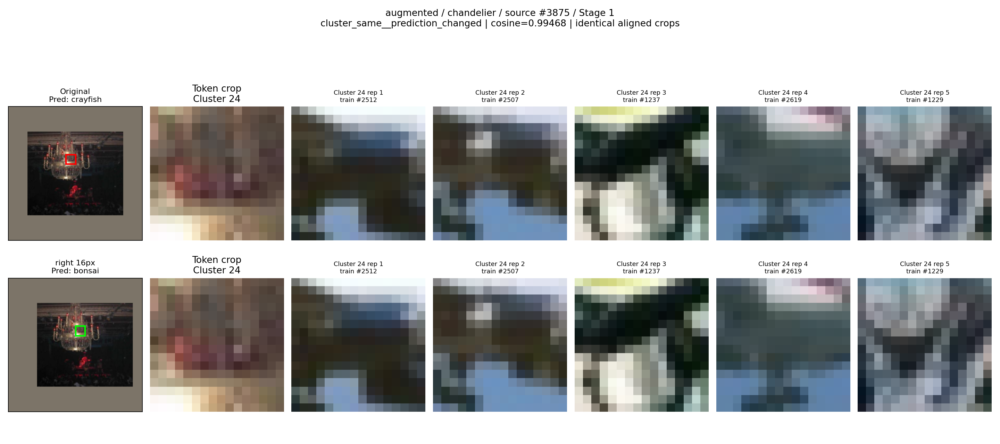

### augmented / chandelier / Stage 1 / cluster_changed__prediction_same

Source 3910, up 16px; cosine=0.99525; cluster 8→6; prediction chandelier→chandelier

### augmented / chandelier / Stage 1 / cluster_same__prediction_same

Source 3846, up 16px; cosine=0.99470; cluster 8→8; prediction chandelier→chandelier

### augmented / chandelier / Stage 2 / cluster_changed__prediction_changed

Source 3827, left 32px; cosine=0.98336; cluster 27→2; prediction chandelier→watch

### augmented / chandelier / Stage 2 / cluster_same__prediction_changed

Source 3854, right 32px; cosine=0.98656; cluster 17→17; prediction grand_piano→wheelchair

### augmented / chandelier / Stage 2 / cluster_changed__prediction_same

Source 3904, up 32px; cosine=0.98194; cluster 2→18; prediction chandelier→chandelier

### augmented / chandelier / Stage 2 / cluster_same__prediction_same

Source 3921, right 32px; cosine=0.99079; cluster 5→5; prediction chandelier→chandelier

### augmented / brain / Stage 0 / cluster_same__prediction_changed

Source 3198, up 8px; cosine=0.99808; cluster 27→27; prediction brain→pizza

### augmented / brain / Stage 0 / cluster_changed__prediction_same

Source 3135, up 8px; cosine=0.99648; cluster 30→22; prediction brain→brain

### augmented / brain / Stage 0 / cluster_same__prediction_same

Source 3179, up 8px; cosine=0.99803; cluster 26→26; prediction brain→brain

### augmented / brain / Stage 1 / cluster_same__prediction_changed

Source 3117, left 16px; cosine=0.99280; cluster 21→21; prediction dolphin→helicopter

### augmented / brain / Stage 1 / cluster_changed__prediction_same

Source 3128, left 16px; cosine=0.99047; cluster 27→6; prediction brain→brain

### augmented / brain / Stage 1 / cluster_same__prediction_same

Source 3211, left 16px; cosine=0.99456; cluster 21→21; prediction brain→brain

### augmented / brain / Stage 2 / cluster_changed__prediction_changed

Source 3179, up 32px; cosine=0.98002; cluster 2→18; prediction brain→menorah

### augmented / brain / Stage 2 / cluster_same__prediction_changed

Source 3198, up 32px; cosine=0.98864; cluster 27→27; prediction brain→ant

### augmented / brain / Stage 2 / cluster_changed__prediction_same

Source 3129, up 32px; cosine=0.98711; cluster 27→5; prediction brain→brain

### augmented / brain / Stage 2 / cluster_same__prediction_same

Source 3165, up 32px; cosine=0.99118; cluster 27→27; prediction car_side→car_side

