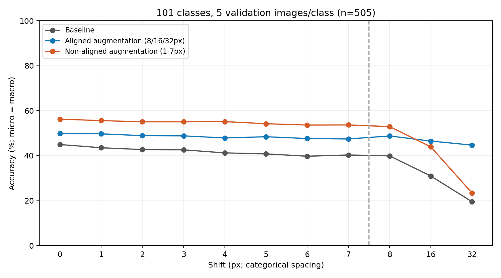
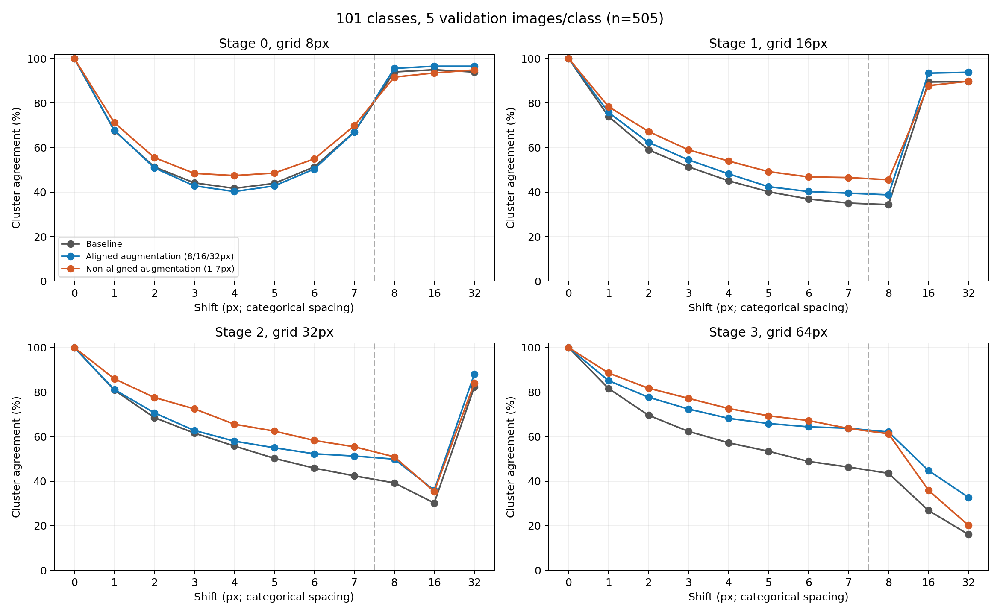
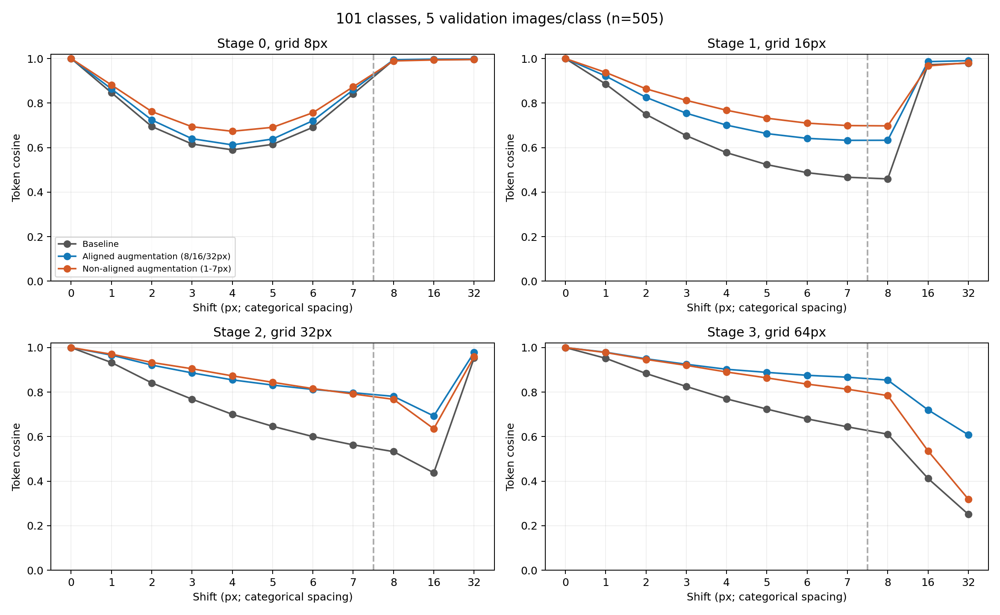

# Caltech-101 平移增強：分類與表徵穩定性三圖報告

## 評估設定

涵蓋101類，每類固定採樣5張validation影像，共505張；採樣seed42。三模型使用相同來源影像，測試原位與上下左右1–8、16、32px平移。各類樣本數相同，以下正確率為此平衡採樣的結果。

- **Baseline（灰）**：無新增平移增強。
- **對齊增強（藍）**：8／16／32px訓練增強。
- **非對齊增強（橘）**：1–7px訓練增強。

群一致率與cosine取修正annotation中心的對應token；四stage網格依序為8／16／32／64px。每模型、每stage沿用以未平移training特徵建立的固定spherical K-means字典（K=31）。圖片橫軸逐一列出已測位移，並非等比例距離；虛線區分1–7px與8／16／32px，後者只保證對齊初始8px網格。

## 圖一：分類正確率

| 模型 | 原位 | 非對齊1–7px平均 | 8／16／32px平均 |
|---|---|---|---|
| Baseline | 44.95% | 41.56% | 30.12% |
| A：8/16/32 增強 | 49.90% | 48.39% | 46.65% |
| T1：1–7 增強 | 56.24% | 54.62% | 40.07% |

非對齊增強模型在原位與小位移的正確率較高；對齊增強模型在16／32px下較穩定。非對齊增強的絕對正確率優勢也包含較高原位表現，不能全部歸因於平移穩健性。

## 圖二：群一致率

群一致率表示平移前後對應中心token仍分到同一群的比例。與Baseline相比，非對齊增強改善小位移下的群一致率；各stage達到自身網格對齊的位移時，一致率明顯回升。Stage3網格為64px，本輪所有非零位移均未對齊該層。

## 圖三：Cosine相似度

Cosine衡量平移前後中心token向量的方向相似度，不依賴群指派。非對齊增強提高小位移下的相似度；對齊增強對較大位移與Stage3較有利。Cosine與群一致率的模型排序不一定相同，兩者應並讀。

## 綜合判讀

對Stage0–2分別使用8／16／32px對齊測試時，對齊增強後的群一致率與cosine仍高於非對齊增強在1–7px平均的結果；非對齊組的表徵改善幅度則較大。兩組的起點、位移量與token涵蓋內容不同，這是各自條件下的比較，不能單獨證明alignment的因果效果或嚴格平移不變性。

本輪只有一個訓練seed，validation曾參與選模，且每類僅5張；結果不代表全部1,770張validation的分布加權正確率，也不足以對單一類別作強結論。完整數據、配對比較與不確定性見[詳細分析報告](REPORT.md)與[繪圖數據](plot_data.csv)。

