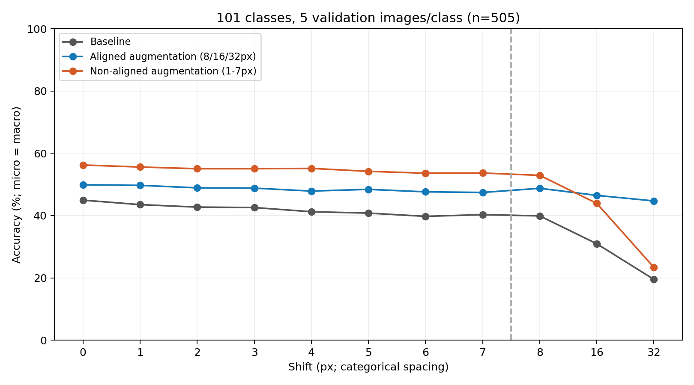
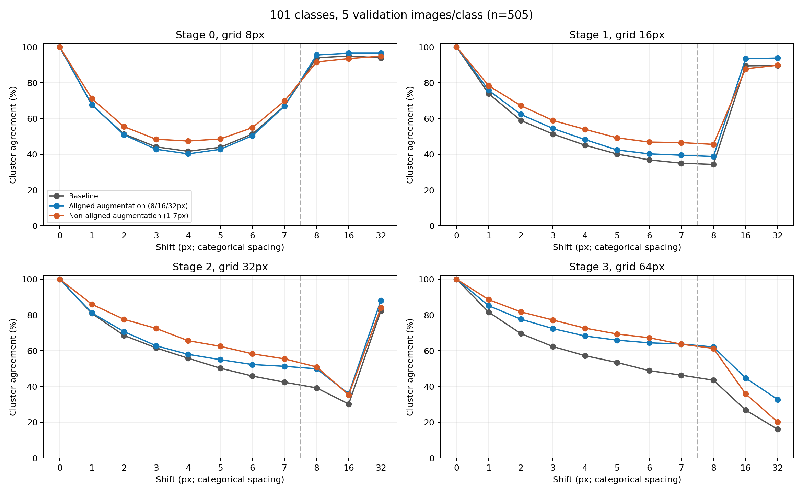
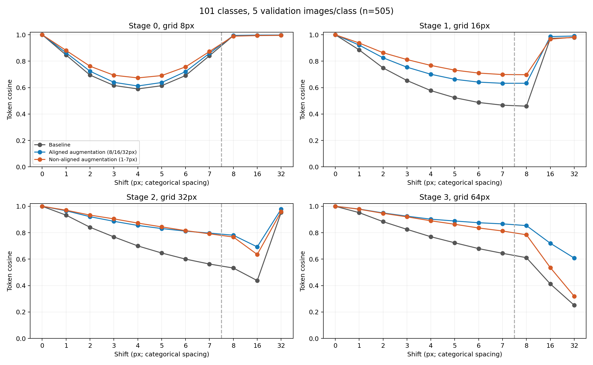

# Caltech-101 全類別分層採樣：平移分類與表徵穩定性

完成：2026-10-20T07:24:45.691178+00:00；執行位置：remote140165 `/home/ref/RGB_SFM_V3`。

## 主要發現

全類別平衡採樣下，T1在1–7px的accuracy最高（54.62%），A在8/16/32px最高（46.65%）。兩組各50%時A為47.52%、T1為47.34%，點估計相近；這不同於先前三類影像占比失衡的彙總，不應沿用原先的排名差距。未針對此混合分數差值另作顯著性判定。

每類5張使本輪原位accuracy接近類別等權的採樣估計，不能與全部1,770張、依原始類別數加權的62.09%/65.71%/68.36%直接比較或解讀為模型退化。

## 採樣與比較方式

涵蓋101類，每類從固定seed-42 validation split無放回抽5張，共505張；採樣seed42，三模型使用完全相同來源ID。來源清單、每類可用與採樣數見 `selection_manifest.json`。這是全類別涵蓋的平衡採樣，不是全部1,770張validation，也不是另設的untouched test。每類樣本很少，單類估計不穩定。

原位與四方向×1–8/16/32px；160-in-224，整數平移、無來源內容裁切、無平移插值；修正annotation offset後的中心token。沒有重新訓練。Baseline/A/T1分別為歷史無新增平移、8/16/32增強、完成版1–7增強（best epochs66/84/78）；不是epoch-10暫停模型。

沿用三類混合評估的同一組已驗證、固定training spherical codebooks。每模型各stage K31/niter100/nredo50/seed42；codebook由未平移全類別6,907張training中心token fitting，沒有用這505張重fit。不同模型cluster ID不對應；同模型跨位移字典固定。

每模型505×41=20,705個影像條件，四stage共82,820筆token配對；三模型合計248,460筆。各類樣本數相同，micro與macro在本採樣上相等；不代表原始資料分布的整體accuracy。Stage3網格64px沒有實際64px對齊測試。

## 總體分類結果

| 模型 | 原位 | 1–7px平均 | 8/16/32px平均 | 十個位移等權 | 兩組各50% |
|---|---|---|---|---|---|
| Baseline | 44.95% | 41.56% | 30.12% | 38.12% | 35.84% |
| A：8/16/32 增強 | 49.90% | 48.39% | 46.65% | 47.87% | 47.52% |
| T1：1–7 增強 | 56.24% | 54.62% | 40.07% | 50.25% | 47.34% |

十個非零位移各等權時，小位移組占70%、對齊初始patch組占30%；兩組各50%則先各自彙整再平均。所有位移都先對四方向等權。



## 群一致率



## Token cosine相似度



## 對應訓練→測試條件的增強前後比較

每列Baseline→對應增強模型；對齊測試依stage採8/16/32px，非對齊測試皆1–7px平均。分類來自完整模型輸出，不是各stage獨立probe；非對齊accuracy各stage相同。

### 群一致率

#### 對齊增強 → 對齊測試

| Stage | 測試位移 | 增強前 | 增強後 | 改善量 |
|---|---|---|---|---|
| 0 | 8 px | 93.96% | 95.54% | +1.58 pp |
| 1 | 16 px | 89.46% | 93.42% | +3.96 pp |
| 2 | 32 px | 82.23% | 88.02% | +5.79 pp |

#### 非對齊增強 → 非對齊測試

| Stage | 測試位移 | 增強前 | 增強後 | 改善量 |
|---|---|---|---|---|
| 0 | 1–7 px 平均 | 52.43% | 56.54% | +4.11 pp |
| 1 | 1–7 px 平均 | 48.77% | 57.30% | +8.53 pp |
| 2 | 1–7 px 平均 | 57.90% | 68.26% | +10.36 pp |

### 分類正確率

#### 對齊增強 → 對齊測試

| Stage | 測試位移 | 增強前 | 增強後 | 改善量 |
|---|---|---|---|---|
| 0 | 8 px | 39.90% | 48.76% | +8.86 pp |
| 1 | 16 px | 30.94% | 46.49% | +15.54 pp |
| 2 | 32 px | 19.50% | 44.70% | +25.20 pp |

#### 非對齊增強 → 非對齊測試

| Stage | 測試位移 | 增強前 | 增強後 | 改善量 |
|---|---|---|---|---|
| 0 | 1–7 px 平均 | 41.56% | 54.62% | +13.06 pp |
| 1 | 1–7 px 平均 | 41.56% | 54.62% | +13.06 pp |
| 2 | 1–7 px 平均 | 41.56% | 54.62% | +13.06 pp |

### Cosine相似度

#### 對齊增強 → 對齊測試

| Stage | 測試位移 | 增強前 | 增強後 | 改善量 |
|---|---|---|---|---|
| 0 | 8 px | 0.9924 | 0.9944 | +0.0020 |
| 1 | 16 px | 0.9720 | 0.9861 | +0.0141 |
| 2 | 32 px | 0.9530 | 0.9782 | +0.0253 |

#### 非對齊增強 → 非對齊測試

| Stage | 測試位移 | 增強前 | 增強後 | 改善量 |
|---|---|---|---|---|
| 0 | 1–7 px 平均 | 0.6991 | 0.7615 | +0.0624 |
| 1 | 1–7 px 平均 | 0.6203 | 0.7888 | +0.1685 |
| 2 | 1–7 px 平均 | 0.7217 | 0.8761 | +0.1543 |

## 逐位移文字表

### 分類accuracy

| 位移px | Baseline | A：8/16/32增強 | T1：1–7增強 |
|---|---|---|---|
| 0 | 44.95% | 49.90% | 56.24% |
| 1 | 43.51% | 49.70% | 55.59% |
| 2 | 42.72% | 48.91% | 55.05% |
| 3 | 42.57% | 48.81% | 55.05% |
| 4 | 41.24% | 47.87% | 55.15% |
| 5 | 40.79% | 48.42% | 54.21% |
| 6 | 39.75% | 47.62% | 53.61% |
| 7 | 40.30% | 47.43% | 53.66% |
| 8 | 39.90% | 48.76% | 52.92% |
| 16 | 30.94% | 46.49% | 43.91% |
| 32 | 19.50% | 44.70% | 23.37% |

### 群一致率：Stage 0

| 位移px | Baseline | A | T1 |
|---|---|---|---|
| 0 | 100.00% | 100.00% | 100.00% |
| 1 | 67.57% | 67.82% | 71.19% |
| 2 | 51.34% | 50.89% | 55.50% |
| 3 | 44.16% | 42.82% | 48.42% |
| 4 | 41.68% | 40.25% | 47.43% |
| 5 | 43.91% | 42.77% | 48.56% |
| 6 | 51.34% | 50.40% | 54.90% |
| 7 | 67.03% | 66.93% | 69.80% |
| 8 | 93.96% | 95.54% | 91.63% |
| 16 | 94.95% | 96.53% | 93.51% |
| 32 | 93.91% | 96.53% | 94.85% |

### 群一致率：Stage 1

| 位移px | Baseline | A | T1 |
|---|---|---|---|
| 0 | 100.00% | 100.00% | 100.00% |
| 1 | 73.91% | 75.74% | 78.37% |
| 2 | 58.96% | 62.33% | 67.23% |
| 3 | 51.34% | 54.46% | 58.96% |
| 4 | 45.10% | 48.22% | 53.96% |
| 5 | 40.15% | 42.43% | 49.21% |
| 6 | 36.88% | 40.25% | 46.83% |
| 7 | 35.05% | 39.50% | 46.53% |
| 8 | 34.36% | 38.76% | 45.54% |
| 16 | 89.46% | 93.42% | 87.82% |
| 32 | 89.65% | 93.81% | 89.80% |

### 群一致率：Stage 2

| 位移px | Baseline | A | T1 |
|---|---|---|---|
| 0 | 100.00% | 100.00% | 100.00% |
| 1 | 80.89% | 81.14% | 85.99% |
| 2 | 68.56% | 70.69% | 77.57% |
| 3 | 61.58% | 62.77% | 72.48% |
| 4 | 55.79% | 57.97% | 65.59% |
| 5 | 50.25% | 55.00% | 62.48% |
| 6 | 45.84% | 52.28% | 58.27% |
| 7 | 42.38% | 51.29% | 55.45% |
| 8 | 39.21% | 49.90% | 50.94% |
| 16 | 30.20% | 35.89% | 35.35% |
| 32 | 82.23% | 88.02% | 83.96% |

### 群一致率：Stage 3

| 位移px | Baseline | A | T1 |
|---|---|---|---|
| 0 | 100.00% | 100.00% | 100.00% |
| 1 | 81.58% | 85.15% | 88.56% |
| 2 | 69.60% | 77.67% | 81.73% |
| 3 | 62.33% | 72.38% | 77.18% |
| 4 | 57.23% | 68.22% | 72.62% |
| 5 | 53.42% | 65.89% | 69.36% |
| 6 | 48.86% | 64.41% | 67.23% |
| 7 | 46.34% | 63.76% | 63.66% |
| 8 | 43.51% | 62.08% | 61.29% |
| 16 | 26.83% | 44.75% | 35.89% |
| 32 | 16.04% | 32.72% | 20.15% |

### Cosine相似度：Stage 0

| 位移px | Baseline | A | T1 |
|---|---|---|---|
| 0 | 1.0000 | 1.0000 | 1.0000 |
| 1 | 0.8466 | 0.8636 | 0.8811 |
| 2 | 0.6948 | 0.7241 | 0.7619 |
| 3 | 0.6160 | 0.6399 | 0.6936 |
| 4 | 0.5899 | 0.6121 | 0.6733 |
| 5 | 0.6142 | 0.6384 | 0.6909 |
| 6 | 0.6911 | 0.7208 | 0.7566 |
| 7 | 0.8409 | 0.8592 | 0.8730 |
| 8 | 0.9924 | 0.9944 | 0.9893 |
| 16 | 0.9950 | 0.9971 | 0.9935 |
| 32 | 0.9957 | 0.9978 | 0.9955 |

### Cosine相似度：Stage 1

| 位移px | Baseline | A | T1 |
|---|---|---|---|
| 0 | 1.0000 | 1.0000 | 1.0000 |
| 1 | 0.8853 | 0.9214 | 0.9375 |
| 2 | 0.7490 | 0.8257 | 0.8639 |
| 3 | 0.6535 | 0.7543 | 0.8121 |
| 4 | 0.5771 | 0.7008 | 0.7677 |
| 5 | 0.5234 | 0.6628 | 0.7320 |
| 6 | 0.4872 | 0.6415 | 0.7098 |
| 7 | 0.4668 | 0.6325 | 0.6988 |
| 8 | 0.4593 | 0.6328 | 0.6975 |
| 16 | 0.9720 | 0.9861 | 0.9667 |
| 32 | 0.9791 | 0.9902 | 0.9810 |

### Cosine相似度：Stage 2

| 位移px | Baseline | A | T1 |
|---|---|---|---|
| 0 | 1.0000 | 1.0000 | 1.0000 |
| 1 | 0.9329 | 0.9661 | 0.9703 |
| 2 | 0.8414 | 0.9213 | 0.9333 |
| 3 | 0.7683 | 0.8863 | 0.9048 |
| 4 | 0.7001 | 0.8550 | 0.8729 |
| 5 | 0.6465 | 0.8315 | 0.8441 |
| 6 | 0.6002 | 0.8120 | 0.8157 |
| 7 | 0.5630 | 0.7971 | 0.7916 |
| 8 | 0.5327 | 0.7810 | 0.7675 |
| 16 | 0.4377 | 0.6927 | 0.6354 |
| 32 | 0.9530 | 0.9782 | 0.9590 |

### Cosine相似度：Stage 3

| 位移px | Baseline | A | T1 |
|---|---|---|---|
| 0 | 1.0000 | 1.0000 | 1.0000 |
| 1 | 0.9519 | 0.9791 | 0.9778 |
| 2 | 0.8837 | 0.9497 | 0.9468 |
| 3 | 0.8254 | 0.9251 | 0.9201 |
| 4 | 0.7695 | 0.9025 | 0.8903 |
| 5 | 0.7237 | 0.8886 | 0.8639 |
| 6 | 0.6797 | 0.8755 | 0.8359 |
| 7 | 0.6439 | 0.8669 | 0.8131 |
| 8 | 0.6111 | 0.8539 | 0.7843 |
| 16 | 0.4122 | 0.7202 | 0.5360 |
| 32 | 0.2511 | 0.6081 | 0.3191 |

## 配對差值與採樣不確定性

先於每張來源影像平均同組所有位移與方向，再比較模型；固定101類，每類內對5張來源影像有放回分層bootstrap，5,000次、seed42。這維持類別等權；區間不包含訓練seed、類別選擇、模型選模或其他採樣seed的不確定性。不是將平移重複視為獨立樣本；未做多重比較校正。

| 測試組 | 模型差值 | Accuracy差值pp | 95% CI pp |
|---|---|---|---|
| non_aligned_1_7 | A：8/16/32 增強 − Baseline | +6.84 | [+4.78, +8.88] |
| non_aligned_1_7 | T1：1–7 增強 − Baseline | +13.06 | [+10.77, +15.25] |
| non_aligned_1_7 | T1：1–7 增強 − A：8/16/32 增強 | +6.22 | [+4.08, +8.35] |
| patch_aligned_8_16_32 | A：8/16/32 增強 − Baseline | +16.53 | [+14.57, +18.52] |
| patch_aligned_8_16_32 | T1：1–7 增強 − Baseline | +9.95 | [+8.48, +11.44] |
| patch_aligned_8_16_32 | T1：1–7 增強 − A：8/16/32 增強 | -6.58 | [-8.28, -4.83] |

### 原位差異與平移退化應分開看

| 模型 | 原位accuracy | 1–7px相對原位變化 | 8/16/32px相對原位變化 |
|---|---|---|---|
| Baseline | 44.95% | -3.39 pp | -14.83 pp |
| A：8/16/32 增強 | 49.90% | -1.51 pp | -3.25 pp |
| T1：1–7 增強 | 56.24% | -1.62 pp | -16.17 pp |

T1的絕對accuracy改善同時包含較高原位表現，不能全部歸因於平移穩健性。平移相對原位的降幅與prediction consistency應一起閱讀；後者逐位移數字見plot_data.csv。

### 表徵改善的範圍

對Stage0–2各自對齊的8/16/32px，對齊增強後的群一致率與cosine仍高於非對齊增強在1–7px平均的值；非對齊組的絕對表徵增益則較大。這個起點與上限不同的比較應同時報告before/after，不能只以改善量或最終值判斷方法優劣。

同樣以1–7px測試時，Stage3的群一致率是T1 74.34%、A 71.07%；cosine則是T1 0.8925、A 0.9125，兩指標排序不一致。這也顯示不能將某個stage或三類子集的排序概括為所有表徵指標。

## 分析與限制

小位移1–7px：T1的accuracy為54.62%，A為48.39%，Baseline為41.56%。較大8/16/32px組：A為46.65%、T1為40.07%。這些是本次全類別平衡採樣的結果，應與三類探索性結果分開讀。

在32px，Baseline/A/T1的accuracy分別為19.50%/44.70%/23.37%；Stage3 cosine分別為0.2511/0.6081/0.3191。分類與局部中心token穩定性是不同測量，不應互相取代。

8px只對齊Stage0，16px對齊Stage0/1，32px對齊Stage0/1/2；所有本輪非零位移對Stage3均不對齊。對齊與非對齊組的位移量不同，不能宣稱單獨證明alignment的因果效果；非對齊token的內容涵蓋也會改變。高群一致率可能受分群集中程度影響，群數、熵與最大群占比見group_summary.csv；不能只用群一致率證明語意品質或嚴格平移不變性。

單一training seed、validation已參與選模；101類涵蓋改善了類別覆蓋，但每類5張仍不足以對單類作強結論。每類分類變好／不變／變差的數量見下表，該數量同樣受小樣本波動影響。

| 組別 | 模型差值 | 改善類數 | 相同類數 | 下降類數 |
|---|---|---|---|---|
| non_aligned_1_7 | A：8/16/32 增強 − Baseline | 76 | 3 | 22 |
| non_aligned_1_7 | T1：1–7 增強 − Baseline | 84 | 6 | 11 |
| non_aligned_1_7 | T1：1–7 增強 − A：8/16/32 增強 | 61 | 11 | 29 |
| patch_aligned_8_16_32 | A：8/16/32 增強 − Baseline | 85 | 5 | 11 |
| patch_aligned_8_16_32 | T1：1–7 增強 − Baseline | 84 | 2 | 15 |
| patch_aligned_8_16_32 | T1：1–7 增強 − A：8/16/32 增強 | 32 | 6 | 63 |

## 重現、校驗與產物

三模型確認來源ID與split相同、train/validation分離、資料位元組fingerprint一致、0px identity、完整筆數及唯一鍵、中心位移、centroid單位norm、codebook矩陣與上一輪逐值相同、artifact hashes。與原三類評估重疊的15張影像在全部位移下分類與群指派一致，cosine差異小於1e-5；詳見verification.json。

```bash
ALLCLASS_DEVICE=cuda:1 bash scripts/run_allclass_translation_1020.sh
.venv/bin/python scripts/analyze_allclass_translation.py
```

圖片：classification_comparison.png、cluster_agreement_comparison.png、token_cosine_comparison.png。文字：REPORT.md、REPORT.txt。數據：all_summary.csv（含每類）、plot_data.csv、group_summary.csv、direction_summary.csv、per_image_metrics.csv、paired_contrasts.csv、overall_accuracy.csv、matched_training_test_comparison.csv、category_effect_counts.csv；來源selection_manifest.json與逐檔analysis_manifest.json。

每模型raw paired CSV、feature caches與固定codebook留遠端，不納入Git；compact數據與報告可追蹤。本輪沒有將新產物複製／解壓到Windows/WSL本機專案。舊三類群一致率圖見 ../caltech_mixed_translation_1020/cluster_agreement_comparison.png。

