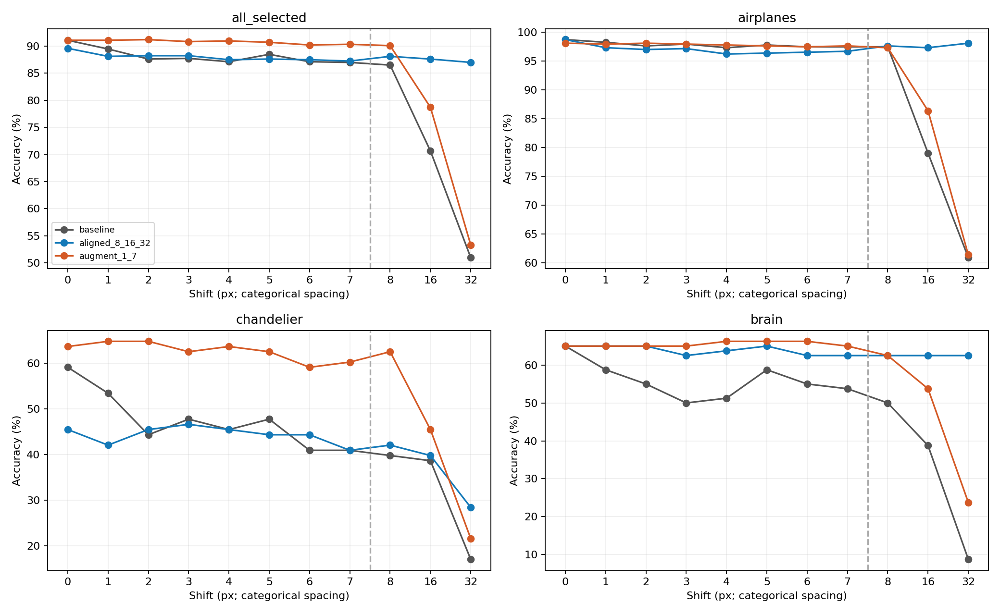
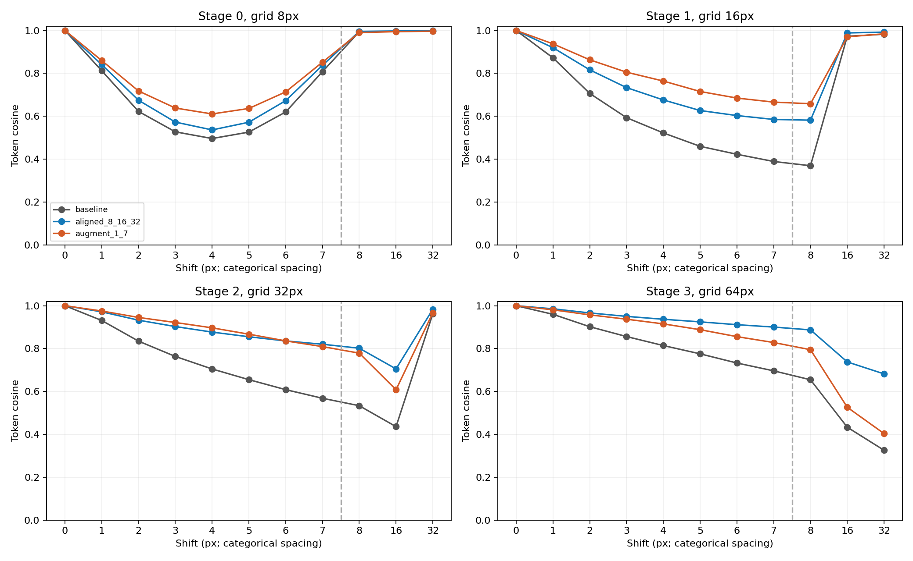
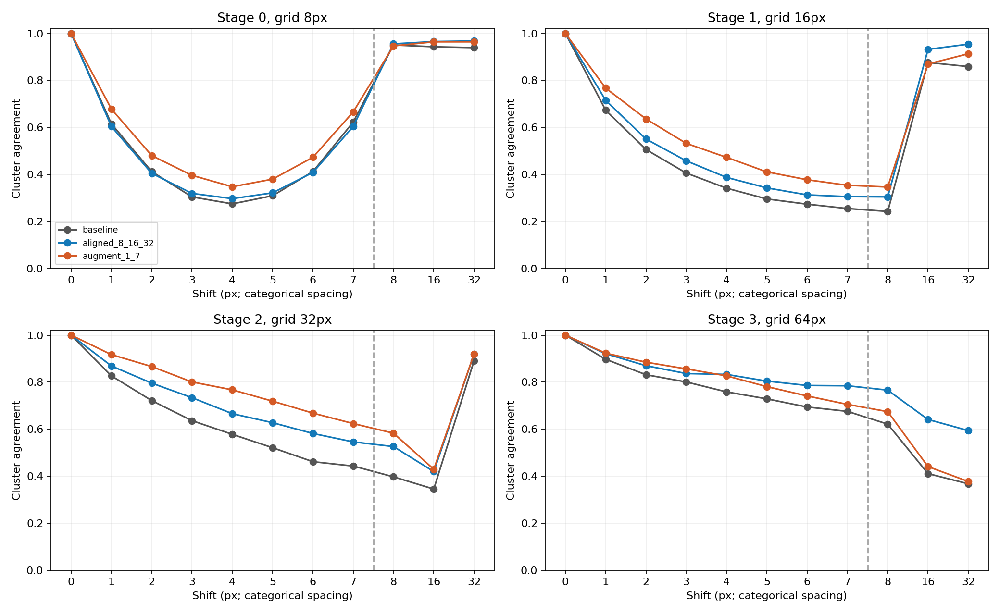

# Caltech-101 對齊／非對齊平移混合分析

更新：2026-10-20T07:04:18.250723+00:00。執行位置為遠端 remote140165：`/home/ref/RGB_SFM_V3`。

## 主要發現

T1 在非對齊 1–7 px 的三類合併 accuracy 為 90.77%，高於 Baseline 87.80% 與 A 87.78%；但對齊初始 patch 的 8/16/32 px 平均，A 為 87.58%，高於 T1 的 74.05%。兩組等權時 A 最佳。資料支持增強效果與訓練位移範圍有關，尚不支持小位移增強取代大位移增強。

## 問題與比較範圍

補齊三個既有 checkpoint 在原位、1–7 px 非對齊小位移、8／16／32 px 對齊初始 patch 位移的完整交叉評估。這裡「混合」指兩類測試條件的合併分析；沒有訓練同時混合兩種位移的新模型。原 epoch-10 暫停模型不納入完成模型比較。

## 模型、資料與統一方法

三模型使用 seed-42 split：training 6,907、validation 1,770；分析固定 validation airplanes 160／chandelier 22／brain 20，共 202 張。三模型本輪全部在同一遠端環境重新推論與 fitting，沒有直接拼接歷史 Euclidean 群指派。T1 從本機共享 inbox 下載至遠端並核對 SHA256，不代表本機專案已更新。

| 模型 | 訓練平移 | 最佳 epoch | 原位全類別 validation accuracy | checkpoint SHA256 |
|---|---|---|---|---|
| Baseline | 無新增平移 | 66 | 62.09% | `3cf8ab1056dfb025aa63c349e4d06e3ef49e519418fceb7798f49af1be39daca` |
| A：8/16/32 增強 | 原位或四方向 × 8/16/32 px | 84 | 65.71% | `c7fe1d1125494c7cc7459cf1324419673d94977d2f141a3d88faa63372239a63` |
| T1：1–7 增強 | 原位或四方向 × 1–7 px | 78 | 68.36% | `88bba79f9f6357c58e592272657b505def602acb10a98914902e2eeab09bc889` |

160-in-224；完整影像整數平移，最大 32 px，不做平移插值或裁切來源影像。使用修正 annotation bbox offset 後的輪廓點平均中心，取各 stage 對應中心 token。每模型、每 stage 只用未平移全類別 training fitting 一個固定 codebook：FAISS spherical K-means，K=31、niter=100、nredo=50、seed=42。L2-normalized features、每輪 centroid 正規化；margin 為 top-1 減 top-2 cosine。不同模型 cluster ID 不對應。

每模型 202 × (1 + 4×10) = 8,282 個影像條件；四 stage 共 33,128 筆配對。三模型合計 99,384 筆 token 配對。沒有執行實際 64 px 位移。

| 位移 | Stage 0：8 px | Stage 1：16 px | Stage 2：32 px | Stage 3：64 px |
|---|---|---|---|---|
| 1–7 px | 不對齊 | 不對齊 | 不對齊 | 不對齊 |
| 8 px | 對齊 | 不對齊 | 不對齊 | 不對齊 |
| 16 px | 對齊 | 對齊 | 不對齊 | 不對齊 |
| 32 px | 對齊 | 對齊 | 對齊 | 不對齊 |

## 配對比較：對齊增強→對齊測試／非對齊增強→非對齊測試

各列為相同測試條件下 Baseline → 對應增強模型，括號為增強減Baseline。對齊列依stage選8/16/32 px；非對齊列固定1–7 px平均。統一三類202張影像、四方向平均與spherical codebooks。分類accuracy來自完整模型輸出，不是該stage的分類probe；非對齊列重複的accuracy是同一結果。

### 群一致率

| Stage | 訓練→測試條件 | 增強前 | 增強後 | 改善量 |
|---|---|---|---|---|
| 0 | 對齊增強 → 對齊 8 px | 95.05% | 95.54% | +0.50 pp |
| 0 | 非對齊增強 → 非對齊 1–7 px 平均 | 42.15% | 48.87% | +6.72 pp |
| 1 | 對齊增強 → 對齊 16 px | 87.62% | 93.19% | +5.57 pp |
| 1 | 非對齊增強 → 非對齊 1–7 px 平均 | 39.30% | 50.72% | +11.42 pp |
| 2 | 對齊增強 → 對齊 32 px | 89.11% | 91.96% | +2.85 pp |
| 2 | 非對齊增強 → 非對齊 1–7 px 平均 | 59.83% | 76.61% | +16.78 pp |

### 分類正確率

| Stage | 訓練→測試條件 | 增強前 | 增強後 | 改善量 |
|---|---|---|---|---|
| 0 | 對齊增強 → 對齊 8 px | 86.51% | 88.12% | +1.61 pp |
| 0 | 非對齊增強 → 非對齊 1–7 px 平均 | 87.80% | 90.77% | +2.97 pp |
| 1 | 對齊增強 → 對齊 16 px | 70.67% | 87.62% | +16.96 pp |
| 1 | 非對齊增強 → 非對齊 1–7 px 平均 | 87.80% | 90.77% | +2.97 pp |
| 2 | 對齊增強 → 對齊 32 px | 50.99% | 87.00% | +36.01 pp |
| 2 | 非對齊增強 → 非對齊 1–7 px 平均 | 87.80% | 90.77% | +2.97 pp |

### Token cosine 相似度

| Stage | 訓練→測試條件 | 增強前 | 增強後 | 改善量 |
|---|---|---|---|---|
| 0 | 對齊增強 → 對齊 8 px | 0.9940 | 0.9956 | +0.0016 |
| 0 | 非對齊增強 → 非對齊 1–7 px 平均 | 0.6303 | 0.7184 | +0.0881 |
| 1 | 對齊增強 → 對齊 16 px | 0.9729 | 0.9884 | +0.0155 |
| 1 | 非對齊增強 → 非對齊 1–7 px 平均 | 0.5665 | 0.7766 | +0.2102 |
| 2 | 對齊增強 → 對齊 32 px | 0.9628 | 0.9836 | +0.0208 |
| 2 | 非對齊增強 → 非對齊 1–7 px 平均 | 0.7237 | 0.8931 | +0.1693 |

在Stage 0–2，非對齊增強的群一致率與cosine絕對增益較大，但增強後的表徵穩定程度仍低於對齊增強在相應stage對齊測試下的結果。分類改善量則依位移量而異：對齊16/32 px的增益明顯大於非對齊1–7 px平均。兩類條件的起點、位移量與token涵蓋內容不同，不能將增益大小直接解讀為訓練方法的因果優劣。Stage 3沒有64 px對齊測試，故不納入此表。

## 三類合併分類結果

各方向等權；兩組各自對位移量等權。合併 accuracy 依影像數加權，飛機占 160/202；macro accuracy 為三類 accuracy 等權，避免只看飛機主導的合併值。

### 非對齊：1–7 px 平均

| 模型 | 原位 accuracy | 平移 accuracy | 三類 macro accuracy | 預測一致率 | 相對原位變化 |
|---|---|---|---|---|---|
| Baseline | 91.09% | 87.80% | 66.05% | 89.02% | -3.29 pp |
| A：8/16/32 增強 | 89.60% | 87.78% | 68.23% | 93.32% | -1.82 pp |
| T1：1–7 增強 | 91.09% | 90.77% | 75.28% | 97.35% | -0.32 pp |

### 對齊初始 patch：8／16／32 px 平均

| 模型 | 原位 accuracy | 平移 accuracy | 三類 macro accuracy | 預測一致率 | 相對原位變化 |
|---|---|---|---|---|---|
| Baseline | 91.09% | 69.39% | 47.83% | 69.27% | -21.70 pp |
| A：8/16/32 增強 | 89.60% | 87.58% | 65.65% | 92.82% | -2.02 pp |
| T1：1–7 增強 | 91.09% | 74.05% | 57.19% | 76.69% | -17.04 pp |

### 兩組等權的混合分數

先分別計算非對齊與對齊組平均，再各給 50% 權重；此權重是分析約定，不代表真實使用時的位移分布。不可把十個位移直接平均後當成兩組等權。

| 模型 | 混合 accuracy | 混合預測一致率 |
|---|---|---|
| Baseline | 78.60% | 79.14% |
| A：8/16/32 增強 | 87.68% | 93.07% |
| T1：1–7 增強 | 82.41% | 87.02% |

## Overall accuracy：所有已測條件合併

以下仍是固定三類202張影像，非101類平移結果。十個非零位移量（1–8/16/32）及四方向等權，共每模型8,080個平移條件；非對齊組因此占70%、對齊組占30%。另列兩組各50%的分數；含原位欄則每張影像的原位與40個平移條件各占1/41。這些是同來源影像的重複測量，不是8,080張獨立影像。

| 模型 | 原位 | 所有平移等權 | 兩組各50% | 原位+40平移條件等權 |
|---|---|---|---|---|
| Baseline | 91.09% | 82.28% | 78.60% | 82.49% |
| A：8/16/32 增強 | 89.60% | 87.72% | 87.68% | 87.77% |
| T1：1–7 增強 | 91.09% | 85.75% | 82.41% | 85.89% |

## 完整逐位移分類表

### all_selected

| 位移 px | B accuracy | B 一致率 | A accuracy | A 一致率 | T1 accuracy | T1 一致率 |
|---|---|---|---|---|---|---|
| 0 | 91.09% | 100.00% | 89.60% | 100.00% | 91.09% | 100.00% |
| 1 | 89.48% | 93.69% | 88.12% | 95.54% | 91.09% | 99.26% |
| 2 | 87.62% | 89.60% | 88.24% | 95.05% | 91.21% | 98.89% |
| 3 | 87.75% | 88.99% | 88.24% | 93.81% | 90.84% | 98.27% |
| 4 | 87.13% | 87.00% | 87.50% | 92.45% | 90.97% | 97.03% |
| 5 | 88.49% | 88.61% | 87.62% | 92.20% | 90.72% | 96.41% |
| 6 | 87.13% | 87.75% | 87.50% | 91.83% | 90.22% | 95.79% |
| 7 | 87.00% | 87.50% | 87.25% | 92.33% | 90.35% | 95.79% |
| 8 | 86.51% | 86.88% | 88.12% | 92.70% | 90.10% | 94.80% |
| 16 | 70.67% | 69.68% | 87.62% | 92.57% | 78.71% | 80.94% |
| 32 | 50.99% | 51.24% | 87.00% | 93.19% | 53.34% | 54.33% |

### airplanes

| 位移 px | B accuracy | B 一致率 | A accuracy | A 一致率 | T1 accuracy | T1 一致率 |
|---|---|---|---|---|---|---|
| 0 | 98.75% | 100.00% | 98.75% | 100.00% | 98.12% | 100.00% |
| 1 | 98.28% | 98.59% | 97.34% | 98.12% | 97.97% | 99.53% |
| 2 | 97.66% | 97.81% | 97.03% | 97.81% | 98.12% | 99.22% |
| 3 | 97.97% | 97.81% | 97.19% | 97.97% | 97.97% | 99.22% |
| 4 | 97.34% | 97.03% | 96.25% | 96.88% | 97.81% | 99.06% |
| 5 | 97.81% | 97.50% | 96.41% | 97.03% | 97.66% | 98.91% |
| 6 | 97.50% | 97.34% | 96.56% | 97.03% | 97.50% | 98.75% |
| 7 | 97.50% | 97.34% | 96.72% | 97.34% | 97.66% | 98.91% |
| 8 | 97.50% | 97.19% | 97.66% | 98.28% | 97.34% | 98.59% |
| 16 | 79.06% | 79.06% | 97.34% | 97.66% | 86.41% | 86.88% |
| 32 | 60.94% | 60.94% | 98.12% | 99.06% | 61.41% | 61.88% |

### chandelier

| 位移 px | B accuracy | B 一致率 | A accuracy | A 一致率 | T1 accuracy | T1 一致率 |
|---|---|---|---|---|---|---|
| 0 | 59.09% | 100.00% | 45.45% | 100.00% | 63.64% | 100.00% |
| 1 | 53.41% | 70.45% | 42.05% | 81.82% | 64.77% | 96.59% |
| 2 | 44.32% | 47.73% | 45.45% | 80.68% | 64.77% | 97.73% |
| 3 | 47.73% | 47.73% | 46.59% | 76.14% | 62.50% | 95.45% |
| 4 | 45.45% | 43.18% | 45.45% | 69.32% | 63.64% | 87.50% |
| 5 | 47.73% | 48.86% | 44.32% | 65.91% | 62.50% | 86.36% |
| 6 | 40.91% | 42.05% | 44.32% | 64.77% | 59.09% | 82.95% |
| 7 | 40.91% | 42.05% | 40.91% | 65.91% | 60.23% | 82.95% |
| 8 | 39.77% | 40.91% | 42.05% | 65.91% | 62.50% | 77.27% |
| 16 | 38.64% | 25.00% | 39.77% | 62.50% | 45.45% | 53.41% |
| 32 | 17.05% | 14.77% | 28.41% | 55.68% | 21.59% | 25.00% |

### brain

| 位移 px | B accuracy | B 一致率 | A accuracy | A 一致率 | T1 accuracy | T1 一致率 |
|---|---|---|---|---|---|---|
| 0 | 65.00% | 100.00% | 65.00% | 100.00% | 65.00% | 100.00% |
| 1 | 58.75% | 80.00% | 65.00% | 90.00% | 65.00% | 100.00% |
| 2 | 55.00% | 70.00% | 65.00% | 88.75% | 65.00% | 97.50% |
| 3 | 50.00% | 63.75% | 62.50% | 80.00% | 65.00% | 93.75% |
| 4 | 51.25% | 55.00% | 63.75% | 82.50% | 66.25% | 91.25% |
| 5 | 58.75% | 61.25% | 65.00% | 82.50% | 66.25% | 87.50% |
| 6 | 55.00% | 61.25% | 62.50% | 80.00% | 66.25% | 86.25% |
| 7 | 53.75% | 58.75% | 62.50% | 81.25% | 65.00% | 85.00% |
| 8 | 50.00% | 55.00% | 62.50% | 77.50% | 62.50% | 83.75% |
| 16 | 38.75% | 43.75% | 62.50% | 85.00% | 53.75% | 63.75% |
| 32 | 8.75% | 13.75% | 62.50% | 87.50% | 23.75% | 26.25% |



## 各 stage 表徵穩定性

### 非對齊 1–7 px

| Stage | 模型 | 群一致率 | Cosine | Spherical margin | 群數 | 群熵 | 最大群占比 |
|---|---|---|---|---|---|---|---|
| 0 | Baseline | 42.15% | 0.6303 | 0.1329 | 31 | 3.0686 | 11.85% |
| 0 | A：8/16/32 增強 | 42.27% | 0.6724 | 0.1191 | 31 | 2.9611 | 15.31% |
| 0 | T1：1–7 增強 | 48.87% | 0.7184 | 0.1198 | 31 | 2.8745 | 18.39% |
| 1 | Baseline | 39.30% | 0.5665 | 0.1003 | 31 | 2.9537 | 13.79% |
| 1 | A：8/16/32 增強 | 43.90% | 0.7086 | 0.1082 | 31 | 2.7130 | 17.96% |
| 1 | T1：1–7 增強 | 50.72% | 0.7766 | 0.0841 | 31 | 2.6790 | 17.17% |
| 2 | Baseline | 59.83% | 0.7237 | 0.1158 | 30 | 2.7331 | 15.43% |
| 2 | A：8/16/32 增強 | 68.85% | 0.8850 | 0.0699 | 30 | 2.5142 | 19.94% |
| 2 | T1：1–7 增強 | 76.61% | 0.8931 | 0.1173 | 30 | 2.4181 | 26.24% |
| 3 | Baseline | 76.96% | 0.8195 | 0.2379 | 30 | 1.8168 | 59.42% |
| 3 | A：8/16/32 增強 | 83.36% | 0.9393 | 0.0812 | 27 | 1.7425 | 48.82% |
| 3 | T1：1–7 增強 | 81.70% | 0.9090 | 0.1384 | 27 | 1.8910 | 43.88% |

### 對齊初始 patch 8／16／32 px

| Stage | 模型 | 群一致率 | Cosine | Spherical margin | 群數 | 群熵 | 最大群占比 |
|---|---|---|---|---|---|---|---|
| 0 | Baseline | 94.43% | 0.9955 | 0.1304 | 29 | 2.9446 | 12.71% |
| 0 | A：8/16/32 增強 | 96.29% | 0.9972 | 0.1146 | 30 | 2.9591 | 14.65% |
| 0 | T1：1–7 增強 | 95.83% | 0.9938 | 0.1282 | 28 | 2.8071 | 17.37% |
| 1 | Baseline | 65.92% | 0.7749 | 0.0984 | 31 | 2.8993 | 14.52% |
| 1 | A：8/16/32 增強 | 73.02% | 0.8542 | 0.0997 | 31 | 2.7234 | 18.77% |
| 1 | T1：1–7 增強 | 71.00% | 0.8710 | 0.0852 | 30 | 2.6587 | 17.04% |
| 2 | Baseline | 54.46% | 0.6441 | 0.1106 | 30 | 2.8224 | 13.04% |
| 2 | A：8/16/32 增強 | 62.17% | 0.8302 | 0.0659 | 31 | 2.6157 | 17.95% |
| 2 | T1：1–7 增強 | 64.40% | 0.7847 | 0.1132 | 30 | 2.5807 | 24.67% |
| 3 | Baseline | 46.66% | 0.4712 | 0.1654 | 31 | 2.6129 | 37.50% |
| 3 | A：8/16/32 增強 | 66.71% | 0.7690 | 0.0862 | 30 | 2.0970 | 44.02% |
| 3 | T1：1–7 增強 | 49.75% | 0.5749 | 0.1187 | 31 | 2.5757 | 28.71% |

群數／熵／最大群占比是在該模型、stage、整組位移方向的 pooled assignments 計算；不是逐位移群熵的平均。表徵表均為三類合併。逐位移、各類別、各 stage 完整值見 `all_summary.csv`。





## 影像層級配對差值與不確定性

同一影像先平均同組所有位移與方向，再將模型差值按來源影像 paired bootstrap；5,000 次、seed 42、202 張影像，報告 percentile 95% CI。沒有把重複位移、方向或 stage 當成獨立樣本。CI 僅描述本批影像抽樣不確定性，不包含重訓 seed；下列為描述性區間，未做多重比較校正。

| 測試組 | 模型差值 | 指標 | 差值 pp | 95% CI pp |
|---|---|---|---|---|
| non_aligned_1_7 | A：8/16/32 增強 − Baseline | accuracy | -0.02 | [-2.33, +2.32] |
| non_aligned_1_7 | T1：1–7 增強 − Baseline | accuracy | +2.97 | [+0.72, +5.34] |
| non_aligned_1_7 | T1：1–7 增強 − A：8/16/32 增強 | accuracy | +2.99 | [+0.69, +5.46] |
| non_aligned_1_7 | A：8/16/32 增強 − Baseline | prediction_consistency | +4.30 | [+1.91, +6.82] |
| non_aligned_1_7 | T1：1–7 增強 − Baseline | prediction_consistency | +8.33 | [+5.73, +11.09] |
| non_aligned_1_7 | T1：1–7 增強 − A：8/16/32 增強 | prediction_consistency | +4.03 | [+2.09, +6.14] |
| patch_aligned_8_16_32 | A：8/16/32 增強 − Baseline | accuracy | +18.19 | [+15.31, +21.08] |
| patch_aligned_8_16_32 | T1：1–7 增強 − Baseline | accuracy | +4.66 | [+2.76, +6.56] |
| patch_aligned_8_16_32 | T1：1–7 增強 − A：8/16/32 增強 | accuracy | -13.53 | [-16.17, -10.93] |
| patch_aligned_8_16_32 | A：8/16/32 增強 − Baseline | prediction_consistency | +23.56 | [+20.54, +26.61] |
| patch_aligned_8_16_32 | T1：1–7 增強 − Baseline | prediction_consistency | +7.43 | [+5.36, +9.53] |
| patch_aligned_8_16_32 | T1：1–7 增強 − A：8/16/32 增強 | prediction_consistency | -16.13 | [-18.81, -13.53] |

四 stage 的群一致率／cosine 配對區間見 `paired_contrasts.csv`；分類在四 stage 重複，不應解讀為四次獨立驗證。

## 綜合解讀與後續判斷

### 1. 小位移改善可以延伸至 8 px，但不能延伸解讀到 32 px

T1 從 7 px 到未見的 8 px，accuracy 為 90.35% → 90.10%，顯示鄰近位移仍穩健；到 16 px 降為 78.71%，32 px 降為 53.34%。A 在 32 px 為 87.00%。T1 對整組 8/16/32 的平均改善不能掩蓋 32 px 的明顯失效。

### 2. 對齊帶來局部表徵回升，不保證分類同步回升

Baseline 的 Stage 0 cosine 在 7 → 8 px 由 0.8078 回升到 0.9940，但合併 accuracy 為 87.00% → 86.51%。8 px 只對齊 Stage 0，後面 stage 仍不對齊；因此不能用單層高 cosine 推論分類不變。這與網格相位敏感性的解讀一致，但尚未隔離位置編碼、merging 或 attention 的因果作用。

### 3. 固定 32 px 時，最後一層仍呈現明顯變動

| 模型 | Stage 2 cosine：網格32 | Stage 3 cosine：網格64 | Stage 3 群一致率 | 32 px accuracy |
|---|---|---|---|---|
| Baseline | 0.9628 | 0.3259 | 36.76% | 50.99% |
| A：8/16/32 增強 | 0.9836 | 0.6819 | 59.41% | 87.00% |
| T1：1–7 增強 | 0.9671 | 0.4036 | 37.75% | 53.34% |

固定同一個 32 px 位移，Stage 2 對齊而 Stage 3 不對齊；三模型的最後一層 cosine 都下降。A 的分類仍較穩定，說明中心 token 的局部穩定性與全圖分類輸出並非一對一。這個跨層差異也同時涉及層深與 token 涵蓋範圍，不能單獨歸因網格對齊。

### 4. 群一致率需與分群集中程度一起解讀

非對齊組 T1 的 Stage 2 最大群占比為 26.24%，Baseline 為 15.43%；T1 的群熵也較低。因此較高群一致率可能同時受到分群集中程度影響。相對地，cosine 和分類 accuracy 的同步提高提供額外證據。現有群數未顯示單群完全坍縮，但不能據此證明語意品質提升。

### 5. 下一個實驗應檢驗混合訓練，而非假設已具備跨範圍穩健性

如果目標同時涵蓋 1–7 與 8/16/32 px，現有結果支持將「同時包含小位移與大位移的增強」列為下一個候選，並用相同訓練預算、明確的小／大位移取樣權重及多個 seed 驗證；本輪沒有執行此訓練。另需獨立 held-out 資料與更廣類別，才能評估是否可推廣。

## 驗證、歷史關係與限制

已驗證：三模型 train/validation/source IDs、資料位元組 fingerprint 與前處理程式 hash 相同；train/validation 分離；每個位移／stage 的筆數與唯一鍵完整；0 px cosine=1、群指派及預測 identity；中心位移精確等於要求值；centroid 單位 norm；summary/CSV/圖與 manifest SHA256 相符。每模型 codebook 在所有位移間固定。

歷史 0–7 px spherical 結果的 checkpoint hash 已對上；本輪與歷史 summary 的逐指標最大差異保存在 `verification.json`，以區分跨硬體浮點及 fitting 敏感性。10/14 對齊報告仍是原 Euclidean 結果，本報告的新 spherical 群指派不覆寫或重命名舊實驗。

對齊組和非對齊組的位移大小不同，沒有以相同位移量隔離 alignment 的因果效果。7 與 8 px 鄰近比較也會同時改變位移量與內容涵蓋。對齊某 stage 也不代表對齊所有 stage，亦不保證感受野完全相同。單中心 token 不能代表整圖；高分類一致率、較高 cosine 或群一致率不構成人類語意概念或嚴格平移不變性的證明。

只有一個 training seed，validation 已參與選模，三類為探索性子集。對 A 而言 8/16/32 是訓練內位移；對 T1 而言 1–7 是訓練內位移、8/16/32 是未見位移量；反向亦然。跨範圍結果僅限本次四方向與影像，不是普遍泛化保證。

## 重現與產物

```bash
# 在 remote140165 專案執行；需三模型權重、Caltech-101 與既有 .venv
MIXED_DEVICE=cuda:1 bash scripts/run_mixed_translation_1020.sh
.venv/bin/python scripts/analyze_mixed_translation.py
```

執行 log/status：`overnight_logs/mixed_translation_1020/`。每模型目錄含 `paired_metrics.csv`、`summary.csv`、`run_manifest.json`、codebook 與 feature caches。彙總：`all_summary.csv`、`group_summary.csv`、`direction_summary.csv`、`per_image_metrics.csv`、`paired_contrasts.csv`、`cluster_prediction_contingency.csv`、`verification.json`。原模型與 cache 不納入 Git。

