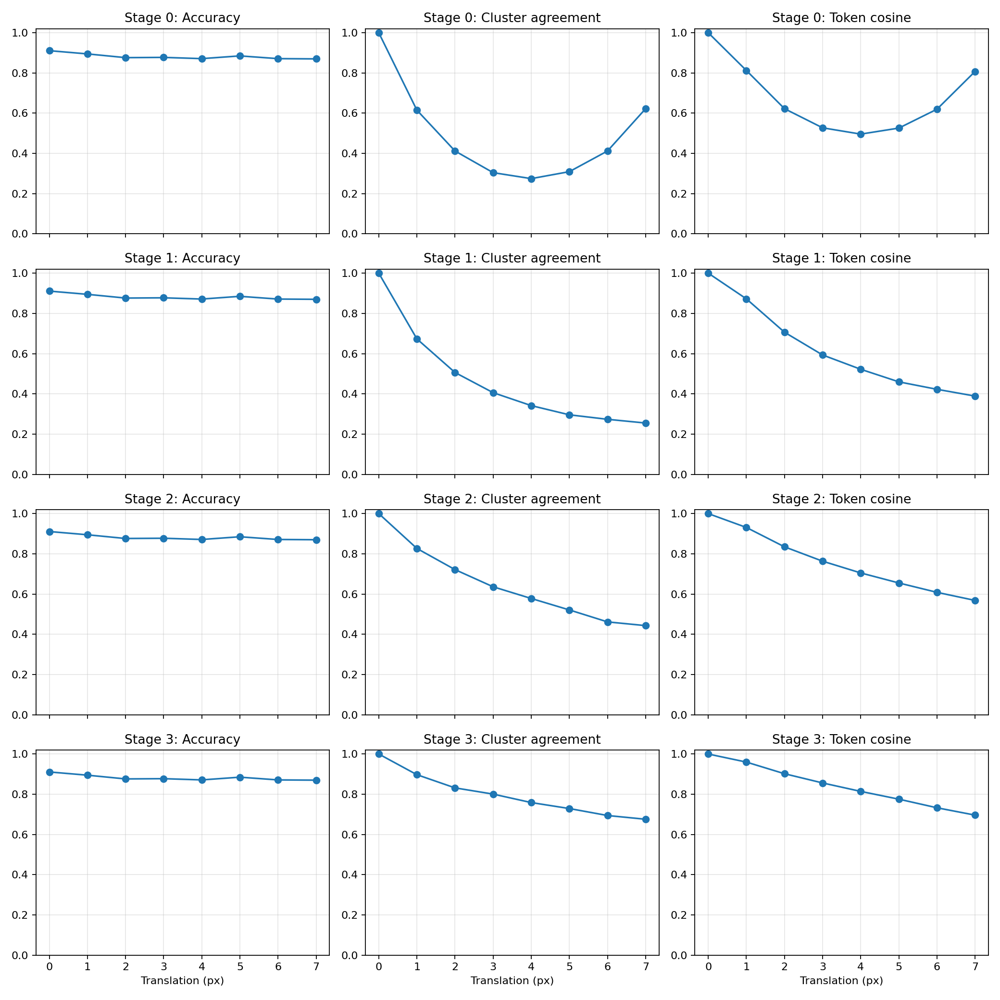
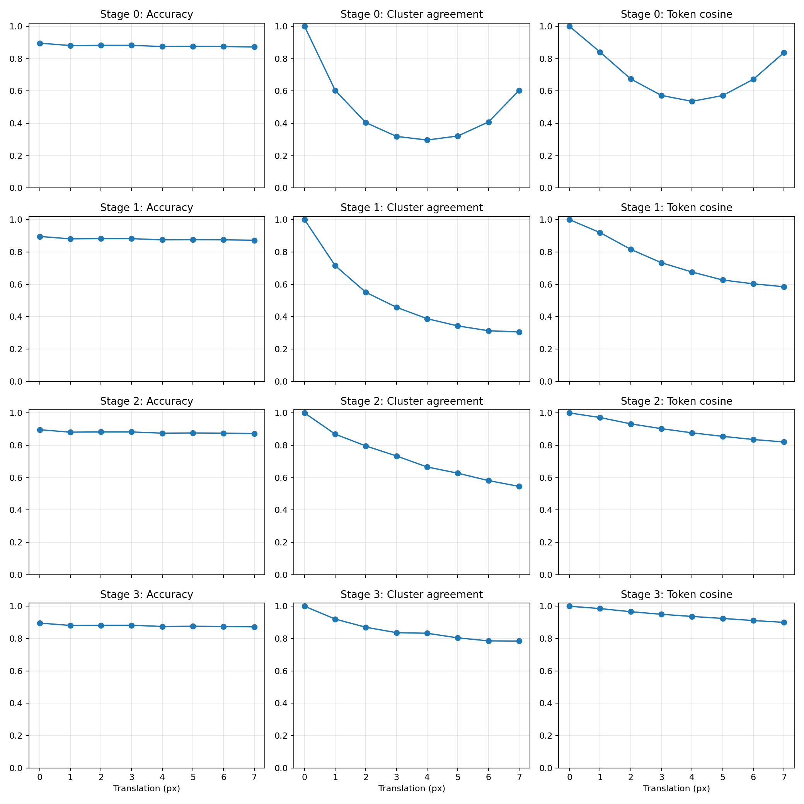
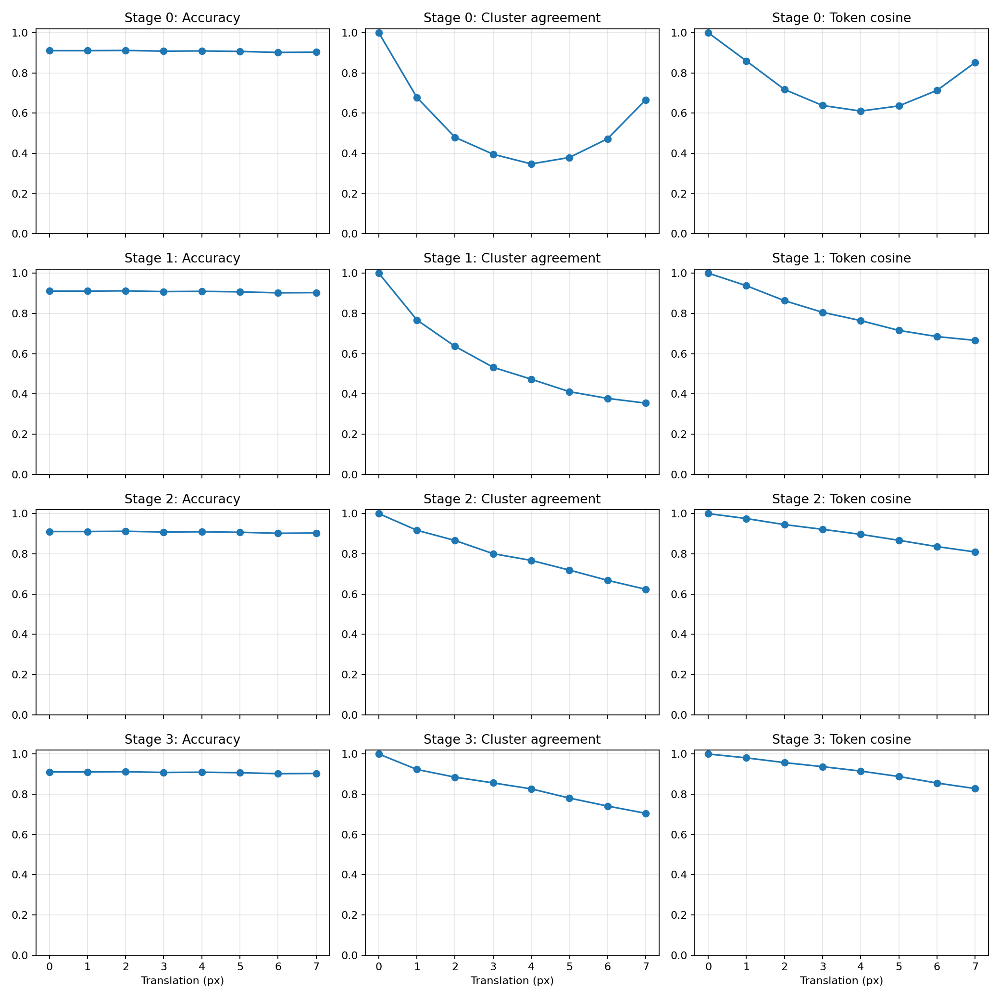

# 1–7 px 非對齊平移：分類與 spherical K-means

## 設定

160-in-224，固定 seed-42 split。訓練 6,907 張、101 類；評估固定 airplanes 160／chandelier 22／brain 20 張。全來源影像平移，沒有物件裁切或平移插值。
測試原位及四方向 × 1–7 px；此輪增強模型從頭訓練，training 每次讀取均勻抽原位或四方向 × 1–7 px，共 29 種。沿用原有 flip／color jitter／erasing 與模型／優化設定。這是見過位移範圍的 robustness，不是 unseen-shift 泛化。
每模型獨立以未平移全類別 training 的修正中心 token fitting 每 stage 共享 codebook。FAISS spherical=True；L2-normalized features；centroids 每次更新正規化；K=31、niter=100、nredo=50、seed=42。內積最高者為指派；margin=最高與次高 cosine 分數差。與舊 sklearn 歐式 margin 數值不可直接互比。
每個模型在全部測試變換中固定 codebook。不同模型 cluster ID 不對應；前後皆錯亦可能 prediction 一致。
1–7 px 不對齊初始 8 px patch，中心 token 涵蓋內容可能改變。Cosine 與群變動同時包含內容涵蓋與位置敏感性，不能當成相同 crop 的純漂移。Stage 3 是觀察 64 px 網格，不是平移 64 px。

## 執行狀態

- baseline: 已評估完成
- aligned_8_16_32: 已評估完成
- augment_1_7: 已評估完成

既有 validation 用於選模；僅一個 training seed，三類探索性比較，不是 untouched final test 或全類別結論。

## baseline

### 分類：四方向平均

| 位移 | 飛機 accuracy | 吊燈 accuracy | 腦部 accuracy | 三類合併 accuracy | 預測一致率（三類） |
|---|---:|---:|---:|---:|---:|
| 0 px | 98.75% | 59.09% | 65.00% | 91.09% | 100.00% |
| 1 px | 98.28% | 53.41% | 58.75% | 89.48% | 93.69% |
| 2 px | 97.66% | 44.32% | 55.00% | 87.62% | 89.60% |
| 3 px | 97.97% | 47.73% | 50.00% | 87.75% | 88.99% |
| 4 px | 97.34% | 45.45% | 51.25% | 87.13% | 87.00% |
| 5 px | 97.81% | 47.73% | 58.75% | 88.49% | 88.61% |
| 6 px | 97.50% | 40.91% | 55.00% | 87.13% | 87.75% |
| 7 px | 97.50% | 40.91% | 53.75% | 87.00% | 87.50% |

### 內部表徵：三類合併、四方向平均

#### Stage 0（網格 8 px）

| 位移 | 群一致率 | Token cosine | Spherical margin | 使用群數 |
|---|---:|---:|---:|---:|
| 0 px | 100.00% | 1.0000 | 0.1294 | 28 |
| 1 px | 61.51% | 0.8123 | 0.1405 | 31 |
| 2 px | 41.21% | 0.6224 | 0.1309 | 31 |
| 3 px | 30.45% | 0.5273 | 0.1256 | 31 |
| 4 px | 27.48% | 0.4961 | 0.1345 | 30 |
| 5 px | 30.94% | 0.5260 | 0.1265 | 31 |
| 6 px | 41.21% | 0.6199 | 0.1311 | 31 |
| 7 px | 62.25% | 0.8078 | 0.1407 | 31 |
#### Stage 1（網格 16 px）

| 位移 | 群一致率 | Token cosine | Spherical margin | 使用群數 |
|---|---:|---:|---:|---:|
| 0 px | 100.00% | 1.0000 | 0.0978 | 27 |
| 1 px | 67.33% | 0.8723 | 0.0985 | 31 |
| 2 px | 50.62% | 0.7064 | 0.0965 | 30 |
| 3 px | 40.59% | 0.5933 | 0.0980 | 31 |
| 4 px | 34.16% | 0.5221 | 0.1048 | 31 |
| 5 px | 29.58% | 0.4597 | 0.1031 | 31 |
| 6 px | 27.35% | 0.4226 | 0.1004 | 31 |
| 7 px | 25.50% | 0.3889 | 0.1010 | 31 |
#### Stage 2（網格 32 px）

| 位移 | 群一致率 | Token cosine | Spherical margin | 使用群數 |
|---|---:|---:|---:|---:|
| 0 px | 100.00% | 1.0000 | 0.1243 | 22 |
| 1 px | 82.67% | 0.9311 | 0.1198 | 26 |
| 2 px | 72.15% | 0.8348 | 0.1144 | 28 |
| 3 px | 63.61% | 0.7634 | 0.1148 | 28 |
| 4 px | 57.80% | 0.7050 | 0.1162 | 30 |
| 5 px | 52.10% | 0.6551 | 0.1162 | 30 |
| 6 px | 46.16% | 0.6085 | 0.1152 | 30 |
| 7 px | 44.31% | 0.5683 | 0.1139 | 30 |
#### Stage 3（網格 64 px）

| 位移 | 群一致率 | Token cosine | Spherical margin | 使用群數 |
|---|---:|---:|---:|---:|
| 0 px | 100.00% | 1.0000 | 0.2691 | 24 |
| 1 px | 89.73% | 0.9599 | 0.2648 | 25 |
| 2 px | 83.17% | 0.9020 | 0.2580 | 29 |
| 3 px | 80.07% | 0.8561 | 0.2486 | 30 |
| 4 px | 75.87% | 0.8142 | 0.2404 | 29 |
| 5 px | 72.90% | 0.7755 | 0.2298 | 30 |
| 6 px | 69.43% | 0.7328 | 0.2181 | 30 |
| 7 px | 67.57% | 0.6962 | 0.2055 | 29 |

## aligned_8_16_32

### 分類：四方向平均

| 位移 | 飛機 accuracy | 吊燈 accuracy | 腦部 accuracy | 三類合併 accuracy | 預測一致率（三類） |
|---|---:|---:|---:|---:|---:|
| 0 px | 98.75% | 45.45% | 65.00% | 89.60% | 100.00% |
| 1 px | 97.34% | 42.05% | 65.00% | 88.12% | 95.54% |
| 2 px | 97.03% | 45.45% | 65.00% | 88.24% | 95.05% |
| 3 px | 97.19% | 46.59% | 62.50% | 88.24% | 93.81% |
| 4 px | 96.25% | 45.45% | 63.75% | 87.50% | 92.45% |
| 5 px | 96.41% | 44.32% | 65.00% | 87.62% | 92.20% |
| 6 px | 96.56% | 44.32% | 62.50% | 87.50% | 91.83% |
| 7 px | 96.72% | 40.91% | 62.50% | 87.25% | 92.33% |

### 內部表徵：三類合併、四方向平均

#### Stage 0（網格 8 px）

| 位移 | 群一致率 | Token cosine | Spherical margin | 使用群數 |
|---|---:|---:|---:|---:|
| 0 px | 100.00% | 1.0000 | 0.1146 | 29 |
| 1 px | 60.40% | 0.8408 | 0.1216 | 31 |
| 2 px | 40.47% | 0.6745 | 0.1189 | 31 |
| 3 px | 31.93% | 0.5727 | 0.1183 | 31 |
| 4 px | 29.70% | 0.5362 | 0.1166 | 30 |
| 5 px | 32.18% | 0.5721 | 0.1181 | 31 |
| 6 px | 40.84% | 0.6726 | 0.1187 | 31 |
| 7 px | 60.40% | 0.8375 | 0.1214 | 31 |
#### Stage 1（網格 16 px）

| 位移 | 群一致率 | Token cosine | Spherical margin | 使用群數 |
|---|---:|---:|---:|---:|
| 0 px | 100.00% | 1.0000 | 0.0976 | 26 |
| 1 px | 71.53% | 0.9197 | 0.1018 | 31 |
| 2 px | 55.07% | 0.8163 | 0.1064 | 30 |
| 3 px | 45.79% | 0.7335 | 0.1090 | 31 |
| 4 px | 38.74% | 0.6760 | 0.1097 | 31 |
| 5 px | 34.28% | 0.6266 | 0.1105 | 31 |
| 6 px | 31.31% | 0.6031 | 0.1106 | 31 |
| 7 px | 30.57% | 0.5851 | 0.1090 | 31 |
#### Stage 2（網格 32 px）

| 位移 | 群一致率 | Token cosine | Spherical margin | 使用群數 |
|---|---:|---:|---:|---:|
| 0 px | 100.00% | 1.0000 | 0.0757 | 20 |
| 1 px | 86.88% | 0.9715 | 0.0753 | 24 |
| 2 px | 79.58% | 0.9325 | 0.0725 | 27 |
| 3 px | 73.39% | 0.9028 | 0.0718 | 28 |
| 4 px | 66.58% | 0.8770 | 0.0692 | 29 |
| 5 px | 62.75% | 0.8552 | 0.0678 | 29 |
| 6 px | 58.17% | 0.8357 | 0.0670 | 30 |
| 7 px | 54.58% | 0.8203 | 0.0654 | 30 |
#### Stage 3（網格 64 px）

| 位移 | 群一致率 | Token cosine | Spherical margin | 使用群數 |
|---|---:|---:|---:|---:|
| 0 px | 100.00% | 1.0000 | 0.0834 | 20 |
| 1 px | 92.08% | 0.9855 | 0.0826 | 23 |
| 2 px | 87.00% | 0.9663 | 0.0824 | 23 |
| 3 px | 83.66% | 0.9503 | 0.0801 | 25 |
| 4 px | 83.29% | 0.9368 | 0.0794 | 26 |
| 5 px | 80.45% | 0.9247 | 0.0793 | 26 |
| 6 px | 78.59% | 0.9115 | 0.0807 | 25 |
| 7 px | 78.47% | 0.9004 | 0.0836 | 27 |

## augment_1_7

### 分類：四方向平均

| 位移 | 飛機 accuracy | 吊燈 accuracy | 腦部 accuracy | 三類合併 accuracy | 預測一致率（三類） |
|---|---:|---:|---:|---:|---:|
| 0 px | 98.12% | 63.64% | 65.00% | 91.09% | 100.00% |
| 1 px | 97.97% | 64.77% | 65.00% | 91.09% | 99.26% |
| 2 px | 98.12% | 64.77% | 65.00% | 91.21% | 98.89% |
| 3 px | 97.97% | 62.50% | 65.00% | 90.84% | 98.27% |
| 4 px | 97.81% | 63.64% | 66.25% | 90.97% | 97.03% |
| 5 px | 97.66% | 62.50% | 66.25% | 90.72% | 96.41% |
| 6 px | 97.50% | 59.09% | 66.25% | 90.22% | 95.79% |
| 7 px | 97.66% | 60.23% | 65.00% | 90.35% | 95.79% |

### 內部表徵：三類合併、四方向平均

#### Stage 0（網格 8 px）

| 位移 | 群一致率 | Token cosine | Spherical margin | 使用群數 |
|---|---:|---:|---:|---:|
| 0 px | 100.00% | 1.0000 | 0.1282 | 28 |
| 1 px | 67.82% | 0.8597 | 0.1231 | 30 |
| 2 px | 48.02% | 0.7178 | 0.1217 | 31 |
| 3 px | 39.60% | 0.6383 | 0.1165 | 30 |
| 4 px | 34.78% | 0.6107 | 0.1179 | 29 |
| 5 px | 38.00% | 0.6363 | 0.1164 | 29 |
| 6 px | 47.28% | 0.7135 | 0.1209 | 31 |
| 7 px | 66.58% | 0.8522 | 0.1225 | 30 |
#### Stage 1（網格 16 px）

| 位移 | 群一致率 | Token cosine | Spherical margin | 使用群數 |
|---|---:|---:|---:|---:|
| 0 px | 100.00% | 1.0000 | 0.0895 | 23 |
| 1 px | 76.73% | 0.9376 | 0.0870 | 30 |
| 2 px | 63.61% | 0.8632 | 0.0836 | 29 |
| 3 px | 53.22% | 0.8054 | 0.0841 | 29 |
| 4 px | 47.28% | 0.7641 | 0.0836 | 27 |
| 5 px | 41.09% | 0.7154 | 0.0833 | 29 |
| 6 px | 37.75% | 0.6848 | 0.0847 | 30 |
| 7 px | 35.40% | 0.6659 | 0.0822 | 29 |
#### Stage 2（網格 32 px）

| 位移 | 群一致率 | Token cosine | Spherical margin | 使用群數 |
|---|---:|---:|---:|---:|
| 0 px | 100.00% | 1.0000 | 0.1238 | 21 |
| 1 px | 91.71% | 0.9753 | 0.1245 | 23 |
| 2 px | 86.63% | 0.9452 | 0.1220 | 25 |
| 3 px | 80.07% | 0.9217 | 0.1201 | 25 |
| 4 px | 76.73% | 0.8968 | 0.1168 | 28 |
| 5 px | 71.91% | 0.8672 | 0.1150 | 28 |
| 6 px | 66.83% | 0.8359 | 0.1113 | 28 |
| 7 px | 62.38% | 0.8093 | 0.1113 | 28 |
#### Stage 3（網格 64 px）

| 位移 | 群一致率 | Token cosine | Spherical margin | 使用群數 |
|---|---:|---:|---:|---:|
| 0 px | 100.00% | 1.0000 | 0.1431 | 18 |
| 1 px | 92.33% | 0.9809 | 0.1435 | 22 |
| 2 px | 88.49% | 0.9573 | 0.1443 | 22 |
| 3 px | 85.64% | 0.9371 | 0.1418 | 25 |
| 4 px | 82.67% | 0.9152 | 0.1385 | 24 |
| 5 px | 78.09% | 0.8882 | 0.1358 | 25 |
| 6 px | 74.13% | 0.8558 | 0.1338 | 25 |
| 7 px | 70.54% | 0.8283 | 0.1314 | 26 |

## 三類合併：1–7 px 整體描述

各位移、方向等權；同張圖片反覆使用，下列平均不是獨立樣本推論。

| 模型 | 原圖 accuracy | 平移後平均 accuracy | 平均預測一致率 |
|---|---:|---:|---:|
| baseline | 91.09% | 87.80% | 89.02% |
| aligned_8_16_32 | 89.60% | 87.78% | 93.32% |
| augment_1_7 | 91.09% | 90.77% | 97.35% |

## 增強後的逐 stage 改善（1–7 px 平均）

| Stage | 原模型群一致率 | 1–7 增強群一致率 | 原模型 cosine | 1–7 增強 cosine |
|---|---:|---:|---:|---:|
| Stage 0 | 42.15% | 48.87% | 0.6303 | 0.7184 |
| Stage 1 | 39.30% | 50.72% | 0.5665 | 0.7766 |
| Stage 2 | 59.83% | 76.61% | 0.7237 | 0.8931 |
| Stage 3 | 76.96% | 81.70% | 0.8195 | 0.9090 |

相較原模型，1–7 px 增強後三類合併的平均平移 accuracy 改變 +2.97 個百分點；平均預測一致率改變 +8.33 個百分點。是否改善須搭配每類別與原圖 accuracy 檢查，不只看總平均。

## 解讀

應同時閱讀原圖 accuracy、平移後 accuracy 與預測一致率，不能只因一致率提高就認定分類變好。逐 stage 的群一致率／cosine／margin 可判斷內部變動是否同步改善，但單一中心 token 不能代表整張圖片。群數與群熵另見 CSV，以排查只因集中到少數群而產生的表面一致性。
與 aligned_8_16_32 的對照用以檢查小位移增強的增益；三模型皆重新使用相同規格 spherical codebooks，避免混入 sklearn／FAISS 的方法差異。未做內容對齊 ROI 或機制消融，不將結果宣稱為嚴格平移不變性。

## 重現與資料

執行：`bash scripts/run_non_aligned_translation_restart_1015.sh`（正在執行時不要重複啟動）。
每模型目錄保存 manifest、逐筆 paired_metrics.csv、summary.csv、分群中心與圖。訓練紀錄另見 `overnight_logs/non_aligned_translation_restart_1015/`。
