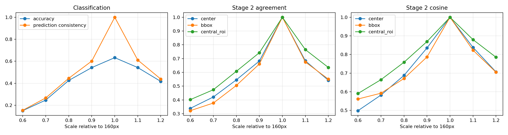
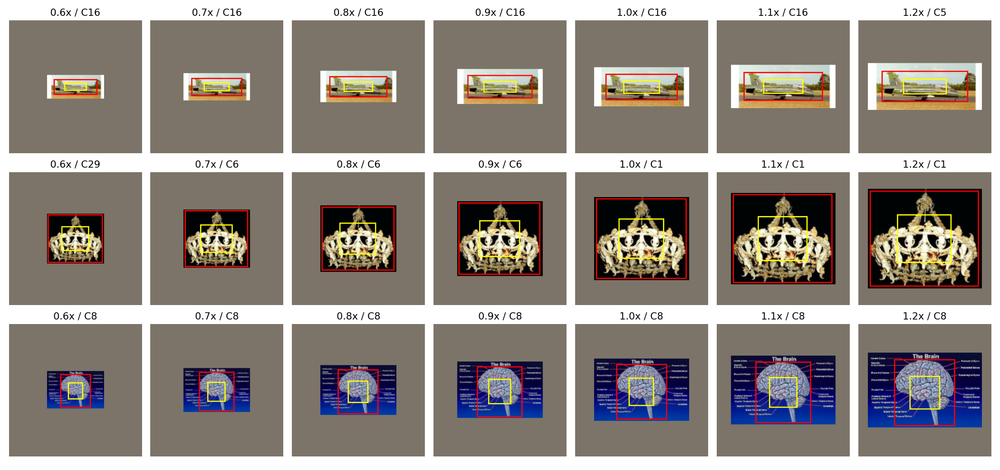
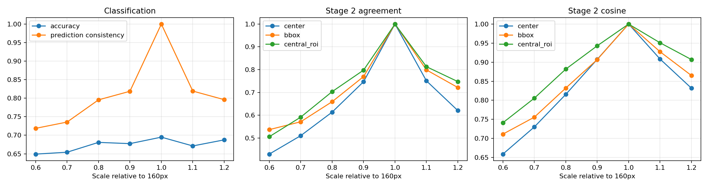
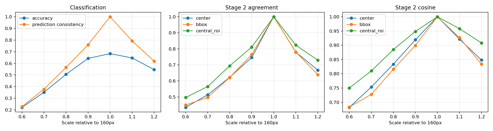
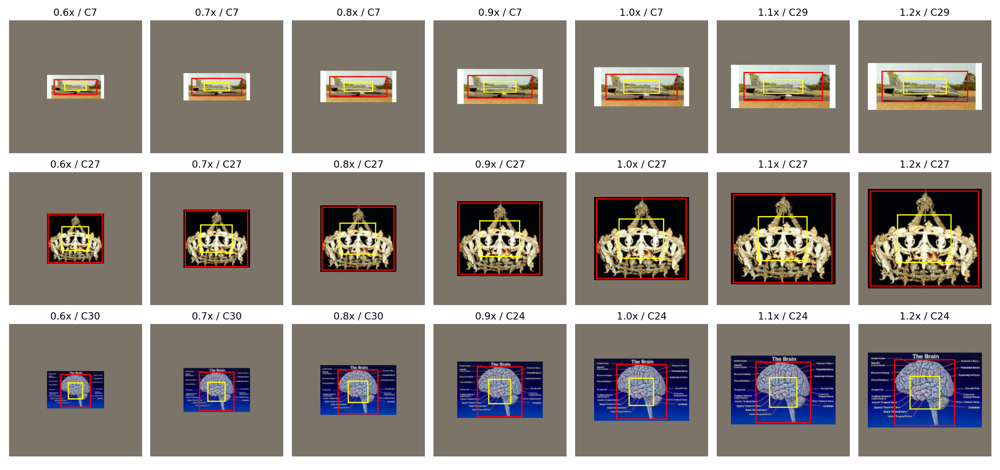

# 尺度穩定性：首輪比較

完整來源影像在固定畫布置中縮放，背景一起縮放；非物件獨立縮放。
S0 固定長邊 160；S1 訓練長邊 96/128/160/192。T1（若有）為平移增強參考，不替代 S0。
每模型／stage／readout 獨立 fitting training-160 spherical codebook；不同模型群編號不對應。
Train 6907 / validation 1770；K=31, niter=100, nredo=50, seed=42。
Stage 3 為 4×4 網格；末端 token 包含 merging padding，ROI 權重僅計 224 畫布內像素。
原位 validation 用於選模；單一 training seed，屬探索性結果。

| 模型 | 1.0 accuracy | 未見倍率平均 accuracy | 未見倍率 macro accuracy | Stage 2 bbox agreement |
|---|---:|---:|---:|---:|
| S0 | 63.28% | 44.41% | 32.29% | 57.12% |
| S1 | 69.49% | 66.76% | 53.11% | 71.32% |
| T1 | 68.36% | 54.69% | 40.86% | 68.08% |

主要差值 S1−S0：每張來源先平均三個未見倍率，再做配對影像 bootstrap（1000 次）；CI 不涵蓋 training-seed 不確定性。

```json
{
  "correct": {
    "mean": 0.2235404896421846,
    "image_bootstrap_95ci": [
      0.207909604519774,
      0.23879943502824863
    ]
  },
  "cluster_agreement": {
    "mean": 0.14199623352165724,
    "image_bootstrap_95ci": [
      0.12334745762711866,
      0.1610216572504708
    ]
  }
}
```

群一致率須配合群熵／最大群占比、同圖對應 cosine 與同類異圖 cosine 一起判讀；ROI pooling 的穩定不等於原始 token 不變。

## 重點摘要

- 未見倍率平均 accuracy：S1 **66.76%**、S0 **44.41%**、T1 **54.69%**。S1−S0 提升 **22.35 個百分點**，配對影像 bootstrap 95% CI 為 **20.79–23.88 個百分點**。
- 未見倍率 macro accuracy：S1 **53.11%**、S0 **32.29%**、T1 **40.86%**，顯示類別平均表現也有改善。
- Stage 2 bbox 群一致率：S1 **71.32%**、S0 **57.12%**、T1 **68.08%**。S1−S0 提升 **14.20 個百分點**，95% CI 為 **12.33–16.10 個百分點**。
- 原尺度 accuracy 由 S0 的 **63.28%** 提升至 S1 的 **69.49%**。本輪支持尺度增強改善尺度泛化；僅有單一訓練 seed，不能據此推論原始 token 已具尺度不變性。

未見倍率為 **0.7／0.9／1.1**（長邊 112／144／176，以 160 為基準）。T1 是平移增強參考。

## S0



[開啟 S0 尺度評估曲線](./S0/scale_curves.png)



[開啟 S0 尺度變化案例](./S0/scale_cases.png)

## S1



[開啟 S1 尺度評估曲線](./S1/scale_curves.png)


[開啟 S1 尺度變化案例](./S1/scale_cases.png)

## T1



[開啟 T1 尺度評估曲線](./T1/scale_curves.png)



[開啟 T1 尺度變化案例](./T1/scale_cases.png)

## 中間狀態分析

[四層特徵比較與逐案例概念／介入分析方案](./INTERNAL_ANALYSIS.md)。

[已完成：三案例逐 token 分群圖、跨層 merging 對應與 Stage 2 介入試驗](./internal_1020/REPORT.md)。
