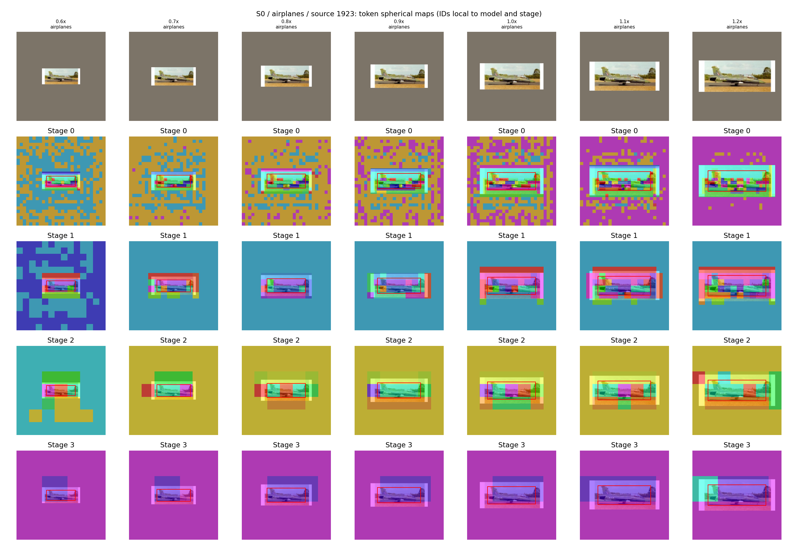
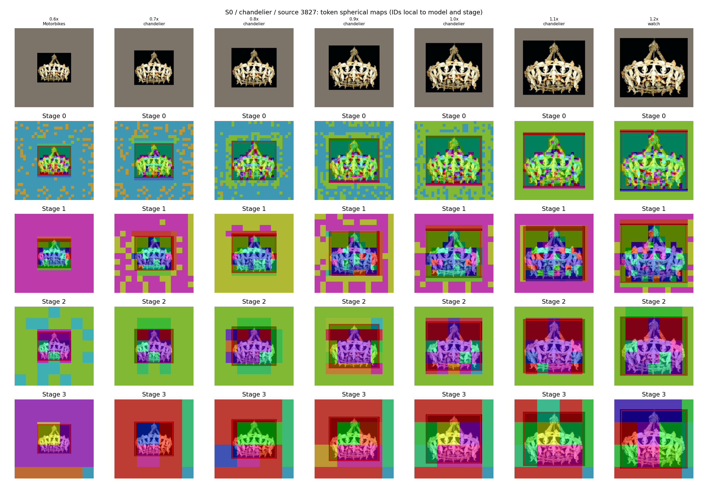
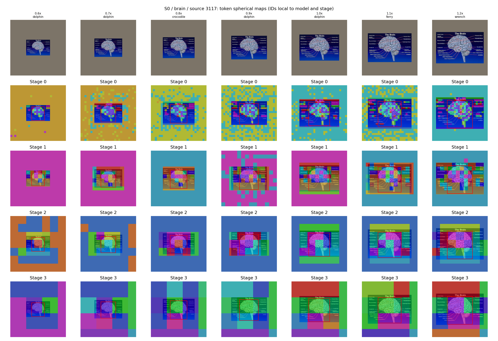
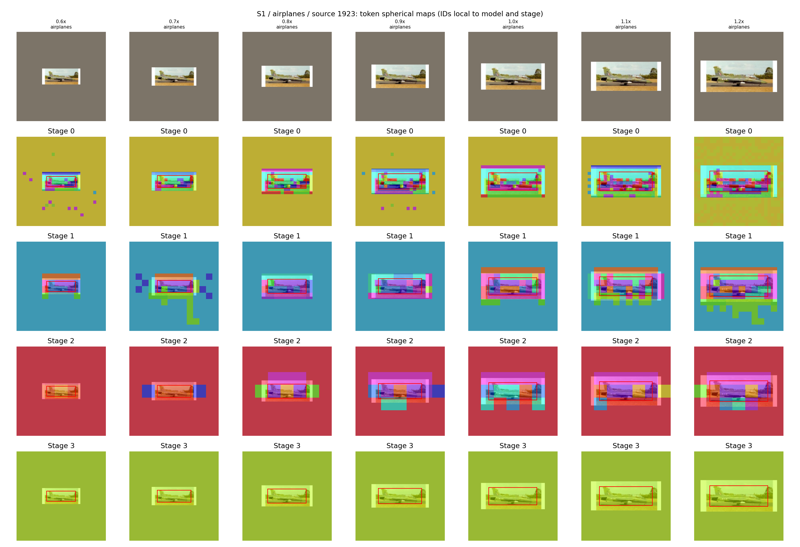
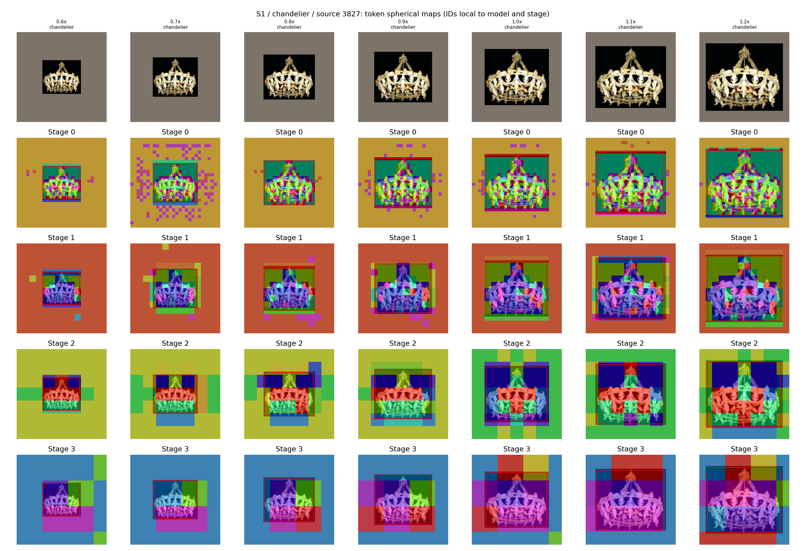
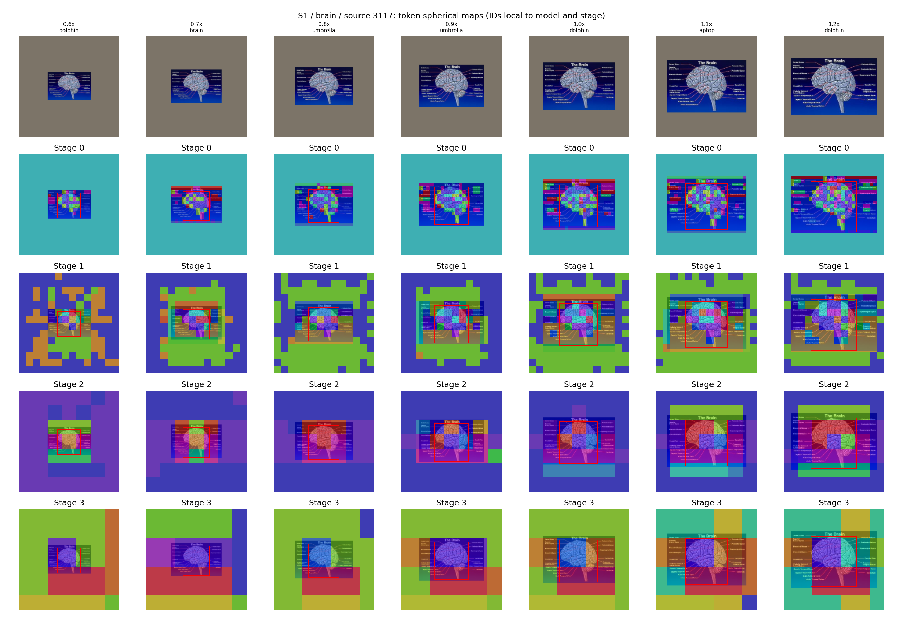
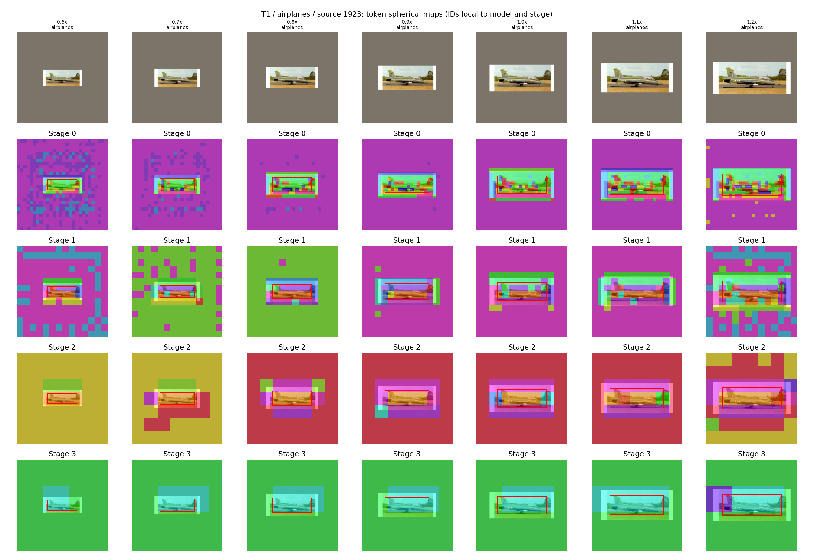
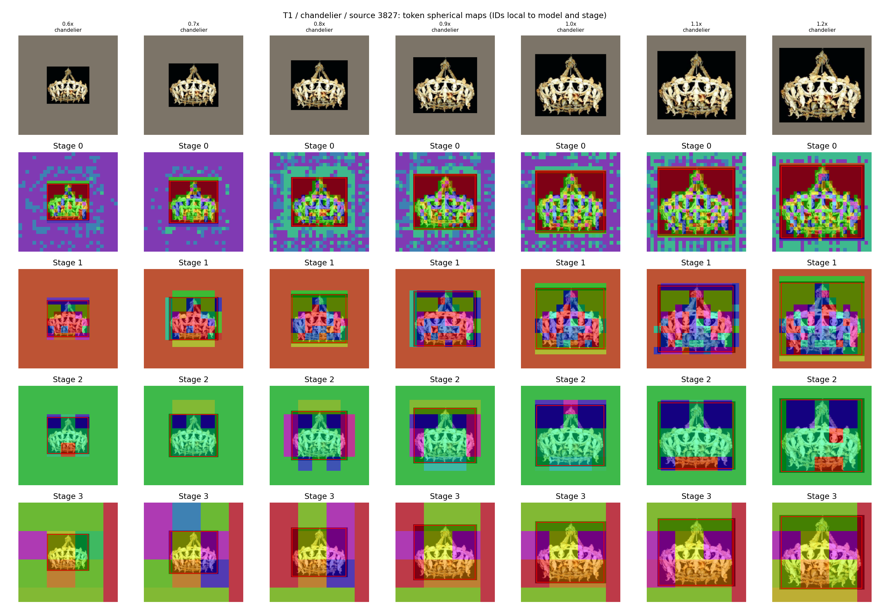
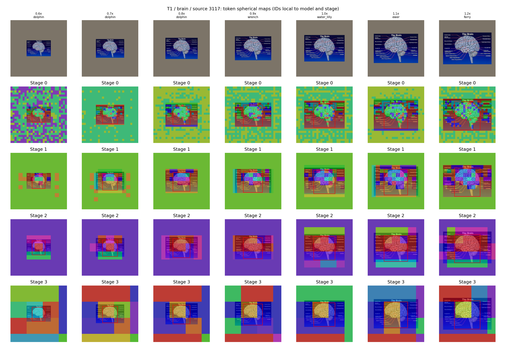

# 縮放案例：逐 token 中間狀態與介入試驗

三個固定案例（airplanes／chandelier／brain）、三模型、七尺度。此為描述性 pilot，不做群體顯著性推論。
每模型每 stage 分別以固定 512 張 training-160 影像、每張 8 個隨機 token 建立 FAISS spherical K=31 字典（100 iterations、50 restarts）。不同模型／stage 群號不可比較；這不是原報告的 ROI 字典。
顏色對應該模型該層的群號，精確群號請讀 cases_*.npz；紅框為 bbox。對應以 cell 中心逆映射至原圖再映射至原尺度，nearest-cell 並非精確語意對應。Stage 3 含 merging padding。

| Model | Stage 2 未見尺度 bbox token agreement | bbox token cosine | 有支持的介入案例數 | 平均 effect gap |
|---|---:|---:|---:|---:|
| S0 | 43.99% | 0.5845 | 7/9 | 0.1207 |
| S1 | 47.35% | 0.7783 | 6/9 | -0.6964 |
| T1 | 77.89% | 0.7973 | 9/9 | 0.1775 |

這三張案例中，S1 的對應 token cosine 高於 S0，但 T1 的群一致率最高；不能將此排序外推到全體 validation，亦不能與原 ROI pooling 指標直接互換。三模型介入支持集合不同，平均 effect gap 僅作描述，不作模型間因果優劣比較。

介入固定原尺度預測類別作 target；替換該參考中心概念在當前 bbox 內所有 token，使用同位置 raw training mean。對照匹配 stage、token 數與 bbox 範圍，未匹配精確位置、norm 或概念分布；可包含被處理 token。無支持列不作介入證據。effect gap 正值不代表 logit drop 必定為正；替換亦可能偏離 activation 分布。
merge_edges.csv 僅記錄真實 child→parent 結構及群號，不是已驗證的跨層因果路徑。本輪尚未做 A/B/A+B、donor 敏感度或介入後下游群追蹤。
身份介入與原輸出比對、原尺度自對應及 checkpoint hashes 見 verification.json 與各模型 manifest。未重新訓練 backbone。

## S0

## S1

## T1

