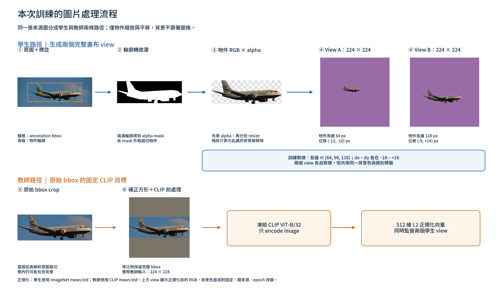
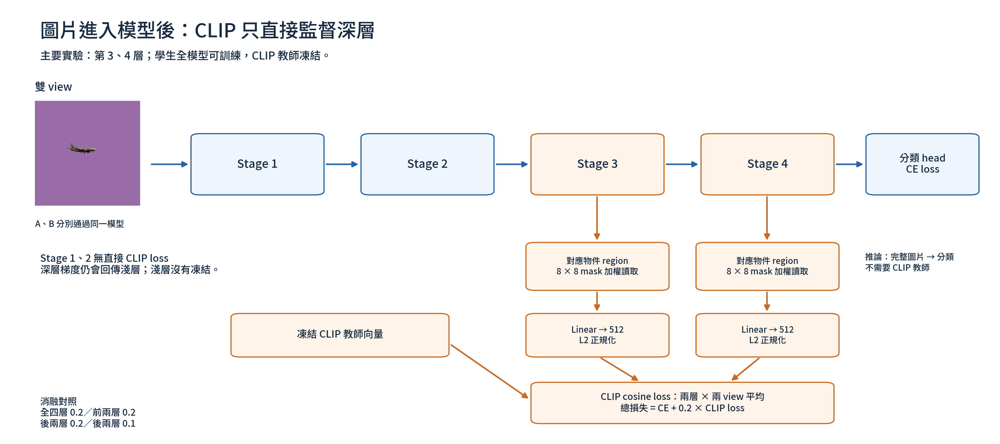

# 本次訓練：圖片處理與深層監督圖表

兩張圖依目前實際程式與真實Caltech訓練影像製作，未使用生成式圖片。圖中文字、幾何參數及資料來源可由figure_manifest.json追溯；重製腳本scripts/plot_clip_training_flow.py。

## 圖1：圖片處理流程



同一原圖分兩路。學生：輪廓→alpha mask→按mask外框裁切→RGB先乘alpha→直接resize RGB/alpha→與固定合成背景組合，產生兩個224×224 view。每view獨立抽長邊64/96/128及兩軸−16..+16位移；同一對背景色相同，背景色依source與epoch改變。示例為實際source2216、seed42、zero-based epoch3，兩view物件長邊64/128，位移(−13,−10)/(−9,+14)。輪廓是資料集近似標註，不等於精確無孔洞的物件分割。

教師：原圖annotation bbox crop→置中補正方形→官方CLIP224前處理→frozen ViT-B/32→512維正規化image embedding。此路徑保留bbox內背景，不使用學生已縮小的view作教師。圖中圖片顯示正規化前RGB；學生以ImageNet mean/std、教師以CLIP mean/std正規化。

## 圖2：深層監督位置



圖示主要deep實驗：Stage3/4的pre-merge region，依同一來源物件相對位置作8×8採樣，再用縮小至8×8的mask加權讀取，Linear投影512維後與教師計算cosine loss，對兩層與雙view平均。CE是兩view分類交叉熵平均。總loss=CE+0.2CLIP。Stage1/2沒有直接CLIP loss，但深層梯度仍回傳淺層，全主幹可訓練。此圖不是宣稱深層監督已改善效果，完整消融見本次報告。

## 可下載格式

- [圖片流程：PDF](01_image_processing.pdf)／[SVG](01_image_processing.svg)
- [深層監督：PDF](02_deep_supervision.pdf)／[SVG](02_deep_supervision.svg)

PDF及SVG保留向量文字／圖形；實際來源照片仍為點陣。字體使用Noto Sans TC（OFL），授權見assets/OFL.txt。

交接：遠端專案/home/ref/RGB_SFM_V3；圖表、說明與SHA256清單經HTTPS送E: artifact inbox。該交付不代表本機專案已匯入，根目錄尚未確認；匯入時核對hash並保留不同版本。

## 重製

需有專案的 Caltech-101 影像與 Annotations（data/caltech101/）、PyTorch、torchvision、SciPy、Matplotlib，以及官方 openai/CLIP 套件。字體已附上。若沒有原實驗run config，腳本會依已保存的figure_manifest.json選取同一來源影像，不需訓練權重。執行：

```bash
python scripts/plot_clip_training_flow.py
```
